# Class Diagrams - Beeboard API

This document provides class diagrams for the Beeboard API, organized by architectural layer following Domain-Driven Design (DDD) principles.

## Table of Contents

1. [DDD Layered Architecture Overview](#1-ddd-layered-architecture-overview)
2. [Domain Layer - Aggregates](#2-domain-layer---aggregates)
   - [2.1 User Aggregate](#21-user-aggregate)
   - [2.2 Role Aggregate](#22-role-aggregate)
   - [2.3 Permission Aggregate](#23-permission-aggregate)
   - [2.4 AuditLog Aggregate](#24-auditlog-aggregate)
   - [2.5 PasswordResetRequest Aggregate](#25-passwordresetrequest-aggregate)
   - [2.6 RateLimit (Technical Domain Model)](#26-ratelimit-technical-domain-model)
   - [2.7 Domain Services](#27-domain-services)
3. [Application Layer](#3-application-layer)
   - [3.1 Use Cases (Commands)](#31-use-cases-commands)
   - [3.2 Use Cases (Queries)](#32-use-cases-queries)
   - [3.3 Application Services](#33-application-services)
4. [Infrastructure Layer](#4-infrastructure-layer)
   - [4.1 JPA Entities](#41-jpa-entities)
   - [4.2 Repository Implementations](#42-repository-implementations)
5. [Exposition Layer](#5-exposition-layer)
   - [5.1 REST Controllers](#51-rest-controllers)
   - [5.2 Security Components](#52-security-components)

---

## 1. DDD Layered Architecture Overview

This diagram illustrates the four-layer architecture following Domain-Driven Design principles. Each layer has a specific responsibility and dependencies flow inward (outer layers depend on inner layers).

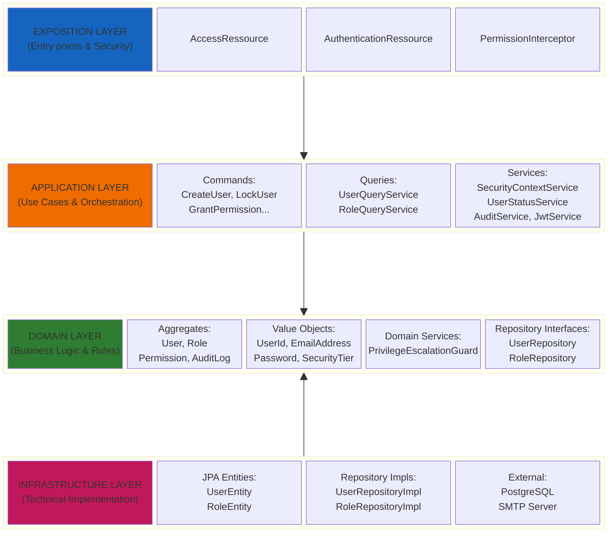

### Layer Responsibilities

| Layer | Responsibility | Key Components |
|-------|----------------|----------------|
| **Exposition** | HTTP endpoints, authentication, authorization | REST Controllers, Interceptors, Filters |
| **Application** | Use case orchestration, transaction management | Commands, Queries, Application Services |
| **Domain** | Business logic, validation, domain rules | Aggregates, Value Objects, Domain Services, Repository Interfaces |
| **Infrastructure** | Technical implementation, persistence, external systems | JPA Entities, Repository Implementations, Database, SMTP |

### Dependency Rules

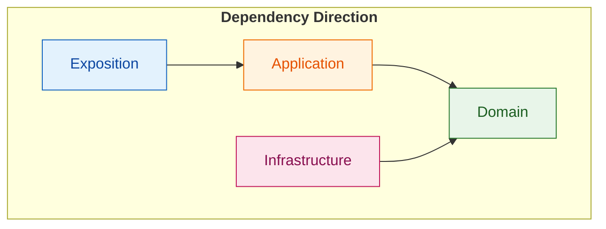

- **Domain** is the core - it has no dependencies on other layers
- **Application** depends only on Domain
- **Exposition** depends on Application (and transitively on Domain)
- **Infrastructure** implements Domain interfaces (Dependency Inversion)

---

## 2. Domain Layer - Aggregates

### DDD Glossary (Domain-Driven Design)

Before exploring the domain class diagrams, here are the key DDD concepts used in this architecture:

| Concept | Description | Beeboard Example |
|---------|-------------|------------------|
| **Entity** | Object with a unique identity that persists over time. Two entities are equal if they have the same ID, even if their attributes differ. | `User`, `Role`, `Permission` |
| **Value Object** | Immutable object defined only by its attributes. Two Value Objects are equal if all their attributes are identical. Has no identity of its own. | `EmailAddress`, `Password`, `FullName`, `SecurityTier` |
| **Aggregate** | Group of entities and Value Objects treated as a cohesive unit. Ensures data consistency within its boundaries. | `User` (with its Value Objects), `Role` (with its permissions) |
| **Aggregate Root** | Main entity of an Aggregate. Single entry point to modify the Aggregate. External objects can only reference the Aggregate Root. | `User` is the Aggregate Root of the User aggregate |
| **Repository** | Abstract interface for accessing Aggregates. Hides persistence details (database). | `UserRepository`, `RoleRepository` |
| **Domain Service** | Business logic that doesn't naturally belong to any Entity. Operations involving multiple Aggregates. | `PrivilegeEscalationGuard` |
| **Factory Method** | Static method to create instances of complex objects with validation. | `User.create(...)`, `Role.create(...)` |

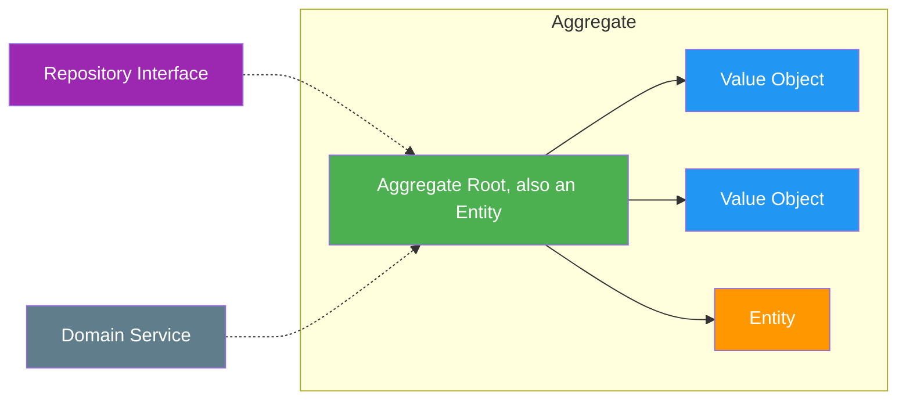

**Important Rules:**
- References between Aggregates are made only by **ID** (e.g., `User` contains `RoleId`, not `Role`)
- Only the **Aggregate Root** can be retrieved via a Repository
- **Value Objects** are always immutable and entirely replaced when modified

---

### 2.1 User Aggregate

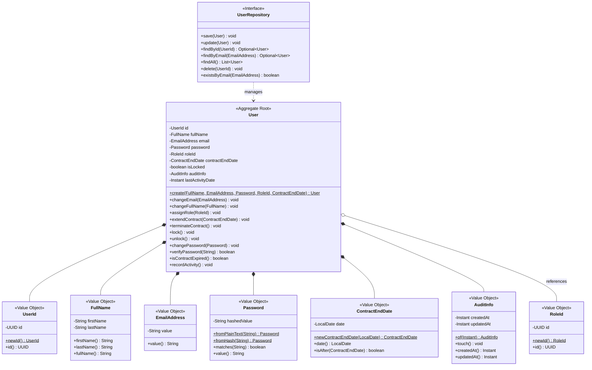

---

### 2.2 Role Aggregate

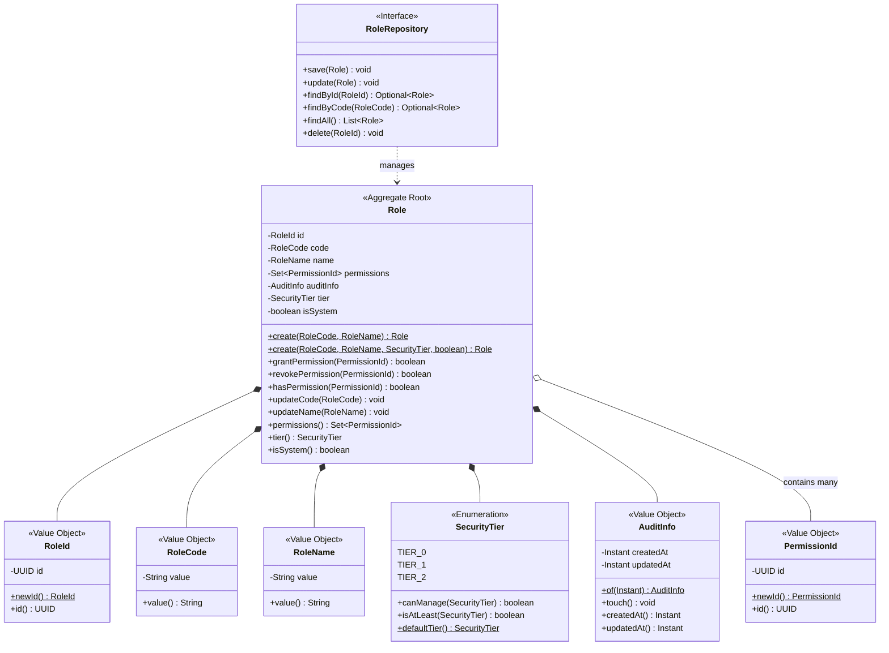

---

### 2.3 Permission Aggregate

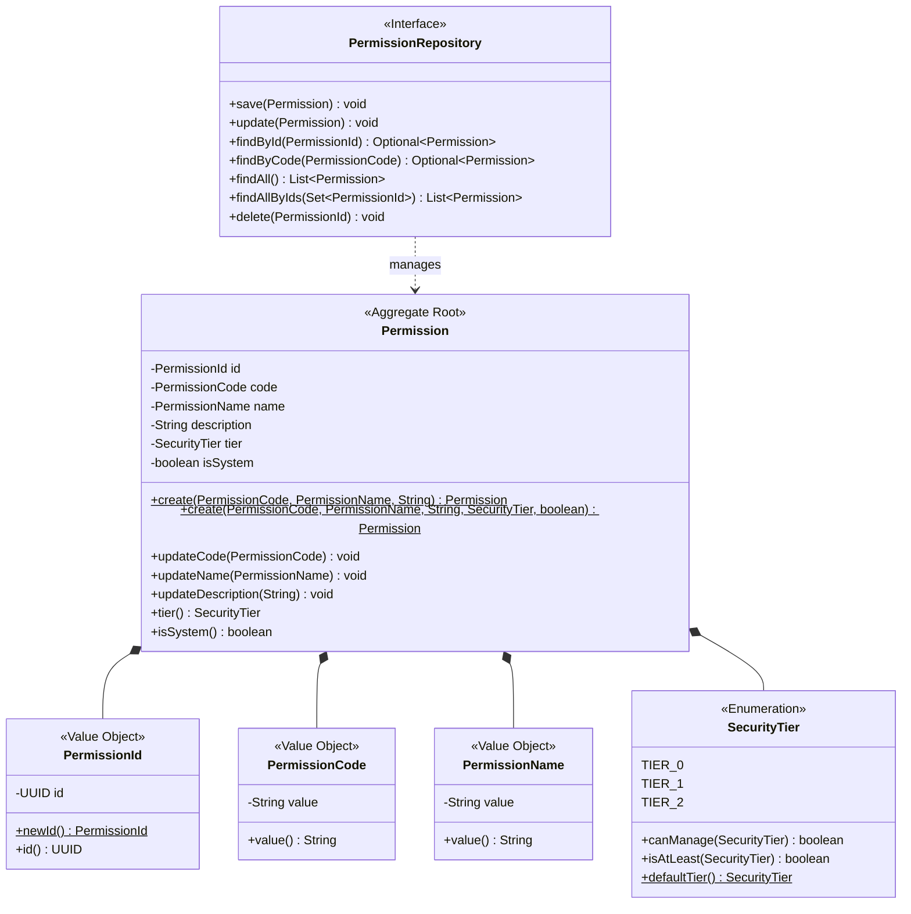

---

### 2.4 AuditLog Aggregate

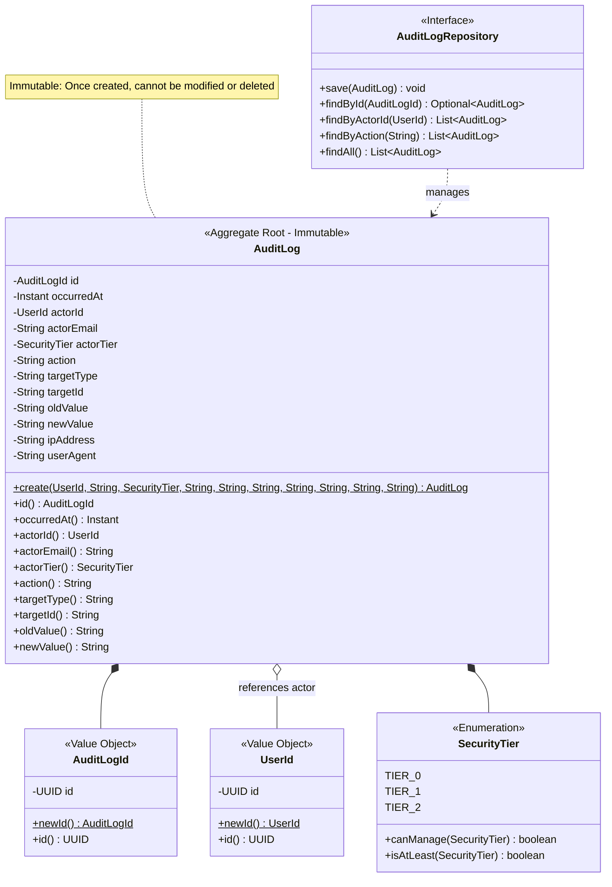

---

### 2.5 PasswordResetRequest Aggregate

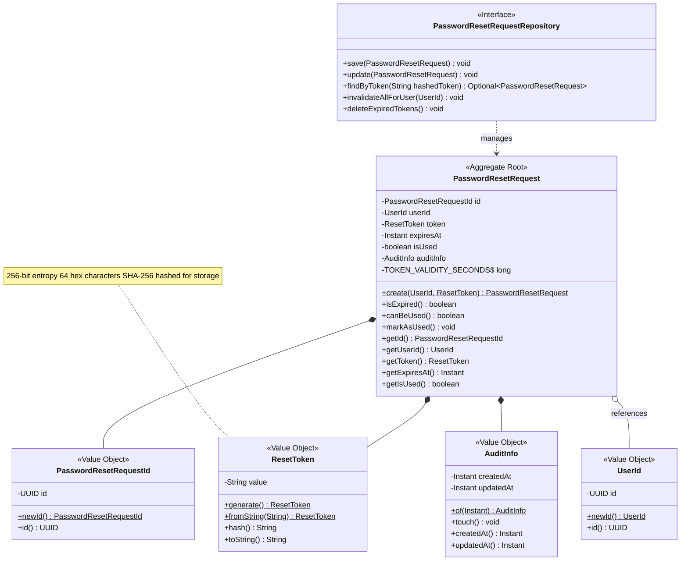

---

### 2.6 RateLimit (Technical Domain Model)

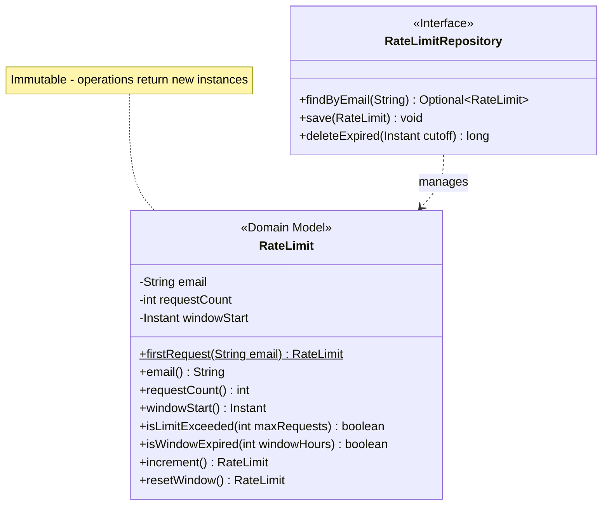

---

### 2.7 Domain Services

#### PrivilegeEscalationGuard

```mermaid
classDiagram
    direction TB

    class PrivilegeEscalationGuard {
        <<Domain Service>>
        +validateNotSelfModification(UserId actorId, UserId targetUserId) void
        +validateRoleAssignment(SecurityTier actorTier, Role targetRole) void
        +validatePermissionGrant(SecurityTier actorTier, Permission targetPermission) void
        +validateSystemRoleModification(SecurityTier actorTier, Role role) void
        +validateRoleDeletion(Role role) void
        +validateSystemPermissionModification(SecurityTier actorTier, Permission permission) void
        +validatePermissionDeletion(Permission permission) void
        +validateMinimumTier(SecurityTier actorTier, SecurityTier requiredTier) void
        +validateTierZeroRequired(SecurityTier actorTier, String operation) void
        +validateUserManagement(SecurityTier actorTier, SecurityTier targetUserTier) void
    }

    class SecurityTier {
        <<Enumeration>>
        TIER_0
        TIER_1
        TIER_2
        +canManage(SecurityTier) boolean
        +isAtLeast(SecurityTier) boolean
    }

    class SelfModificationForbiddenException {
        <<Exception>>
        +cannotModifyOwnRole()$ SelfModificationForbiddenException
    }

    class PrivilegeEscalationException {
        <<Exception>>
        +cannotAssignHigherTierRole(String, String)$ PrivilegeEscalationException
        +cannotGrantHigherTierPermission(String, String)$ PrivilegeEscalationException
        +cannotManageHigherTierUser(String, String)$ PrivilegeEscalationException
    }

    class SystemResourceProtectedException {
        <<Exception>>
        +cannotModifySystemRole(String)$ SystemResourceProtectedException
        +cannotDeleteSystemRole(String)$ SystemResourceProtectedException
        +cannotModifySystemPermission(String)$ SystemResourceProtectedException
        +cannotDeleteSystemPermission(String)$ SystemResourceProtectedException
    }

    class InsufficientTierException {
        <<Exception>>
        +requiresTier(SecurityTier, SecurityTier)$ InsufficientTierException
        +onlyTierZeroCanPerform(String)$ InsufficientTierException
    }

    PrivilegeEscalationGuard ..> SecurityTier : uses
    PrivilegeEscalationGuard ..> SelfModificationForbiddenException : throws
    PrivilegeEscalationGuard ..> PrivilegeEscalationException : throws
    PrivilegeEscalationGuard ..> SystemResourceProtectedException : throws
    PrivilegeEscalationGuard ..> InsufficientTierException : throws
```

#### SecurityContext

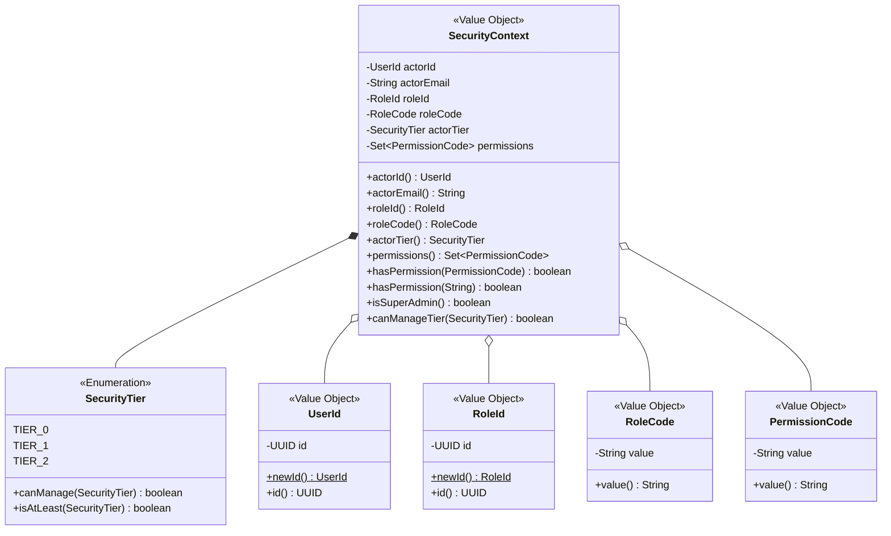

---

## 3. Application Layer

### 3.1 Use Cases (Commands)

#### User Commands

```mermaid
classDiagram
    direction TB

    class CreateUser {
        <<Use Case>>
        -UserRepository userRepository
        -RoleRepository roleRepository
        -PrivilegeEscalationGuard privilegeGuard
        -AuditService auditService
        +execute(CreateUserCommand, SecurityContext) void
    }

    class AssignNewRole {
        <<Use Case>>
        -UserRepository userRepository
        -RoleRepository roleRepository
        -PrivilegeEscalationGuard privilegeGuard
        -AuditService auditService
        +execute(AssignNewRoleCommand, SecurityContext) void
    }

    class LockUser {
        <<Use Case>>
        -UserRepository userRepository
        -RoleRepository roleRepository
        -PrivilegeEscalationGuard privilegeGuard
        -AuditService auditService
        +execute(LockUserCommand, SecurityContext) void
    }

    class UnlockUser {
        <<Use Case>>
        -UserRepository userRepository
        -RoleRepository roleRepository
        -PrivilegeEscalationGuard privilegeGuard
        -AuditService auditService
        +execute(UnlockUserCommand, SecurityContext) void
    }

    class DeleteUser {
        <<Use Case>>
        -UserRepository userRepository
        -RoleRepository roleRepository
        -PrivilegeEscalationGuard privilegeGuard
        -AuditService auditService
        +execute(DeleteUserCommand, SecurityContext) void
    }

    CreateUser ..> UserRepository
    CreateUser ..> RoleRepository
    CreateUser ..> PrivilegeEscalationGuard
    CreateUser ..> AuditService
```

```mermaid
classDiagram
    direction TB

    class ExtendContract {
        <<Use Case>>
        -UserRepository userRepository
        -RoleRepository roleRepository
        -PrivilegeEscalationGuard privilegeGuard
        -AuditService auditService
        +execute(ExtendContractCommand, SecurityContext) void
    }

    class TerminateContract {
        <<Use Case>>
        -UserRepository userRepository
        -RoleRepository roleRepository
        -PrivilegeEscalationGuard privilegeGuard
        -AuditService auditService
        +execute(TerminateContractCommand, SecurityContext) void
    }

    class ChangePassword {
        <<Use Case>>
        -UserRepository userRepository
        -AuditService auditService
        +execute(ChangePasswordCommand, SecurityContext) void
    }

    class ChangeFullName {
        <<Use Case>>
        -UserRepository userRepository
        +execute(ChangeFullNameCommand) void
    }

    class ChangeMail {
        <<Use Case>>
        -UserRepository userRepository
        +execute(ChangeMailCommand) void
    }
```

#### Role Commands

```mermaid
classDiagram
    direction TB

    class CreateRole {
        <<Use Case>>
        -RoleRepository roleRepository
        -AuditService auditService
        +execute(CreateRoleCommand, SecurityContext) void
    }

    class UpdateRole {
        <<Use Case>>
        -RoleRepository roleRepository
        -PrivilegeEscalationGuard privilegeGuard
        -AuditService auditService
        +execute(UpdateRoleCommand, SecurityContext) void
    }

    class DeleteRole {
        <<Use Case>>
        -RoleRepository roleRepository
        -PrivilegeEscalationGuard privilegeGuard
        -AuditService auditService
        +execute(DeleteRoleCommand, SecurityContext) void
    }

    class GrantPermission {
        <<Use Case>>
        -RoleRepository roleRepository
        -PermissionRepository permissionRepository
        -PrivilegeEscalationGuard privilegeGuard
        -AuditService auditService
        +execute(GrantPermissionCommand, SecurityContext) void
    }

    class RevokePermissionFromRole {
        <<Use Case>>
        -RoleRepository roleRepository
        -PermissionRepository permissionRepository
        -PrivilegeEscalationGuard privilegeGuard
        -AuditService auditService
        +execute(RevokePermissionCommand, SecurityContext) void
    }
```

#### Permission Commands

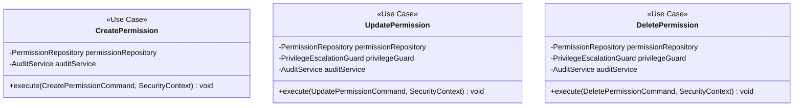

#### Auth Commands

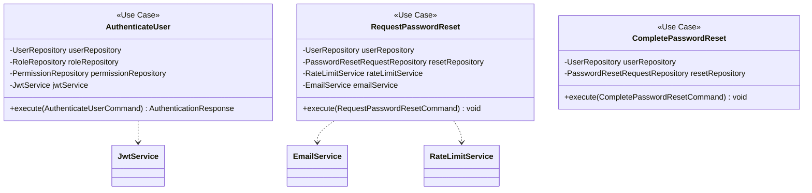

---

### 3.2 Use Cases (Queries)

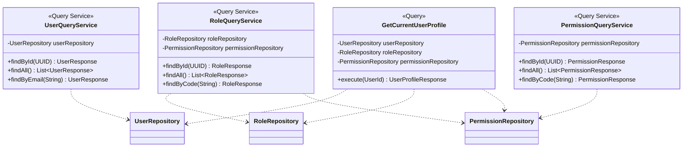

---

### 3.3 Application Services

#### Core Services (Audit & Security)

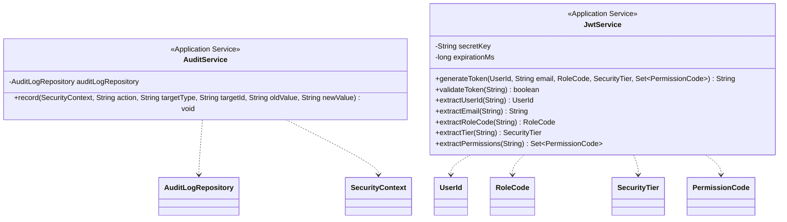

#### Support Services (Password Reset & User Status)

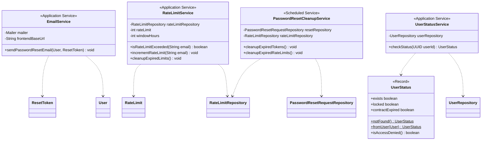

---

## 4. Infrastructure Layer

### 4.1 JPA Entities

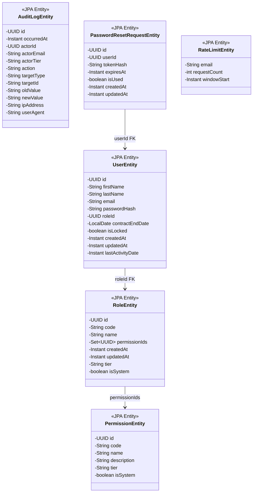

---

### 4.2 Repository Implementations

```mermaid
classDiagram
    direction TB

    class UserRepository {
        <<Interface>>
    }

    class UserRepositoryImpl {
        <<Implementation>>
        -EntityManager entityManager
        +save(User) void
        +update(User) void
        +findById(UserId) Optional~User~
        +findByEmail(EmailAddress) Optional~User~
        +findAll() List~User~
        +delete(UserId) void
        +existsByEmail(EmailAddress) boolean
        -toDomain(UserEntity) User
        -toEntity(User) UserEntity
    }

    class RoleRepository {
        <<Interface>>
    }

    class RoleRepositoryImpl {
        <<Implementation>>
        -EntityManager entityManager
        +save(Role) void
        +update(Role) void
        +findById(RoleId) Optional~Role~
        +findByCode(RoleCode) Optional~Role~
        +findAll() List~Role~
        +delete(RoleId) void
        -toDomain(RoleEntity) Role
        -toEntity(Role) RoleEntity
    }

    class PermissionRepository {
        <<Interface>>
    }

    class PermissionRepositoryImpl {
        <<Implementation>>
        -EntityManager entityManager
        +save(Permission) void
        +update(Permission) void
        +findById(PermissionId) Optional~Permission~
        +findByCode(PermissionCode) Optional~Permission~
        +findAll() List~Permission~
        +findAllByIds(Set~PermissionId~) List~Permission~
        +delete(PermissionId) void
        -toDomain(PermissionEntity) Permission
        -toEntity(Permission) PermissionEntity
    }

    class AuditLogRepository {
        <<Interface>>
    }

    class AuditLogRepositoryImpl {
        <<Implementation>>
        -EntityManager entityManager
        +save(AuditLog) void
        +findById(AuditLogId) Optional~AuditLog~
        +findByActorId(UserId) List~AuditLog~
        +findByAction(String) List~AuditLog~
        +findAll() List~AuditLog~
        -toDomain(AuditLogEntity) AuditLog
        -toEntity(AuditLog) AuditLogEntity
    }

    class PasswordResetRequestRepository {
        <<Interface>>
    }

    class PasswordResetRequestRepositoryImpl {
        <<Implementation>>
        -EntityManager entityManager
        +save(PasswordResetRequest) void
        +update(PasswordResetRequest) void
        +findByToken(String) Optional~PasswordResetRequest~
        +invalidateAllForUser(UserId) void
        +deleteExpiredTokens() void
        -toDomain(PasswordResetRequestEntity) PasswordResetRequest
        -toEntity(PasswordResetRequest) PasswordResetRequestEntity
    }

    class RateLimitRepository {
        <<Interface>>
    }

    class RateLimitRepositoryImpl {
        <<Implementation>>
        -EntityManager entityManager
        +findByEmail(String) Optional~RateLimit~
        +save(RateLimit) void
        +deleteExpired(Instant) long
        -toDomain(RateLimitEntity) RateLimit
        -toEntity(RateLimit) RateLimitEntity
    }

    UserRepository <|.. UserRepositoryImpl
    RoleRepository <|.. RoleRepositoryImpl
    PermissionRepository <|.. PermissionRepositoryImpl
    AuditLogRepository <|.. AuditLogRepositoryImpl
    PasswordResetRequestRepository <|.. PasswordResetRequestRepositoryImpl
    RateLimitRepository <|.. RateLimitRepositoryImpl

    UserRepositoryImpl ..> UserEntity : maps
    RoleRepositoryImpl ..> RoleEntity : maps
    PermissionRepositoryImpl ..> PermissionEntity : maps
    AuditLogRepositoryImpl ..> AuditLogEntity : maps
    PasswordResetRequestRepositoryImpl ..> PasswordResetRequestEntity : maps
    RateLimitRepositoryImpl ..> RateLimitEntity : maps
```

---

## 5. Exposition Layer

### 5.1 REST Controllers

```mermaid
classDiagram
    direction TB

    class AccessRessource {
        <<REST Controller>>
        -CreateUser createUser
        -AssignNewRole assignNewRole
        -LockUser lockUser
        -UnlockUser unlockUser
        -DeleteUser deleteUser
        -ExtendContract extendContract
        -TerminateContract terminateContract
        -UserQueryService userQueryService
        -CreateRole createRole
        -UpdateRole updateRole
        -DeleteRole deleteRole
        -GrantPermission grantPermission
        -RevokePermissionFromRole revokePermission
        -RoleQueryService roleQueryService
        -CreatePermission createPermission
        -UpdatePermission updatePermission
        -DeletePermission deletePermission
        -PermissionQueryService permissionQueryService
        -SecurityContextService securityContextService
        +createUser(CreateUserRequest) Response
        +getUsers() Response
        +getUserById(UUID) Response
        +assignRole(UUID, AssignRoleRequest) Response
        +lockUser(UUID) Response
        +unlockUser(UUID) Response
        +deleteUser(UUID) Response
        +extendContract(UUID, ExtendContractRequest) Response
        +terminateContract(UUID) Response
        +createRole(CreateRoleRequest) Response
        +getRoles() Response
        +getRoleById(UUID) Response
        +updateRole(UUID, UpdateRoleRequest) Response
        +deleteRole(UUID) Response
        +grantPermission(UUID, GrantPermissionRequest) Response
        +revokePermission(UUID, UUID) Response
        +createPermission(CreatePermissionRequest) Response
        +getPermissions() Response
        +getPermissionById(UUID) Response
        +updatePermission(UUID, UpdatePermissionRequest) Response
        +deletePermission(UUID) Response
    }

    class AuthenticationRessource {
        <<REST Controller>>
        -AuthenticateUser authenticateUser
        -RequestPasswordReset requestPasswordReset
        -CompletePasswordReset completePasswordReset
        -GetCurrentUserProfile getCurrentUserProfile
        -SecurityContextService securityContextService
        +login(LoginRequest) Response
        +requestPasswordReset(PasswordResetRequest) Response
        +completePasswordReset(CompleteResetRequest) Response
        +getCurrentProfile() Response
    }

    AccessRessource ..> SecurityContextService
    AccessRessource ..> CreateUser
    AccessRessource ..> AssignNewRole
    AccessRessource ..> LockUser
    AccessRessource ..> UnlockUser
    AccessRessource ..> DeleteUser
    AccessRessource ..> CreateRole
    AccessRessource ..> UpdateRole
    AccessRessource ..> DeleteRole
    AccessRessource ..> CreatePermission
    AccessRessource ..> UpdatePermission
    AccessRessource ..> DeletePermission

    AuthenticationRessource ..> SecurityContextService
    AuthenticationRessource ..> AuthenticateUser
    AuthenticationRessource ..> RequestPasswordReset
    AuthenticationRessource ..> CompletePasswordReset
    AuthenticationRessource ..> GetCurrentUserProfile
```

---

### 5.2 Security Components

```mermaid
classDiagram
    direction TB

    class RequiresPermission {
        <<Annotation>>
        +value() String[]
        +operator() LogicalOperator
    }

    class LogicalOperator {
        <<Enumeration>>
        AND
        OR
    }

    class PermissionInterceptor {
        <<CDI Interceptor>>
        -SecurityContextService securityContextService
        +intercept(InvocationContext) Object
        -checkPermissions(RequiresPermission annotation) void
        -hasAllPermissions(SecurityContext, String[]) boolean
        -hasAnyPermission(SecurityContext, String[]) boolean
    }

    class UserStatusFilter {
        <<JAX-RS Filter>>
        -UserStatusService userStatusService
        -JsonWebToken jwt
        +filter(ContainerRequestContext) void
    }

    PermissionInterceptor ..> RequiresPermission : reads
    PermissionInterceptor ..> LogicalOperator : uses
    PermissionInterceptor ..> SecurityContextService : uses
    PermissionInterceptor ..> SecurityContext : validates

    UserStatusFilter ..> UserStatusService : uses

    note for PermissionInterceptor "SecurityContextService is in Application layer"
    note for UserStatusFilter "UserStatusService is in Application layer"
```

---

## Legend

| Symbol | Meaning |
|--------|---------|
| `<<Aggregate Root>>` | Main domain entity that owns other objects |
| `<<Value Object>>` | Immutable object identified by its values |
| `<<Interface>>` | Contract for dependency inversion |
| `<<Implementation>>` | Concrete implementation of an interface |
| `<<Use Case>>` | Application service handling a specific command |
| `<<Query Service>>` | Read-only service for data retrieval |
| `<<Application Service>>` | Cross-cutting application concern |
| `<<JPA Entity>>` | Database persistence model |
| `<<REST Controller>>` | HTTP endpoint handler |
| `<<Annotation>>` | Java annotation for metadata |
| `<<Enumeration>>` | Fixed set of constants |
| `*--` | Composition (owns lifecycle) |
| `o--` | Aggregation (references) |
| `..>` | Dependency (uses) |
| `<\|..` | Implementation (implements) |
