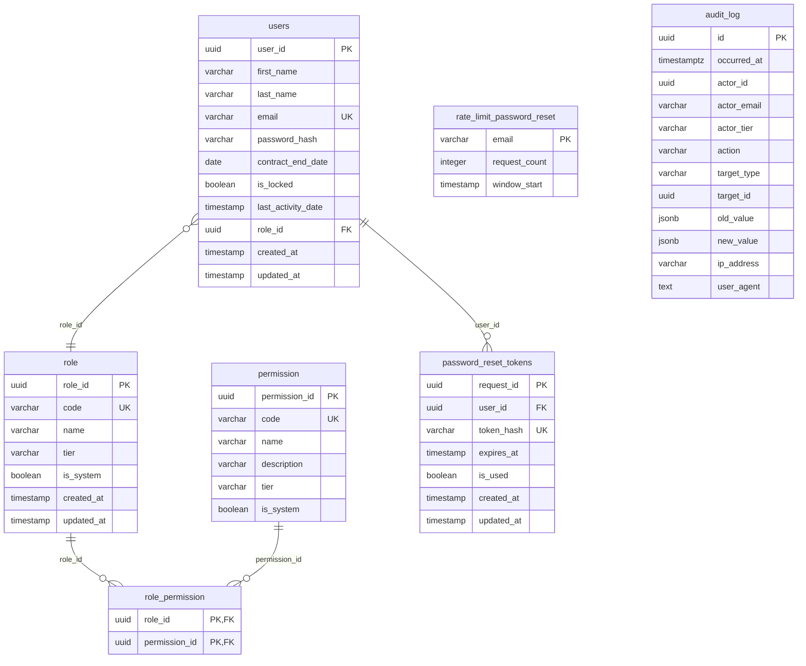

# Entity Relationship Diagram (ERD)

## Overview

The ERD represents the physical structure of the PostgreSQL database for the Access bounded context.

---

## Diagram



---

## Tables

### users

| Column | Type | Constraints | Description |
|--------|------|-------------|-------------|
| user_id | UUID | PK, DEFAULT gen_random_uuid() | Unique identifier |
| first_name | VARCHAR(100) | NOT NULL | User's first name |
| last_name | VARCHAR(100) | NOT NULL | User's last name |
| email | VARCHAR(255) | NOT NULL, UNIQUE | Email address |
| password_hash | VARCHAR | NOT NULL | BCrypt hashed password |
| contract_end_date | DATE | NOT NULL | Contract expiration date |
| is_locked | BOOLEAN | NOT NULL | Account lock status |
| last_activity_date | TIMESTAMP | NOT NULL | Last activity timestamp |
| role_id | UUID | NOT NULL, FK → role | Assigned role |
| created_at | TIMESTAMP | NOT NULL | Creation timestamp |
| updated_at | TIMESTAMP | NOT NULL | Last update timestamp |

### role

| Column | Type | Constraints | Description |
|--------|------|-------------|-------------|
| role_id | UUID | PK, DEFAULT gen_random_uuid() | Unique identifier |
| code | VARCHAR(50) | NOT NULL, UNIQUE | Role code (e.g., SUPER_ADMIN) |
| name | VARCHAR(50) | NOT NULL | Human-readable name |
| tier | VARCHAR(10) | NOT NULL, DEFAULT 'TIER_2' | Security tier |
| is_system | BOOLEAN | NOT NULL, DEFAULT false | System role flag |
| created_at | TIMESTAMP | NOT NULL | Creation timestamp |
| updated_at | TIMESTAMP | NOT NULL | Last update timestamp |

### permission

| Column | Type | Constraints | Description |
|--------|------|-------------|-------------|
| permission_id | UUID | PK, DEFAULT gen_random_uuid() | Unique identifier |
| code | VARCHAR(100) | NOT NULL, UNIQUE | Permission code |
| name | VARCHAR(100) | NOT NULL | Human-readable name |
| description | VARCHAR(100) | NOT NULL | Permission description |
| tier | VARCHAR(10) | NOT NULL, DEFAULT 'TIER_2' | Security tier |
| is_system | BOOLEAN | NOT NULL, DEFAULT false | System permission flag |

### role_permission

| Column | Type | Constraints | Description |
|--------|------|-------------|-------------|
| role_id | UUID | PK, FK → role ON DELETE CASCADE | Role reference |
| permission_id | UUID | PK, FK → permission ON DELETE CASCADE | Permission reference |

### password_reset_tokens

| Column | Type | Constraints | Description |
|--------|------|-------------|-------------|
| request_id | UUID | PK, DEFAULT gen_random_uuid() | Unique identifier |
| user_id | UUID | NOT NULL, FK → users ON DELETE CASCADE | User reference |
| token_hash | VARCHAR(64) | NOT NULL, UNIQUE | SHA-256 token hash |
| expires_at | TIMESTAMP | NOT NULL | Expiration (15 min) |
| is_used | BOOLEAN | NOT NULL, DEFAULT false | Usage status |
| created_at | TIMESTAMP | NOT NULL | Creation timestamp |
| updated_at | TIMESTAMP | NOT NULL | Last update timestamp |

### rate_limit_password_reset

| Column | Type | Constraints | Description |
|--------|------|-------------|-------------|
| email | VARCHAR(255) | PK | Email address |
| request_count | INTEGER | NOT NULL, DEFAULT 1 | Request count |
| window_start | TIMESTAMP | NOT NULL | Window start time |

### audit_log

| Column | Type | Constraints | Description |
|--------|------|-------------|-------------|
| id | UUID | PK, DEFAULT gen_random_uuid() | Unique identifier |
| occurred_at | TIMESTAMPTZ | NOT NULL, DEFAULT NOW() | Event timestamp |
| actor_id | UUID | NOT NULL | Actor user ID |
| actor_email | VARCHAR(255) | NOT NULL | Actor email |
| actor_tier | VARCHAR(10) | NOT NULL | Actor security tier |
| action | VARCHAR(100) | NOT NULL | Action type |
| target_type | VARCHAR(50) | NOT NULL | Target resource type |
| target_id | UUID | | Target resource ID |
| old_value | JSONB | | State before modification |
| new_value | JSONB | | State after modification |
| ip_address | VARCHAR(45) | | Client IP address |
| user_agent | TEXT | | Client user agent |

---

## Indexes

| Table | Index Name | Columns | Purpose |
|-------|------------|---------|---------|
| users | PK | user_id | Primary key |
| users | UK | email | Unique constraint |
| role | PK | role_id | Primary key |
| role | UK | code | Unique constraint |
| permission | PK | permission_id | Primary key |
| permission | UK | code | Unique constraint |
| role_permission | PK | (role_id, permission_id) | Composite primary key |
| password_reset_tokens | PK | request_id | Primary key |
| password_reset_tokens | UK | token_hash | Unique constraint |
| password_reset_tokens | idx_password_reset_user_id | user_id | User lookup |
| password_reset_tokens | idx_password_reset_token_hash | token_hash | Token validation |
| password_reset_tokens | idx_password_reset_expires_at | expires_at | Cleanup queries |
| password_reset_tokens | idx_password_reset_expired | (expires_at, is_used) | Composite cleanup |
| rate_limit_password_reset | PK | email | Primary key |
| rate_limit_password_reset | idx_rate_limit_window | window_start | Cleanup queries |
| audit_log | PK | id | Primary key |
| audit_log | idx_audit_log_actor_id | actor_id | Actor queries |
| audit_log | idx_audit_log_action | action | Action queries |
| audit_log | idx_audit_log_occurred_at | occurred_at | Time range queries |
| audit_log | idx_audit_log_target | (target_type, target_id) | Target queries |

---

## Integrity Constraints

### Foreign Keys

| Source Table | Column | Target Table | On Delete |
|--------------|--------|--------------|-----------|
| users | role_id | role | RESTRICT |
| role_permission | role_id | role | CASCADE |
| role_permission | permission_id | permission | CASCADE |
| password_reset_tokens | user_id | users | CASCADE |

### Immutability (audit_log)

The `audit_log` table is **immutable**. PostgreSQL triggers prevent UPDATE and DELETE operations:

```sql
-- Trigger function
CREATE OR REPLACE FUNCTION prevent_audit_modification()
RETURNS TRIGGER AS $$
BEGIN
    RAISE EXCEPTION 'Audit logs cannot be modified or deleted.';
    RETURN NULL;
END;
$$ LANGUAGE plpgsql;

-- Triggers
CREATE TRIGGER audit_log_prevent_update
BEFORE UPDATE ON audit_log
FOR EACH ROW EXECUTE FUNCTION prevent_audit_modification();

CREATE TRIGGER audit_log_prevent_delete
BEFORE DELETE ON audit_log
FOR EACH ROW EXECUTE FUNCTION prevent_audit_modification();
```

---

## Migrations

| Version | File | Description |
|---------|------|-------------|
| V1 | create_access_tables.sql | Core tables: users, role, permission, role_permission |
| V4 | add_password_hash_column.sql | Add password_hash to users |
| V6 | create_password_reset_tokens_table.sql | Password reset tokens |
| V7 | create_rate_limit_password_reset_table.sql | Rate limiting |
| V8 | add_security_tier_columns.sql | Add tier and is_system columns |
| V9 | create_super_admin_role.sql | SUPER_ADMIN role (TIER_0) |
| V10 | create_audit_log_table.sql | Immutable audit log |
| V11 | add_view_permissions.sql | ROLE_VIEW, PERMISSION_VIEW permissions |
