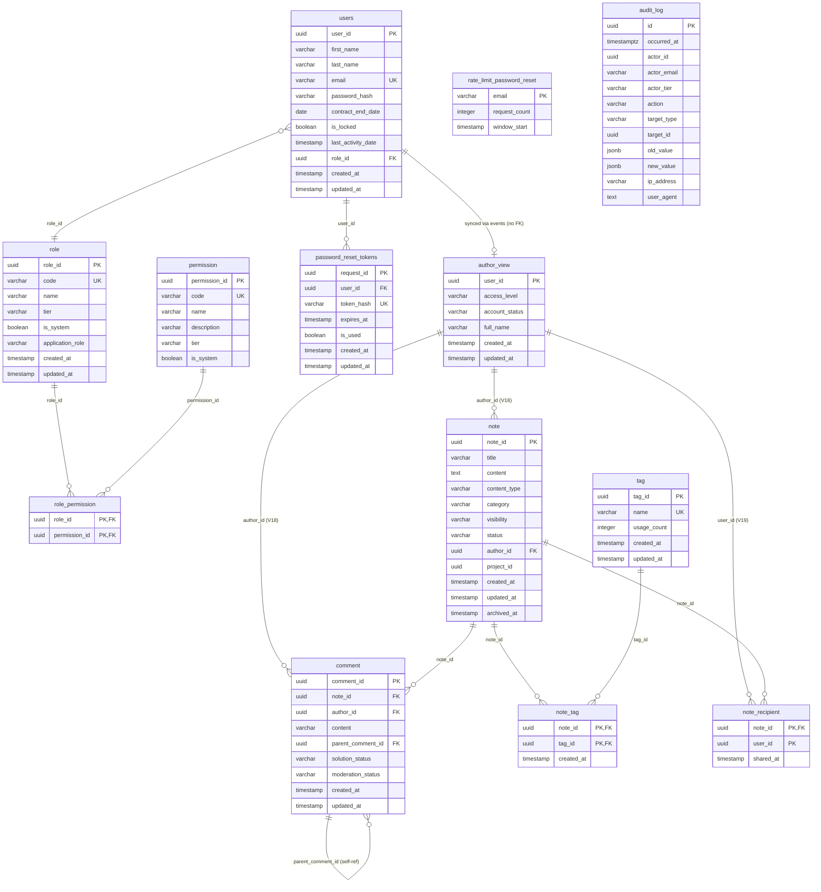

# Entity Relationship Diagram (ERD)

## Overview

The ERD represents the physical structure of the PostgreSQL database for the BeeBoard application, including both the Access BC (authentication/authorization) and Note BC (knowledge sharing) bounded contexts. The schema implements Domain-Driven Design principles with CQRS patterns for cross-context integration.

---

## Diagram



---

## Tables

### users

| Column | Type | Constraints | Description |
|--------|------|-------------|-------------|
| user_id | UUID | PK, DEFAULT gen_random_uuid() | Unique identifier |
| first_name | VARCHAR(100) | NOT NULL | User's first name |
| last_name | VARCHAR(100) | NOT NULL | User's last name |
| email | VARCHAR(255) | NOT NULL, UNIQUE | Email address |
| password_hash | VARCHAR | NOT NULL | BCrypt hashed password |
| contract_end_date | DATE | NOT NULL | Contract expiration date |
| is_locked | BOOLEAN | NOT NULL | Account lock status |
| last_activity_date | TIMESTAMP | NOT NULL | Last activity timestamp |
| role_id | UUID | NOT NULL, FK → role | Assigned role |
| created_at | TIMESTAMP | NOT NULL | Creation timestamp |
| updated_at | TIMESTAMP | NOT NULL | Last update timestamp |

### role

| Column | Type | Constraints | Description |
|--------|------|-------------|-------------|
| role_id | UUID | PK, DEFAULT gen_random_uuid() | Unique identifier |
| code | VARCHAR(50) | NOT NULL, UNIQUE | Role code (e.g., SUPER_ADMIN) |
| name | VARCHAR(50) | NOT NULL | Human-readable name |
| tier | VARCHAR(10) | NOT NULL, DEFAULT 'TIER_2' | Security tier |
| is_system | BOOLEAN | NOT NULL, DEFAULT false | System role flag |
| application_role | VARCHAR(20) | NOT NULL | Application-level role (ADMIN/SUPERVISOR/MANAGER/MEMBER/GUEST) |
| created_at | TIMESTAMP | NOT NULL | Creation timestamp |
| updated_at | TIMESTAMP | NOT NULL | Last update timestamp |

### permission

| Column | Type | Constraints | Description |
|--------|------|-------------|-------------|
| permission_id | UUID | PK, DEFAULT gen_random_uuid() | Unique identifier |
| code | VARCHAR(100) | NOT NULL, UNIQUE | Permission code |
| name | VARCHAR(100) | NOT NULL | Human-readable name |
| description | VARCHAR(100) | NOT NULL | Permission description |
| tier | VARCHAR(10) | NOT NULL, DEFAULT 'TIER_2' | Security tier |
| is_system | BOOLEAN | NOT NULL, DEFAULT false | System permission flag |

### role_permission

| Column | Type | Constraints | Description |
|--------|------|-------------|-------------|
| role_id | UUID | PK, FK → role ON DELETE CASCADE | Role reference |
| permission_id | UUID | PK, FK → permission ON DELETE CASCADE | Permission reference |

### password_reset_tokens

| Column | Type | Constraints | Description |
|--------|------|-------------|-------------|
| request_id | UUID | PK, DEFAULT gen_random_uuid() | Unique identifier |
| user_id | UUID | NOT NULL, FK → users ON DELETE CASCADE | User reference |
| token_hash | VARCHAR(64) | NOT NULL, UNIQUE | SHA-256 token hash |
| expires_at | TIMESTAMP | NOT NULL | Expiration (15 min) |
| is_used | BOOLEAN | NOT NULL, DEFAULT false | Usage status |
| created_at | TIMESTAMP | NOT NULL | Creation timestamp |
| updated_at | TIMESTAMP | NOT NULL | Last update timestamp |

### rate_limit_password_reset

| Column | Type | Constraints | Description |
|--------|------|-------------|-------------|
| email | VARCHAR(255) | PK | Email address |
| request_count | INTEGER | NOT NULL, DEFAULT 1 | Request count |
| window_start | TIMESTAMP | NOT NULL | Window start time |

### audit_log

| Column | Type | Constraints | Description |
|--------|------|-------------|-------------|
| id | UUID | PK, DEFAULT gen_random_uuid() | Unique identifier |
| occurred_at | TIMESTAMPTZ | NOT NULL, DEFAULT NOW() | Event timestamp |
| actor_id | UUID | NOT NULL | Actor user ID |
| actor_email | VARCHAR(255) | NOT NULL | Actor email |
| actor_tier | VARCHAR(10) | NOT NULL | Actor security tier |
| action | VARCHAR(100) | NOT NULL | Action type |
| target_type | VARCHAR(50) | NOT NULL | Target resource type |
| target_id | UUID | | Target resource ID |
| old_value | JSONB | | State before modification |
| new_value | JSONB | | State after modification |
| ip_address | VARCHAR(45) | | Client IP address |
| user_agent | TEXT | | Client user agent |

---

## Note BC Tables

### author_view (CQRS Read Model)

**Purpose**: Synchronized read model containing user data from Access BC, used by Note BC for author references. No direct foreign key to Access BC - maintained via domain events.

| Column | Type | Constraints | Description |
|--------|------|-------------|-------------|
| user_id | UUID | PK | User identifier (matches Access BC user_id) |
| access_level | VARCHAR(20) | NOT NULL | Note BC access level (SUPERVISOR/MODERATOR/COMMENTER/VIEWER) |
| account_status | VARCHAR(20) | NOT NULL | Account status (ACTIVE/LOCKED/EXPIRED) |
| full_name | VARCHAR(200) | NOT NULL | User's display name |
| created_at | TIMESTAMP | NOT NULL, DEFAULT NOW() | Creation timestamp |
| updated_at | TIMESTAMP | NOT NULL, DEFAULT NOW() | Last update timestamp |

**Event Synchronization**:
- Created via UserCreatedEvent from Access BC
- Updated via UserUpdatedEvent (name changes, role changes)
- Updated via UserLockedEvent, UserUnlockedEvent, ContractTerminatedEvent
- Translates ApplicationRole (Access BC) → AccessLevel (Note BC vocabulary)

---

### tag

**Purpose**: Flexible classification system for notes.

| Column | Type | Constraints | Description |
|--------|------|-------------|-------------|
| tag_id | UUID | PK, DEFAULT gen_random_uuid() | Unique identifier |
| name | VARCHAR(50) | NOT NULL, UNIQUE | Tag name (lowercase alphanumeric with hyphens) |
| usage_count | INTEGER | NOT NULL, DEFAULT 0 | Number of notes using this tag |
| created_at | TIMESTAMP | NOT NULL, DEFAULT NOW() | Creation timestamp |
| updated_at | TIMESTAMP | NOT NULL, DEFAULT NOW() | Last update timestamp |

**Constraints**:
- `name` format: `^[a-z0-9-]+$` (lowercase alphanumeric with hyphens)
- `usage_count` must be >= 0

---

### note

**Purpose**: Core note aggregate root for knowledge sharing.

| Column | Type | Constraints | Description |
|--------|------|-------------|-------------|
| note_id | UUID | PK, DEFAULT gen_random_uuid() | Unique identifier |
| title | VARCHAR(200) | NOT NULL | Note title (max 200 chars) |
| content | TEXT | NOT NULL | Note content (max 50,000 chars) |
| content_type | VARCHAR(20) | NOT NULL, DEFAULT 'TEXT' | Content type (TEXT/CODE/IMAGE/MIXED) |
| category | VARCHAR(50) | NOT NULL | Category (BUG/TIP/DOCUMENTATION/QUESTION/ANNOUNCEMENT/RECOMMENDATION/BUSINESS_RULE/CODE_SNIPPET) |
| visibility | VARCHAR(20) | NOT NULL, DEFAULT 'PRIVATE' | Visibility (PRIVATE/SHARED/PROJECT) |
| status | VARCHAR(20) | NOT NULL, DEFAULT 'ACTIVE' | Status (ACTIVE/ARCHIVED/DELETED) |
| author_id | UUID | NOT NULL, FK → author_view | Note author |
| project_id | UUID | NULLABLE | External project reference |
| created_at | TIMESTAMP | NOT NULL, DEFAULT NOW() | Creation timestamp |
| updated_at | TIMESTAMP | NOT NULL, DEFAULT NOW() | Last update timestamp |
| archived_at | TIMESTAMP | NULLABLE | Archive timestamp |

**Constraints**:
- `content` length <= 50,000 characters
- `title` length <= 200 characters
- If `visibility = 'PROJECT'`, then `project_id` must be NOT NULL
- Foreign key to `author_view.user_id` (ON DELETE RESTRICT)

**Full-Text Search**:
- GIN index on `to_tsvector('english', title || ' ' || content)` for fast searching

---

### comment

**Purpose**: Comments and threaded discussion on notes.

| Column | Type | Constraints | Description |
|--------|------|-------------|-------------|
| comment_id | UUID | PK, DEFAULT gen_random_uuid() | Unique identifier |
| note_id | UUID | NOT NULL, FK → note | Parent note |
| author_id | UUID | NOT NULL, FK → author_view | Comment author |
| content | VARCHAR(5000) | NOT NULL | Comment content |
| parent_comment_id | UUID | NULLABLE, FK → comment | Parent comment (for threading) |
| solution_status | VARCHAR(20) | NOT NULL, DEFAULT 'REGULAR' | Solution marker (REGULAR/PROPOSED/VALIDATED) |
| moderation_status | VARCHAR(20) | NOT NULL, DEFAULT 'VISIBLE' | Moderation state (VISIBLE/CENSORED/UNDER_REVIEW) |
| created_at | TIMESTAMP | NOT NULL, DEFAULT NOW() | Creation timestamp |
| updated_at | TIMESTAMP | NOT NULL, DEFAULT NOW() | Last update timestamp |

**Constraints**:
- `content` must not be empty (LENGTH(TRIM(content)) > 0)
- Foreign key to `note.note_id` (ON DELETE CASCADE)
- Foreign key to `comment.comment_id` (ON DELETE SET NULL) - self-referential
- Foreign key to `author_view.user_id` (ON DELETE RESTRICT)

**Threading**:
- Self-referential `parent_comment_id` allows nested replies
- Root-level comments have `parent_comment_id = NULL`

---

### note_tag

**Purpose**: Many-to-many association between notes and tags.

| Column | Type | Constraints | Description |
|--------|------|-------------|-------------|
| note_id | UUID | PK, FK → note | Note reference |
| tag_id | UUID | PK, FK → tag | Tag reference |
| created_at | TIMESTAMP | NOT NULL, DEFAULT NOW() | Association timestamp |

**Composite Primary Key**: (note_id, tag_id)

**Constraints**:
- Foreign key to `note.note_id` (ON DELETE CASCADE)
- Foreign key to `tag.tag_id` (ON DELETE RESTRICT)

---

### note_recipient

**Purpose**: Explicit sharing relationships for notes (used when visibility = 'SHARED').

| Column | Type | Constraints | Description |
|--------|------|-------------|-------------|
| note_id | UUID | PK, FK → note | Shared note |
| user_id | UUID | PK | Recipient user ID |
| shared_at | TIMESTAMP | NOT NULL | Share timestamp |

**Composite Primary Key**: (note_id, user_id)

**Constraints**:
- Foreign key to `note.note_id` (ON DELETE CASCADE)
- Foreign key to `user_id` → `author_view.user_id` (ON DELETE CASCADE)

---

## Indexes

| Table | Index Name | Columns | Purpose |
|-------|------------|---------|---------|
| users | PK | user_id | Primary key |
| users | UK | email | Unique constraint |
| role | PK | role_id | Primary key |
| role | UK | code | Unique constraint |
| permission | PK | permission_id | Primary key |
| permission | UK | code | Unique constraint |
| role_permission | PK | (role_id, permission_id) | Composite primary key |
| password_reset_tokens | PK | request_id | Primary key |
| password_reset_tokens | UK | token_hash | Unique constraint |
| password_reset_tokens | idx_password_reset_user_id | user_id | User lookup |
| password_reset_tokens | idx_password_reset_token_hash | token_hash | Token validation |
| password_reset_tokens | idx_password_reset_expires_at | expires_at | Cleanup queries |
| password_reset_tokens | idx_password_reset_expired | (expires_at, is_used) | Composite cleanup |
| rate_limit_password_reset | PK | email | Primary key |
| rate_limit_password_reset | idx_rate_limit_window | window_start | Cleanup queries |
| audit_log | PK | id | Primary key |
| audit_log | idx_audit_log_actor_id | actor_id | Actor queries |
| audit_log | idx_audit_log_action | action | Action queries |
| audit_log | idx_audit_log_occurred_at | occurred_at | Time range queries |
| audit_log | idx_audit_log_target | (target_type, target_id) | Target queries |
| author_view | PK | user_id | Primary key |
| author_view | idx_author_view_access_level | access_level | Access level filtering |
| author_view | idx_author_view_status | account_status | Status filtering |
| author_view | idx_author_view_full_name | full_name | Name searching |
| tag | PK | tag_id | Primary key |
| tag | UK | name | Unique constraint |
| tag | idx_tag_usage_count | usage_count | Popular tags sorting |
| note | PK | note_id | Primary key |
| note | idx_note_author_id | author_id | Author's notes |
| note | idx_note_category | category | Category filtering |
| note | idx_note_visibility | visibility | Visibility filtering |
| note | idx_note_status | status | Status filtering |
| note | idx_note_project_id | project_id (partial: WHERE project_id IS NOT NULL) | Project notes |
| note | idx_note_author_active | (author_id, status) | Active notes by author |
| note | idx_note_archived_at | archived_at (partial: WHERE archived_at IS NOT NULL) | Archived notes |
| note | idx_note_fulltext | GIN(to_tsvector('english', title \|\| ' ' \|\| content)) | Full-text search |
| comment | PK | comment_id | Primary key |
| comment | idx_comment_note_id | note_id | Note's comments |
| comment | idx_comment_parent_id | parent_comment_id (partial: WHERE parent_comment_id IS NOT NULL) | Threaded replies |
| comment | idx_comment_solution_status | solution_status (partial: WHERE solution_status != 'REGULAR') | Solution comments |
| comment | idx_comment_author_id | author_id | Author's comments |
| note_tag | PK | (note_id, tag_id) | Composite primary key |
| note_tag | idx_note_tag_tag_id | tag_id | Notes by tag |
| note_recipient | PK | (note_id, user_id) | Composite primary key |
| note_recipient | idx_note_recipient_user_id | user_id | User's shared notes |
| note_recipient | idx_note_recipient_shared_at | shared_at | Recent shares |
| role | idx_role_application_role | application_role | Application role lookup |

---

## Integrity Constraints

### Foreign Keys

| Source Table | Column | Target Table | On Delete |
|--------------|--------|--------------|-----------|
| users | role_id | role | RESTRICT |
| role_permission | role_id | role | CASCADE |
| role_permission | permission_id | permission | CASCADE |
| password_reset_tokens | user_id | users | CASCADE |
| note | author_id | author_view | RESTRICT |
| comment | note_id | note | CASCADE |
| comment | author_id | author_view | RESTRICT |
| comment | parent_comment_id | comment | SET NULL |
| note_tag | note_id | note | CASCADE |
| note_tag | tag_id | tag | RESTRICT |
| note_recipient | note_id | note | CASCADE |
| note_recipient | user_id | author_view | CASCADE |

### Immutability (audit_log)

The `audit_log` table is **immutable**. PostgreSQL triggers prevent UPDATE and DELETE operations:

```sql
-- Trigger function
CREATE OR REPLACE FUNCTION prevent_audit_modification()
RETURNS TRIGGER AS $$
BEGIN
    RAISE EXCEPTION 'Audit logs cannot be modified or deleted.';
    RETURN NULL;
END;
$$ LANGUAGE plpgsql;

-- Triggers
CREATE TRIGGER audit_log_prevent_update
BEFORE UPDATE ON audit_log
FOR EACH ROW EXECUTE FUNCTION prevent_audit_modification();

CREATE TRIGGER audit_log_prevent_delete
BEFORE DELETE ON audit_log
FOR EACH ROW EXECUTE FUNCTION prevent_audit_modification();
```

---

### CQRS Read Model (author_view)

The `author_view` table is a **CQRS read model** that serves as the integration point between Access BC and Note BC.

**Design Principles**:
- **No Foreign Key to Access BC**: Maintains bounded context independence
- **Event-Driven Synchronization**: Updated via CDI domain events published by Access BC
- **Anti-Corruption Layer**: Translates Access BC vocabulary (ApplicationRole) to Note BC vocabulary (AccessLevel)
- **Eventually Consistent**: Synchronization is immediate (CDI events in-memory), but architecturally allows for eventual consistency

**Event Handlers** (Note BC):
```java
@ApplicationScoped
public class UserEventHandler {

    void onUserCreated(@ObservesAsync UserCreatedEvent event) {
        // Create author_view record
    }

    void onUserUpdated(@ObservesAsync UserUpdatedEvent event) {
        // Update full_name or access_level
    }

    void onUserLocked(@ObservesAsync UserLockedEvent event) {
        // Update account_status to LOCKED
    }

    void onContractTerminated(@ObservesAsync ContractTerminatedEvent event) {
        // Update account_status to EXPIRED
    }
}
```

**Mapping Rules**:
- ApplicationRole.ADMIN → AccessLevel.SUPERVISOR
- ApplicationRole.SUPERVISOR → AccessLevel.SUPERVISOR
- ApplicationRole.MANAGER → AccessLevel.MODERATOR
- ApplicationRole.MEMBER → AccessLevel.COMMENTER
- ApplicationRole.GUEST → AccessLevel.VIEWER

**Deletion Constraints**:
- `ON DELETE RESTRICT` on note.author_id and comment.author_id prevents orphaned content
- Deletion workflow: 1) Delete/anonymize user's notes and comments, 2) Delete from author_view, 3) Delete from Access BC users table

---

## Migrations

| Version | File | Description |
|---------|------|-------------|
| **Access BC (V1-V11)** | | |
| V1 | create_access_tables.sql | Core tables: users, role, permission, role_permission |
| V4 | add_password_hash_column.sql | Add password_hash to users |
| V6 | create_password_reset_tokens_table.sql | Password reset tokens |
| V7 | create_rate_limit_password_reset_table.sql | Rate limiting |
| V8 | add_security_tier_columns.sql | Add tier and is_system columns |
| V9 | create_super_admin_role.sql | SUPER_ADMIN role (TIER_0) |
| V10 | create_audit_log_table.sql | Immutable audit log |
| V11 | add_view_permissions.sql | ROLE_VIEW, PERMISSION_VIEW permissions |
| **Note BC Integration (V12-V18)** | | |
| V12 | create_note_bc_tables.sql | Note BC core: tag, note, comment, note_tag, note_recipient |
| V13 | add_application_role_to_roles.sql | Map roles to application-level roles |
| V14 | remove_note_and_project_permissions.sql | Clean up unused permissions |
| V15 | seed_note_bc_test_data.sql | Test data for tags, notes, comments |
| V16 | create_author_view.sql | CQRS read model table |
| V17 | populate_author_view.sql | Sync existing users to author_view |
| V18 | add_author_fk_constraints.sql | Add FK note/comment → author_view |
| V19 | add_note_recipient_user_fk.sql | Add FK note_recipient → author_view (CASCADE) |
