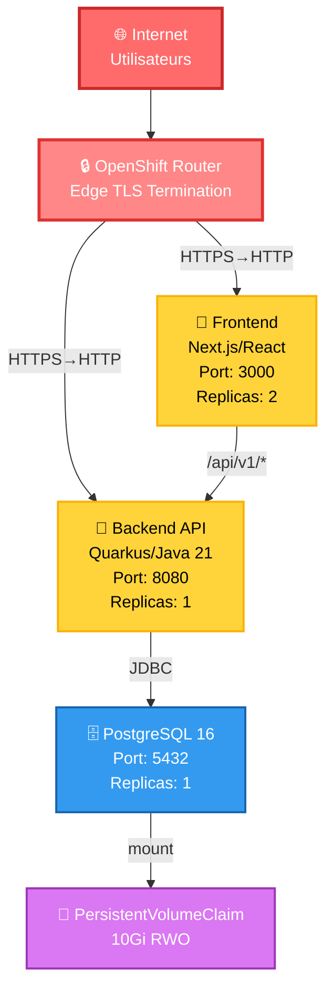

# Diagramme de Déploiement - BeeBoard sur OpenShift

## Vue d'ensemble

BeeBoard est une application de gestion de notes collaborative déployée sur OpenShift Container Platform. L'architecture suit une approche modulaire avec une séparation claire entre le frontend (Next.js/React), le backend (Quarkus/Java 21) et la base de données (PostgreSQL 16).

Cette architecture adopte les principes suivants:
- **Architecture DDD (Domain-Driven Design)** avec des Bounded Contexts séparés (Access BC et Note BC)
- **Sécurité renforcée** avec des conteneurs non-root, terminaison TLS, et authentification JWT
- **Haute disponibilité** du frontend avec plusieurs réplicas
- **Observabilité** via health probes et readiness checks
- **Déploiement cloud-native** sur OpenShift avec gestion automatisée des ressources

## Vue d'architecture simplifiée

Cette vue simplifiée présente les composants principaux de l'architecture BeeBoard sur OpenShift et leurs interactions. Pour une vue détaillée avec tous les composants techniques (health probes, init containers, ConfigMaps, Secrets, Bounded Contexts), consultez la section [Architecture détaillée](#architecture-détaillée) ci-dessous.

### Composants principaux

- **Frontend**: Application Next.js/React (2 réplicas pour haute disponibilité)
- **Backend API**: Application Quarkus/Java 21 avec architecture DDD
- **PostgreSQL 16**: Base de données relationnelle avec stockage persistant
- **OpenShift Router**: Terminaison TLS et routage des requêtes HTTPS

### Flux de communication

1. Les utilisateurs accèdent à l'application via HTTPS
2. L'OpenShift Router termine le TLS et route vers le frontend ou le backend
3. Le frontend communique avec le backend via des appels API REST
4. Le backend accède à PostgreSQL via JDBC
5. PostgreSQL utilise un volume persistant pour stocker les données



## Architecture détaillée

```mermaid
graph TB
    %% ========================
    %% External Layer
    %% ========================
    subgraph Internet["🌐 Internet / Utilisateurs"]
        Users["👥 Utilisateurs<br/>Navigateurs Web"]
    end

    %% ========================
    %% OpenShift Router
    %% ========================
    subgraph Router["🔒 OpenShift Router (Edge TLS Termination)"]
        EdgeTLS["Edge TLS Termination<br/>HTTPS → HTTP<br/>Auto-generated certificates"]
    end

    %% ========================
    %% Namespace beeboard
    %% ========================
    subgraph Namespace["📦 Namespace: beeboard"]

        %% Configuration Layer
        subgraph ConfigLayer["⚙️ Configuration & Secrets"]
            ConfigMapFront["ConfigMap<br/>beeboard-frontend-config<br/>────────────────────<br/>NEXT_PUBLIC_API_URL<br/>API_URL_INTERNAL<br/>LOG_LEVEL"]
            ConfigMapBack["ConfigMap<br/>beeboard-api-config<br/>────────────────────<br/>HTTP_PORT=8080<br/>DB_HOST=postgresql<br/>DB_PORT=5432<br/>DB_NAME=beeboard<br/>CORS_ORIGINS<br/>JWT_ISSUER<br/>SMTP_CONFIG<br/>LOG_LEVEL"]
            SecretBack["Secret<br/>beeboard-api-secrets<br/>────────────────────<br/>DB_USERNAME<br/>DB_PASSWORD<br/>JWT_PRIVATE_KEY (RSA 2048)<br/>JWT_PUBLIC_KEY<br/>RESEND_API_KEY"]
        end

        %% Frontend Layer
        subgraph FrontendLayer["🎨 Frontend Layer"]
            RouteFront["Route<br/>beeboard-frontend<br/>────────────────────<br/>Type: Edge TLS<br/>Auto hostname<br/>HTTP → HTTPS redirect"]
            ServiceFront["Service<br/>beeboard-frontend<br/>────────────────────<br/>Type: ClusterIP<br/>Port: 3000 → 3000<br/>Selector: app=beeboard-frontend"]
            PodFront["Pod: beeboard-frontend<br/>════════════════════<br/>Init Container:<br/>  wait-for-api<br/>  └─ nc -z beeboard-api:8080<br/>────────────────────<br/>Container: beeboard-frontend:latest<br/>  • Next.js 14+ / React 18+<br/>  • User: 1001 (non-root)<br/>  • Port: 3000<br/>  • Health Probes:<br/>    ├─ startupProbe: GET /<br/>    ├─ livenessProbe: GET /<br/>    └─ readinessProbe: GET /<br/>  • Resources:<br/>    ├─ Request: 200m CPU, 256Mi RAM<br/>    └─ Limit: 1 CPU, 1Gi RAM<br/>  • Replicas: 2 (HA)"]
        end

        %% Backend Layer
        subgraph BackendLayer["🚀 Backend API Layer"]
            RouteBack["Route<br/>beeboard-api<br/>────────────────────<br/>Type: Edge TLS<br/>Auto hostname<br/>HTTP → HTTPS redirect"]
            ServiceBack["Service<br/>beeboard-api<br/>────────────────────<br/>Type: ClusterIP<br/>Port: 8080 → 8080<br/>Selector: app=beeboard-api<br/>DNS: beeboard-api.beeboard.svc.cluster.local"]
            PodBack["Pod: beeboard-api<br/>════════════════════<br/>Init Container:<br/>  wait-for-db<br/>  └─ nc -z postgresql:5432<br/>────────────────────<br/>Container: beeboard-api:latest<br/>  • Java 21 / Quarkus (Native)<br/>  • User: 185 (non-root)<br/>  • Port: 8080<br/>  • Health Probes:<br/>    ├─ startupProbe: /q/health/started<br/>    ├─ livenessProbe: /q/health/live<br/>    └─ readinessProbe: /q/health/ready<br/>  • Resources:<br/>    ├─ Request: 500m CPU, 512Mi RAM<br/>    └─ Limit: 2 CPU, 2Gi RAM<br/>  • Replicas: 1"]
        end

        %% Database Layer
        subgraph DatabaseLayer["🗄️ Database Layer"]
            ServiceDB["Service<br/>postgresql<br/>────────────────────<br/>Type: ClusterIP<br/>Port: 5432 → 5432<br/>Selector: app=postgresql<br/>DNS: postgresql.beeboard.svc.cluster.local"]
            PodDB["Pod: postgresql<br/>════════════════════<br/>Container: postgresql-16<br/>  • Image: rhel9/postgresql-16:latest<br/>  • User: 26 (non-root)<br/>  • Port: 5432<br/>  • Health Probes:<br/>    ├─ livenessProbe: TCP:5432<br/>    └─ readinessProbe: pg_isready<br/>  • Resources:<br/>    ├─ Request: 250m CPU, 512Mi RAM<br/>    └─ Limit: 1 CPU, 2Gi RAM<br/>  • Replicas: 1 (RWO limit)<br/>  • Strategy: Recreate"]
        end

        %% Storage Layer
        subgraph StorageLayer["💾 Storage"]
            PVC["PersistentVolumeClaim<br/>postgresql-pvc<br/>────────────────────<br/>Size: 10Gi<br/>Access Mode: ReadWriteOnce (RWO)<br/>Mount: /var/lib/pgsql/data"]
            PV["PersistentVolume<br/>────────────────────<br/>Dynamically provisioned<br/>by OpenShift"]
        end

        %% Bounded Contexts (Internal Architecture)
        subgraph BoundedContexts["🏛️ Bounded Contexts (Backend Internal)"]
            AccessBC["Access BC<br/>────────────────────<br/>• Users (Aggregate Root)<br/>• Roles<br/>• Authentication (JWT)<br/>• Authorization (RBAC)<br/>• User lifecycle"]
            EventBus["CDI Event Bus<br/>────────────────────<br/>In-Memory Events:<br/>• UserCreatedEvent<br/>• UserUpdatedEvent<br/>• RoleAssignedEvent<br/>• UserLockedEvent<br/>• UserUnlockedEvent<br/>• ContractTerminatedEvent"]
            AuthorView["Author View (CQRS)<br/>────────────────────<br/>Materialized View:<br/>• author_id (FK → users.id)<br/>• full_name<br/>• email<br/>• account_status<br/>• Updated by event handlers"]
            NoteBC["Note BC<br/>────────────────────<br/>• Notes (Aggregate Root)<br/>• Comments (Entity)<br/>• Tags<br/>• Visibility rules<br/>• Recipients<br/>• Access validation"]
        end
    end

    %% ========================
    %% Connections
    %% ========================

    %% External to Router
    Users -->|"HTTPS<br/>(TLS 1.2+)"| EdgeTLS

    %% Router to Routes
    EdgeTLS -->|"HTTP<br/>(frontend requests)"| RouteFront
    EdgeTLS -->|"HTTP<br/>(API requests)"| RouteBack

    %% Routes to Services
    RouteFront -->|"route to"| ServiceFront
    RouteBack -->|"route to"| ServiceBack

    %% Services to Pods
    ServiceFront -->|"ClusterIP:3000"| PodFront
    ServiceBack -->|"ClusterIP:8080"| PodBack
    ServiceDB -->|"ClusterIP:5432"| PodDB

    %% Inter-Pod Communication
    PodFront -->|"HTTP GET/POST<br/>/api/v1/*<br/>(SSR + Client-side)"| ServiceBack
    PodBack -->|"JDBC<br/>postgresql://postgresql:5432/beeboard"| ServiceDB

    %% Storage
    PodDB -->|"mount"| PVC
    PVC -->|"claims"| PV

    %% Configuration
    ConfigMapFront -.->|"env vars"| PodFront
    ConfigMapBack -.->|"env vars"| PodBack
    SecretBack -.->|"env vars<br/>(DB credentials)"| PodDB
    SecretBack -.->|"env vars<br/>(JWT, RESEND)"| PodBack

    %% Bounded Contexts Communication
    AccessBC -->|"publishes"| EventBus
    EventBus -->|"updates"| AuthorView
    AuthorView -->|"read by"| NoteBC
    NoteBC -.->|"validates access"| AccessBC

    %% ========================
    %% Styling
    %% ========================
    classDef network fill:#ff6b6b,stroke:#c92a2a,stroke-width:3px,color:#fff
    classDef config fill:#20c997,stroke:#087f5b,stroke-width:2px,color:#000
    classDef service fill:#339af0,stroke:#1864ab,stroke-width:2px,color:#fff
    classDef pod fill:#ffd43b,stroke:#fab005,stroke-width:2px,color:#000
    classDef storage fill:#da77f2,stroke:#9c36b5,stroke-width:2px,color:#fff
    classDef bc fill:#74c0fc,stroke:#1971c2,stroke-width:2px,color:#000
    classDef router fill:#ff8787,stroke:#e03131,stroke-width:3px,color:#fff

    class Users,Internet network
    class EdgeTLS,Router router
    class ConfigMapFront,ConfigMapBack,SecretBack,ConfigLayer config
    class RouteFront,RouteBack,ServiceFront,ServiceBack,ServiceDB service
    class PodFront,PodBack,PodDB,FrontendLayer,BackendLayer,DatabaseLayer pod
    class PVC,PV,StorageLayer storage
    class AccessBC,EventBus,AuthorView,NoteBC,BoundedContexts bc
```



## Composants

### Frontend (Next.js/React)

Le frontend BeeBoard est une application Next.js avec React offrant une expérience utilisateur moderne et réactive.

**Caractéristiques techniques:**
- **Framework**: Next.js 14+ avec App Router
- **UI Library**: React 18+ avec hooks
- **Port d'écoute**: 3000 (HTTP)
- **Stratégie de rendu**: SSR (Server-Side Rendering) + CSR (Client-Side Rendering)
- **Replicas**: 2 instances pour haute disponibilité et load balancing
- **User ID**: 1001 (non-root container)

**Init Container:**
- `wait-for-api`: Attend que le backend API soit accessible sur `beeboard-api:8080` avant de démarrer
- Utilise `nc -z` (netcat) pour vérifier la connectivité

**Health Probes:**
- **Startup Probe**: GET `/` - vérifie que Next.js a démarré (délai initial 30s)
- **Liveness Probe**: GET `/` - vérifie que le serveur répond toujours
- **Readiness Probe**: GET `/` - détermine si le pod peut recevoir du trafic

**Ressources:**
- **Requests**: 200m CPU, 256Mi RAM (garantis par Kubernetes)
- **Limits**: 1 CPU, 1Gi RAM (plafond maximal)

**Variables d'environnement:**
- `NEXT_PUBLIC_API_URL`: URL publique du backend API (accessible depuis le navigateur)
- `API_URL_INTERNAL`: URL interne Kubernetes pour SSR (`http://beeboard-api:8080`)
- `LOG_LEVEL`: Niveau de logging (info, debug, error)

**Communication:**
- **Client-side**: Navigateur → Route HTTPS → Backend API
- **Server-side (SSR)**: Pod frontend → Service backend (DNS interne Kubernetes)

---

### Backend (Quarkus/Java 21)

Le backend BeeBoard est une application Quarkus monolithique modulaire implémentant l'architecture DDD avec deux Bounded Contexts.

**Caractéristiques techniques:**
- **Framework**: Quarkus (Native compilation possible)
- **Runtime**: Java 21 (OpenJDK)
- **Port d'écoute**: 8080 (HTTP)
- **Architecture**: DDD avec Bounded Contexts (Access BC + Note BC)
- **Replicas**: 1 instance (vertical scaling)
- **User ID**: 185 (non-root container)

**Init Container:**
- `wait-for-db`: Attend que PostgreSQL soit accessible sur `postgresql:5432` avant de démarrer
- Utilise `nc -z` pour vérifier la connectivité TCP

**Health Probes:**
- **Startup Probe**: GET `/q/health/started` - vérifie que Quarkus a démarré
- **Liveness Probe**: GET `/q/health/live` - vérifie que l'application n'est pas bloquée
- **Readiness Probe**: GET `/q/health/ready` - vérifie que l'app peut traiter des requêtes (DB connectée)

**Ressources:**
- **Requests**: 500m CPU, 512Mi RAM
- **Limits**: 2 CPU, 2Gi RAM

**Endpoints principaux:**
- `/api/v1/access/*` - Access BC (users, roles, auth)
- `/api/v1/notes/*` - Note BC (notes, comments, tags)
- `/api/v1/internal/users/*` - Internal API (sync entre BCs)
- `/q/health/*` - Health checks
- `/q/swagger-ui` - OpenAPI documentation

**Bounded Contexts:**

1. **Access BC** (Contexte d'accès)
   - Gestion des utilisateurs (création, modification, verrouillage)
   - Gestion des rôles et permissions (RBAC)
   - Authentification JWT (RSA 2048)
   - Lifecycle des contrats utilisateurs
   - Publication d'événements CDI

2. **Note BC** (Contexte de notes)
   - Création et gestion de notes
   - Système de commentaires hiérarchiques
   - Gestion de la visibilité (PUBLIC, PRIVATE, SHARED)
   - Règles d'accès et validation
   - Consommation de la vue `author_view` (CQRS)

**Communication inter-BC:**
- **Events CDI**: Publication/souscription en mémoire (UserCreatedEvent, etc.)
- **CQRS**: La vue matérialisée `author_view` synchronise les données utilisateur vers Note BC
- **Validation**: Note BC valide l'accès via un service de domaine

---

### Base de données (PostgreSQL 16)

PostgreSQL 16 est utilisé comme base de données relationnelle principale pour persister toutes les données applicatives.

**Caractéristiques techniques:**
- **Version**: PostgreSQL 16 (Red Hat UBI9)
- **Port d'écoute**: 5432 (TCP)
- **Storage**: PersistentVolumeClaim 10Gi (ReadWriteOnce)
- **Mount Path**: `/var/lib/pgsql/data`
- **Replicas**: 1 instance (limitée par RWO)
- **User ID**: 26 (postgres, non-root)
- **Deployment Strategy**: Recreate (obligatoire pour RWO)

**Health Probes:**
- **Liveness Probe**: TCP socket check sur port 5432
- **Readiness Probe**: `pg_isready` command pour vérifier que PostgreSQL accepte les connexions

**Ressources:**
- **Requests**: 250m CPU, 512Mi RAM
- **Limits**: 1 CPU, 2Gi RAM

**Schéma de base de données:**

**Access BC tables:**
- `users`: Aggregate root du contexte Access
- `roles`: Définitions des rôles applicatifs
- `user_roles`: Association many-to-many

**Note BC tables:**
- `notes`: Aggregate root du contexte Note
- `comments`: Entités commentaires (hiérarchiques)
- `note_tags`: Tags associés aux notes
- `note_recipients`: Destinataires pour notes SHARED

**CQRS / Sync:**
- `author_view`: Vue matérialisée synchronisée par event handlers
  - Colonnes: `author_id` (FK users.id), `full_name`, `email`, `account_status`
  - Updated par: UserCreatedEvent, UserUpdatedEvent, etc.
  - Utilisée par Note BC pour résoudre les auteurs sans dépendre directement d'Access BC

**Migrations:**
- Flyway pour gestion des versions de schéma
- Migrations dans `src/main/resources/db/migration/V*.sql`

---

## Communication

### Externe (Internet → Application)

**Flux utilisateur complet:**

1. **Utilisateur → Frontend:**
   ```
   Navigateur (HTTPS)
     ↓ TLS 1.2+
   OpenShift Router (Edge TLS Termination)
     ↓ HTTP
   Route: beeboard-frontend (auto-hostname)
     ↓
   Service: beeboard-frontend:3000
     ↓
   Pod: beeboard-frontend (Next.js)
   ```

2. **Frontend → Backend (Client-side):**
   ```
   Navigateur JavaScript (fetch/axios)
     ↓ HTTPS
   OpenShift Router (Edge TLS Termination)
     ↓ HTTP
   Route: beeboard-api
     ↓
   Service: beeboard-api:8080
     ↓
   Pod: beeboard-api (Quarkus)
   ```

3. **Frontend → Backend (Server-side Rendering):**
   ```
   Pod: beeboard-frontend (Next.js SSR)
     ↓ HTTP (internal)
   Service: beeboard-api:8080 (Kubernetes DNS)
     ↓
   Pod: beeboard-api (Quarkus)
   ```
   - Utilise DNS interne: `http://beeboard-api.beeboard.svc.cluster.local:8080`
   - Pas de passage par le Router (communication directe cluster)

**Sécurité des communications:**
- **Externe**: TLS 1.2+ obligatoire (Edge termination)
- **Interne**: HTTP non chiffré (réseau cluster sécurisé)
- **CORS**: Configuré dans le backend pour autoriser le domaine frontend
- **Headers de sécurité**: X-Frame-Options, X-Content-Type-Options, etc.

---

### Interne (Pods)

**1. Backend → PostgreSQL:**
```
Pod: beeboard-api
  ↓ JDBC Connection
postgresql://postgresql.beeboard.svc.cluster.local:5432/beeboard
  ↓
Service: postgresql:5432
  ↓
Pod: postgresql-16
```

**Configuration JDBC:**
- **URL**: `postgresql://postgresql:5432/beeboard`
- **Username**: Injecté depuis Secret (`DB_USERNAME`)
- **Password**: Injecté depuis Secret (`DB_PASSWORD`)
- **Connection Pool**: Configuré par Quarkus (Agroal)
- **SSL Mode**: Disable (communication interne cluster)

**2. Init Containers:**

**Frontend wait-for-api:**
```bash
nc -z beeboard-api 8080
# Retry jusqu'à succès
```

**Backend wait-for-db:**
```bash
nc -z postgresql 5432
# Retry jusqu'à succès
```

**Rôle**: Garantir l'ordre de démarrage et éviter les erreurs de connexion au boot

**3. Health Probes:**

Les probes Kubernetes permettent la gestion automatique du cycle de vie:

- **Startup Probe**: Empêche le trafic tant que l'app n'est pas prête (1ère fois)
- **Liveness Probe**: Redémarre le pod si l'app est bloquée/crashée
- **Readiness Probe**: Retire temporairement le pod du load balancing si DB déconnectée

---

### Bounded Contexts (Communication DDD)

**Architecture événementielle:**

```
Access BC (Source de vérité pour Users)
  ↓ publishes CDI Event
CDI Event Bus (in-memory, synchrone)
  ↓ triggers
Event Handlers (Note BC)
  ↓ updates
author_view (Materialized View)
  ↓ read by
Note BC (Consommateur)
```

**Événements publiés par Access BC:**

1. **UserCreatedEvent**: Nouvel utilisateur créé
   - Payload: `userId`, `fullName`, `email`, `accountStatus`
   - Handler: Insère dans `author_view`

2. **UserUpdatedEvent** (ChangeFullName): Nom d'utilisateur modifié
   - Payload: `userId`, `newFullName`
   - Handler: Met à jour `full_name` dans `author_view`

3. **UserLockedEvent** / **UserUnlockedEvent**: Verrouillage/déverrouillage
   - Payload: `userId`, `accountStatus`
   - Handler: Met à jour `account_status` dans `author_view`

4. **ContractTerminatedEvent**: Fin de contrat utilisateur
   - Payload: `userId`, `accountStatus` (TERMINATED)
   - Handler: Met à jour `account_status` dans `author_view`

5. **RoleAssignedEvent**: Attribution d'un nouveau rôle
   - Payload: `userId`, `roleId`, `applicationRole`
   - Handler: Potentiellement utilisé pour invalider des caches

**Avantages du pattern CQRS:**
- **Découplage**: Note BC n'a pas de dépendance directe vers Access BC
- **Performance**: Lecture optimisée via vue matérialisée (pas de JOIN inter-BC)
- **Résilience**: Note BC peut fonctionner même si Access BC est temporairement indisponible
- **Évolutivité**: Facilite la migration future vers des microservices séparés

**Validation d'accès:**

Note BC valide l'accès aux notes via un service de domaine:
```java
NoteAccessValidator.validateAccess(UserContext, Note)
  ↓ checks
- Note.visibility == PUBLIC → allow all
- Note.visibility == PRIVATE → allow only author
- Note.visibility == SHARED → check recipients list
- UserContext.accountStatus == ACTIVE → required
```

---

## Configuration & Secrets

### ConfigMap: beeboard-api-config

Configuration non sensible du backend injectée comme variables d'environnement.

**HTTP Server:**
```yaml
QUARKUS_HTTP_PORT: "8080"
QUARKUS_HTTP_HOST: "0.0.0.0"
```

**Database:**
```yaml
DB_HOST: "postgresql"
DB_PORT: "5432"
DB_NAME: "beeboard"
QUARKUS_DATASOURCE_JDBC_URL: "jdbc:postgresql://postgresql:5432/beeboard"
```

**CORS:**
```yaml
QUARKUS_HTTP_CORS: "true"
QUARKUS_HTTP_CORS_ORIGINS: "https://beeboard-frontend-beeboard.apps.cluster.example.com"
QUARKUS_HTTP_CORS_METHODS: "GET,POST,PUT,DELETE,PATCH,OPTIONS"
QUARKUS_HTTP_CORS_HEADERS: "Content-Type,Authorization,X-Requested-With"
```

**JWT:**
```yaml
MP_JWT_VERIFY_ISSUER: "https://beeboard.example.com"
QUARKUS_SMALLRYE_JWT_ENABLED: "true"
```

**SMTP (Resend):**
```yaml
QUARKUS_MAILER_FROM: "noreply@beeboard.example.com"
QUARKUS_MAILER_HOST: "smtp.resend.com"
QUARKUS_MAILER_PORT: "587"
QUARKUS_MAILER_START_TLS: "REQUIRED"
```

**Logging:**
```yaml
QUARKUS_LOG_LEVEL: "INFO"
QUARKUS_LOG_CONSOLE_FORMAT: "%d{HH:mm:ss} %-5p [%c{2.}] (%t) %s%e%n"
```

**Flyway:**
```yaml
QUARKUS_FLYWAY_MIGRATE_AT_START: "true"
QUARKUS_FLYWAY_BASELINE_ON_MIGRATE: "true"
```

---

### ConfigMap: beeboard-frontend-config (planifié)

Configuration du frontend Next.js.

```yaml
NEXT_PUBLIC_API_URL: "https://beeboard-api-beeboard.apps.cluster.example.com"
API_URL_INTERNAL: "http://beeboard-api:8080"
LOG_LEVEL: "info"
NODE_ENV: "production"
```

**Variables publiques (`NEXT_PUBLIC_*`):**
- Exposées au navigateur (bundle JavaScript)
- Utilisées pour les appels API client-side

**Variables serveur:**
- Utilisées uniquement pour SSR
- Non exposées au client

---

### Secret: beeboard-api-secrets

Données sensibles encodées en Base64.

**Database Credentials:**
```yaml
DB_USERNAME: <base64>
DB_PASSWORD: <base64>
QUARKUS_DATASOURCE_USERNAME: <base64>
QUARKUS_DATASOURCE_PASSWORD: <base64>
```

**JWT Keys (RSA 2048):**
```yaml
MP_JWT_VERIFY_PUBLICKEY: <base64> # Public key PEM format
SMALLRYE_JWT_SIGN_KEY_LOCATION: <base64> # Private key PEM format
```

**API Keys:**
```yaml
QUARKUS_MAILER_USERNAME: <base64> # Resend API username
QUARKUS_MAILER_PASSWORD: <base64> # Resend API key
RESEND_API_KEY: <base64>
```

**Sécurité des secrets:**
- Stockés dans etcd chiffré (OpenShift/Kubernetes)
- Montés comme variables d'environnement (pas de fichiers)
- Rotation manuelle recommandée tous les 90 jours
- Accès restreint par RBAC

---

## Bounded Contexts (Domaine)

BeeBoard implémente le **Domain-Driven Design (DDD)** avec deux Bounded Contexts distincts dans un monolithe modulaire.

### Access BC (Contexte d'Accès)

**Responsabilité:**
Gestion du cycle de vie des utilisateurs, authentification, autorisation et gestion des rôles.

**Aggregate Roots:**
- **User**: Utilisateur du système
  - Attributs: `userId`, `email`, `fullName`, `accountStatus`, `contractStatus`
  - Invariants: Email unique, full name non vide, statut cohérent
  - Méthodes: `lock()`, `unlock()`, `changeFullName()`, `terminateContract()`, `assignRole()`

- **Role**: Rôle applicatif avec permissions
  - Attributs: `roleId`, `name`, `applicationRole`, `permissions`
  - Invariants: Nom unique, au moins un applicationRole
  - Méthodes: `updateApplicationRole()`, `isAllowed(permission)`

**Entities:**
- UserRole (association)

**Value Objects:**
- `AccountStatus`: ACTIVE, LOCKED, TERMINATED
- `ContractStatus`: ACTIVE, SUSPENDED, TERMINATED
- `ApplicationRole`: ADMIN, COLLABORATOR, USER, SUPERVISOR

**Domain Services:**
- `UserContextFactory`: Création du contexte utilisateur depuis JWT
- `PasswordHashingService`: Bcrypt hashing

**Events (published):**
- `UserCreatedEvent`
- `FullNameChangedEvent`
- `RoleAssignedEvent`
- `UserLockedEvent`
- `UserUnlockedEvent`
- `ContractTerminatedEvent`

**Use Cases:**
- `CreateUser`, `DeleteUser`
- `LockUser`, `UnlockUser`
- `ChangeFullName`, `TerminateContract`
- `AssignNewRole`
- `CreateRole`, `UpdateRoleApplicationRole`

**Exposition (REST API):**
- `/api/v1/access/users/*` - CRUD utilisateurs
- `/api/v1/access/roles/*` - CRUD rôles
- `/api/v1/access/auth/*` - Login, token refresh

---

### Note BC (Contexte de Notes)

**Responsabilité:**
Gestion des notes collaboratives, commentaires, tags et règles de visibilité.

**Aggregate Roots:**
- **Note**: Note collaborative
  - Attributs: `noteId`, `title`, `content`, `visibility`, `authorId`, `tags`, `recipients`, `comments`
  - Invariants: Title non vide, visibilité valide, author existe dans author_view
  - Méthodes: `changeVisibility()`, `addComment()`, `addTag()`, `addRecipient()`

**Entities:**
- **Comment**: Commentaire hiérarchique
  - Attributs: `commentId`, `content`, `authorId`, `parentCommentId`, `createdAt`
  - Invariants: Content non vide, author existe dans author_view

**Value Objects:**
- `NoteVisibility`: PUBLIC, PRIVATE, SHARED
- `Tag`: Simple string wrapper

**Domain Services:**
- `NoteAccessValidator`: Validation des droits d'accès aux notes
  - Vérifie visibility + author + recipients + account status

**Use Cases:**
- `CreateNote`, `UpdateNote`, `DeleteNote`
- `ChangeNoteVisibility`, `AddRecipientToNote`
- `AddComment`, `DeleteComment`
- `AddTagToNote`, `RemoveTagFromNote`

**Queries:**
- `NoteQueryService`: Recherche de notes avec filtres (visibility, author, tags)
- `CommentQueryService`: Récupération des commentaires d'une note

**Exposition (REST API):**
- `/api/v1/notes/*` - CRUD notes
- `/api/v1/notes/{id}/comments/*` - Commentaires
- `/api/v1/notes/{id}/tags/*` - Tags

---

### Communication entre BCs

**Pattern: Event-Driven CQRS**

```
┌─────────────────┐
│   Access BC     │ (Source de vérité)
│   - users       │
│   - roles       │
└────────┬────────┘
         │ publishes events
         ↓
┌─────────────────┐
│  CDI Event Bus  │ (in-memory)
└────────┬────────┘
         │ triggers
         ↓
┌─────────────────┐
│ Event Handlers  │ (Note BC listeners)
└────────┬────────┘
         │ updates
         ↓
┌─────────────────┐
│  author_view    │ (Materialized View - CQRS Read Model)
│  - author_id    │
│  - full_name    │
│  - email        │
│  - account_status│
└────────┬────────┘
         │ read by
         ↓
┌─────────────────┐
│    Note BC      │ (Consommateur)
│    - notes      │
│    - comments   │
└─────────────────┘
```

**Synchronisation:**
- **Synchrone**: Events CDI (in-memory, même JVM)
- **Écriture**: Access BC → `users` table
- **Propagation**: Event handlers → `author_view`
- **Lecture**: Note BC → `author_view` (JOIN avec notes/comments)

**Avantages:**
- ✅ Pas de dépendance directe entre BCs
- ✅ Performance (pas de JOIN complexe inter-BC)
- ✅ Résilience (cache local dans author_view)
- ✅ Évolutivité (facilite split en microservices)

**Contraintes:**
- ⚠️ Eventual consistency (délai minimal, events synchrones)
- ⚠️ Duplication de données (full_name, email dans author_view)
- ⚠️ Complexité (event handlers à maintenir)

---

## Ressources

### CPU & Mémoire

**Allocation par composant:**

| Composant | CPU Request | CPU Limit | RAM Request | RAM Limit | Replicas |
|-----------|-------------|-----------|-------------|-----------|----------|
| **Frontend** | 200m | 1 CPU | 256Mi | 1Gi | 2 |
| **Backend** | 500m | 2 CPU | 512Mi | 2Gi | 1 |
| **PostgreSQL** | 250m | 1 CPU | 512Mi | 2Gi | 1 |
| **TOTAL** | 1150m | 5 CPU | 1536Mi | 6Gi | 4 pods |

**Avec 2 réplicas frontend:**
- CPU Request: 1150m (1.15 CPU cores)
- CPU Limit: 5 CPU cores
- RAM Request: 1536Mi (~1.5Gi)
- RAM Limit: 6Gi

**Recommandations cluster:**
- **Minimum**: 2 CPU, 2Gi RAM par worker node
- **Recommandé**: 4 CPU, 8Gi RAM par worker node (pour overhead Kubernetes)
- **Nodes**: 2-3 worker nodes pour HA

---

### Storage

**PersistentVolumeClaim PostgreSQL:**

```yaml
Name: postgresql-pvc
Namespace: beeboard
Size: 10Gi
Access Mode: ReadWriteOnce (RWO)
Storage Class: <default> (dynamically provisioned)
Mount Path: /var/lib/pgsql/data
Used By: Pod postgresql
```

**Limitations RWO:**
- Un seul pod peut monter le volume à la fois
- Empêche le scale horizontal de PostgreSQL
- Deployment strategy: `Recreate` (pas de rolling update)

**Alternative pour HA:**
- Utiliser un service managé (Red Hat OpenShift Database Access)
- Implémenter PostgreSQL clustering (Patroni, Crunchy Data Operator)
- Migrer vers ReadWriteMany + NFS/CephFS (performance impactée)

**Croissance des données:**
- Surveiller l'utilisation du PVC (`oc get pvc`)
- Prévoir l'expansion du volume si >80% utilisé
- Mettre en place des alertes Prometheus

---

### Scaling

**Horizontal Pod Autoscaling (HPA):**

**Frontend (possible):**
```yaml
minReplicas: 2
maxReplicas: 10
targetCPUUtilizationPercentage: 70
```
- Scale automatiquement selon la charge CPU
- Load balancing automatique par Service ClusterIP

**Backend (possible, avec limites):**
```yaml
minReplicas: 1
maxReplicas: 5
targetCPUUtilizationPercentage: 80
```
- Nécessite un pool de connexions DB bien dimensionné
- Attention à la saturation de PostgreSQL

**PostgreSQL (impossible avec RWO):**
- Limité à 1 réplica par la contrainte ReadWriteOnce
- Scale vertical uniquement (augmenter resources.limits)

**Vertical Pod Autoscaling (VPA):**
- Ajuste automatiquement les requests/limits selon l'utilisation réelle
- Recommandé pour PostgreSQL et backend

---

## Sécurité

### Conteneurs Non-Root

**Tous les pods tournent avec des UIDs non-root:**

| Composant | UID | User | Justification |
|-----------|-----|------|---------------|
| Frontend | 1001 | node | Image Next.js custom |
| Backend | 185 | quarkus | UBI9 Minimal user |
| PostgreSQL | 26 | postgres | Red Hat PostgreSQL image |

**Avantages:**
- ✅ Principe du moindre privilège
- ✅ Protection contre les escalations de privilèges
- ✅ Conformité OpenShift SCC (Security Context Constraints)
- ✅ Isolation renforcée

**Configuration OpenShift:**
```yaml
securityContext:
  runAsNonRoot: true
  runAsUser: <UID>
  allowPrivilegeEscalation: false
  capabilities:
    drop: ["ALL"]
```

---

### TLS & Chiffrement

**Edge TLS Termination:**

```
Internet (HTTPS TLS 1.2+)
  ↓ certificat auto-généré ou Let's Encrypt
OpenShift Router (HAProxy)
  ↓ déchiffrement
Backend Pods (HTTP)
```

**Caractéristiques:**
- **Protocoles**: TLS 1.2, TLS 1.3
- **Ciphers**: Modern secure ciphers uniquement
- **HSTS**: HTTP Strict Transport Security activé
- **Redirect**: HTTP → HTTPS automatique

**Configuration Route:**
```yaml
tls:
  termination: edge
  insecureEdgeTerminationPolicy: Redirect
```

**Certificats:**
- Auto-générés par OpenShift (wildcard *.apps.cluster.example.com)
- Ou custom via Secret avec clé privée + certificat

---

### CORS (Cross-Origin Resource Sharing)

**Configuration backend:**

```yaml
QUARKUS_HTTP_CORS: "true"
QUARKUS_HTTP_CORS_ORIGINS: "https://beeboard-frontend-beeboard.apps.cluster.example.com"
QUARKUS_HTTP_CORS_METHODS: "GET,POST,PUT,DELETE,PATCH,OPTIONS"
QUARKUS_HTTP_CORS_HEADERS: "Content-Type,Authorization,X-Requested-With"
QUARKUS_HTTP_CORS_EXPOSED_HEADERS: "X-Total-Count"
QUARKUS_HTTP_CORS_ACCESS_CONTROL_MAX_AGE: "3600"
```

**Protection:**
- Liste blanche stricte des origines autorisées
- Validation des méthodes HTTP
- Préflight caching (1 heure)

---

### JWT (JSON Web Tokens)

**Algorithme:** RS256 (RSA 2048 bits)

**Émission:**
- Backend `/api/v1/access/auth/login` génère le JWT
- Clé privée RSA stockée dans Secret
- Payload: `sub` (userId), `email`, `roles`, `permissions`, `iss`, `exp`, `iat`

**Validation:**
- Annotation `@RequiresPermission` sur les endpoints
- Vérification de la signature avec clé publique RSA
- Validation de l'émetteur (issuer)
- Vérification de l'expiration
- Extraction du `UserContext` depuis les claims

**Stockage client:**
- LocalStorage ou SessionStorage (client-side)
- HttpOnly cookie (recommandé pour SSR)

**Expiration:**
- Access token: 15 minutes
- Refresh token: 7 jours (optionnel)

---

### RBAC (Role-Based Access Control)

**Modèle de permissions:**

```
User → UserRoles → Roles → ApplicationRole → Permissions (enum)
```

**ApplicationRoles:**
- `ADMIN`: Accès complet (gestion users, roles, system)
- `SUPERVISOR`: Gestion de notes, lecture users
- `COLLABORATOR`: Création de notes, commentaires
- `USER`: Lecture seule de notes publiques

**Permissions (exemples):**
- `USER_CREATE`, `USER_UPDATE`, `USER_DELETE`, `USER_READ`
- `ROLE_CREATE`, `ROLE_UPDATE`, `ROLE_DELETE`, `ROLE_READ`
- `NOTE_CREATE`, `NOTE_UPDATE`, `NOTE_DELETE`, `NOTE_READ`
- `COMMENT_CREATE`, `COMMENT_DELETE`

**Validation:**
```java
@RequiresPermission(Permission.NOTE_CREATE)
public Response createNote(CreateNoteCommand command) {
    // ...
}
```

---

### Secrets Management

**Best Practices:**

1. **Rotation régulière:**
   - JWT keys: tous les 90 jours
   - DB passwords: tous les 90 jours
   - API keys: selon la politique du provider

2. **Stockage sécurisé:**
   - etcd chiffré (OpenShift default)
   - Pas de secrets en clair dans Git
   - Utiliser `.gitignore` pour fichiers locaux

3. **Accès restreint:**
   - RBAC Kubernetes: seuls les ServiceAccounts autorisés
   - Audit logs activés
   - Principe du moindre privilège

4. **Alternatives avancées:**
   - HashiCorp Vault integration
   - Red Hat Advanced Cluster Security
   - External Secrets Operator

---

## Scalabilité

### Scalabilité Horizontale (Horizontal)

**Frontend: ✅ Optimal**
```bash
oc scale deployment/beeboard-frontend --replicas=5
```
- Stateless (pas de session locale)
- Load balancing automatique
- Facile à scaler selon la charge

**Backend: ⚠️ Possible avec limites**
```bash
oc scale deployment/beeboard-api --replicas=3
```
- Stateless (JWT, pas de sessions)
- Nécessite un pool de connexions DB adapté
- Attention à la charge sur PostgreSQL

**PostgreSQL: ❌ Impossible (RWO)**
- Volume ReadWriteOnce = 1 seul pod
- Nécessite un refactoring pour HA (Patroni, Crunchy)

---

### Scalabilité Verticale (Vertical)

**Augmentation des ressources:**

```yaml
# Exemple PostgreSQL
resources:
  requests:
    cpu: 500m      # au lieu de 250m
    memory: 1Gi    # au lieu de 512Mi
  limits:
    cpu: 2         # au lieu de 1
    memory: 4Gi    # au lieu de 2Gi
```

**Cas d'usage:**
- PostgreSQL: augmenter pour gérer plus de connexions
- Backend: augmenter si calculs intensifs (rapports, exports)
- Frontend: rarement nécessaire (scale horizontal préféré)

---

### Autoscaling (HPA)

**Configuration recommandée:**

**Frontend HPA:**
```yaml
apiVersion: autoscaling/v2
kind: HorizontalPodAutoscaler
metadata:
  name: beeboard-frontend-hpa
spec:
  scaleTargetRef:
    apiVersion: apps/v1
    kind: Deployment
    name: beeboard-frontend
  minReplicas: 2
  maxReplicas: 10
  metrics:
  - type: Resource
    resource:
      name: cpu
      target:
        type: Utilization
        averageUtilization: 70
```

**Backend HPA:**
```yaml
apiVersion: autoscaling/v2
kind: HorizontalPodAutoscaler
metadata:
  name: beeboard-api-hpa
spec:
  scaleTargetRef:
    apiVersion: apps/v1
    kind: Deployment
    name: beeboard-api
  minReplicas: 1
  maxReplicas: 5
  metrics:
  - type: Resource
    resource:
      name: cpu
      target:
        type: Utilization
        averageUtilization: 80
  - type: Resource
    resource:
      name: memory
      target:
        type: Utilization
        averageUtilization: 85
```

---

### Limites & Bottlenecks

**Goulots d'étranglement identifiés:**

1. **PostgreSQL (single instance)**
   - Max connexions: ~100 concurrentes (configurable)
   - Solution: Pool de connexions efficace (Agroal/HikariCP)
   - Long terme: PostgreSQL clustering ou managed service

2. **Backend (vertical scaling)**
   - JVM heap size limitée par RAM
   - Solution: Optimiser garbage collector, utiliser native image Quarkus

3. **Réseau (ClusterIP Services)**
   - Bandwidth limité par le CNI plugin
   - Solution: Monitoring et alerting sur la saturation réseau

4. **Storage (PVC IOPS)**
   - Performance dépend du Storage Class
   - Solution: Utiliser des volumes SSD (fast storage class)

---

## Observabilité

### Health Checks

**Endpoints Quarkus:**
- `/q/health` - Vue globale
- `/q/health/live` - Liveness (JVM alive)
- `/q/health/ready` - Readiness (DB connectée)
- `/q/health/started` - Startup (app initialisée)

**Réponses:**
```json
{
  "status": "UP",
  "checks": [
    {
      "name": "Database connection",
      "status": "UP",
      "data": {
        "database": "PostgreSQL 16.1"
      }
    }
  ]
}
```

**Actions Kubernetes:**
- Liveness FAIL → Restart pod
- Readiness FAIL → Retirer du Service (pas de trafic)
- Startup FAIL → Pod reste en état "Starting"

---

### Logging

**Stratégie:**
- Logs envoyés à stdout/stderr (12-factor app)
- Collectés par OpenShift Logging (Elasticsearch/Fluentd/Kibana)
- Ou exportés vers un SIEM externe

**Niveaux de log:**
- TRACE: Développement uniquement
- DEBUG: Troubleshooting
- INFO: Production (default)
- WARN: Situations anormales non critiques
- ERROR: Erreurs nécessitant attention

**Structured logging:**
```json
{
  "timestamp": "2026-01-22T14:30:00.123Z",
  "level": "INFO",
  "thread": "executor-thread-1",
  "logger": "org.access.application.usecase.CreateUser",
  "message": "User created successfully",
  "userId": "550e8400-e29b-41d4-a716-446655440000",
  "traceId": "abc123"
}
```

---

### Monitoring (Prometheus)

**Métriques exposées:**

**Quarkus Metrics:**
- `/q/metrics` - Prometheus format
- HTTP requests: count, duration, status codes
- JVM: heap, threads, GC
- Database: connection pool, query duration

**Métriques métier custom:**
```java
@Counted(name = "user_created_total", description = "Total users created")
@Timed(name = "create_user_duration", description = "Time to create user")
public void createUser(CreateUserCommand command) {
    // ...
}
```

**Dashboards Grafana:**
- Application overview
- Database performance
- API latency (p50, p95, p99)
- Error rates

---

## Best Practices OpenShift

### Ressources Limits/Requests

✅ **Toujours définir requests ET limits**
- Garantit la QoS (Quality of Service)
- Évite les pods "Burstable" instables
- Facilite le scheduling Kubernetes

✅ **Requests = consommation moyenne**
✅ **Limits = pic maximal acceptable**

❌ **Ne pas mettre limits = requests** (trop rigide)
❌ **Ne pas oublier les requests** (scheduling aléatoire)

---

### Health Probes

✅ **Toujours implémenter les 3 probes:**
- startupProbe: pour les apps lentes à démarrer
- livenessProbe: pour détecter les blocages
- readinessProbe: pour valider les dépendances (DB)

✅ **Utiliser des endpoints dédiés** (pas `/` pour le backend)
✅ **Tester les probes localement** avant déploiement

❌ **Ne pas utiliser la même probe pour liveness et readiness**

---

### Init Containers

✅ **Utiliser pour orchestrer les dépendances**
- wait-for-db, wait-for-api
- Évite les crashloops au démarrage

✅ **Garder les init containers simples et rapides**
✅ **Logger explicitement** les étapes (pour troubleshooting)

---

### Sécurité

✅ **Toujours runAsNonRoot: true**
✅ **Drop all capabilities** sauf si absolument nécessaire
✅ **ReadOnlyRootFilesystem** quand possible
✅ **NetworkPolicies** pour isoler les namespaces

---

### Storage

✅ **Utiliser PVC avec storage class** (dynamic provisioning)
✅ **Monitorer l'utilisation des volumes** (alertes à 80%)
✅ **Backups réguliers** (Velero, snapshots, pg_dump)

❌ **Ne pas utiliser emptyDir pour données persistantes**
❌ **Ne pas oublier les snapshots avant maintenance**

---

## Déploiement

### Ordre de déploiement recommandé

**Étape 1: Namespace & Configuration**
```bash
oc apply -f openshift/namespace.yaml
oc apply -f openshift/secret.yaml
oc apply -f openshift/configmap.yaml
```

**Étape 2: Database**
```bash
oc apply -f openshift/postgresql.yaml  # PVC + Deployment + Service
# Attendre que PostgreSQL soit Ready
oc wait --for=condition=ready pod -l app=postgresql --timeout=180s
```

**Étape 3: Backend API**
```bash
oc apply -f openshift/deployment.yaml  # Backend Deployment
oc apply -f openshift/service.yaml     # Backend Service
oc apply -f openshift/route.yaml       # Backend Route
# Attendre que le backend soit Ready
oc wait --for=condition=ready pod -l app=beeboard-api --timeout=180s
```

**Étape 4: Frontend** (à créer)
```bash
oc apply -f openshift/frontend-deployment.yaml
oc apply -f openshift/frontend-service.yaml
oc apply -f openshift/frontend-route.yaml
```

**Étape 5: Vérification**
```bash
oc get pods -n beeboard
oc get svc -n beeboard
oc get routes -n beeboard
oc logs -f deployment/beeboard-api
```

---

### Rollback

**En cas de problème:**

```bash
# Voir l'historique des déploiements
oc rollout history deployment/beeboard-api

# Rollback vers version précédente
oc rollout undo deployment/beeboard-api

# Rollback vers version spécifique
oc rollout undo deployment/beeboard-api --to-revision=3
```

---

## Troubleshooting

### Pods en CrashLoopBackOff

**Causes communes:**
1. Init container bloqué (DB non accessible)
2. Health probe failing immédiatement
3. Erreur de configuration (Secret mal monté)
4. Ressources insuffisantes (OOMKilled)

**Diagnostic:**
```bash
oc describe pod <pod-name>
oc logs <pod-name> --previous  # Logs du crash précédent
oc logs <pod-name> -c wait-for-db  # Logs init container
```

---

### Service non accessible

**Vérifications:**
```bash
# Pod Ready?
oc get pods -l app=beeboard-api

# Service bien configuré?
oc get svc beeboard-api -o yaml

# Endpoints créés?
oc get endpoints beeboard-api

# Route active?
oc get route beeboard-api
```

---

### Database connection refused

**Causes:**
1. PostgreSQL pas encore démarré
2. Secret DB incorrect
3. Network Policy bloquant
4. PostgreSQL en ReadOnly mode

**Diagnostic:**
```bash
# PostgreSQL logs
oc logs deployment/postgresql

# Test connexion depuis backend pod
oc exec -it <backend-pod> -- nc -zv postgresql 5432

# Vérifier les secrets
oc get secret beeboard-api-secrets -o yaml
```

---

## Références

### Documentation externe

- [Quarkus OpenShift Guide](https://quarkus.io/guides/deploying-to-openshift)
- [PostgreSQL Container Images](https://catalog.redhat.com/software/containers/rhel9/postgresql-16)
- [OpenShift Routes](https://docs.openshift.com/container-platform/latest/networking/routes/route-configuration.html)
- [Next.js Deployment](https://nextjs.org/docs/deployment)
- [Kubernetes Health Probes](https://kubernetes.io/docs/tasks/configure-pod-container/configure-liveness-readiness-startup-probes/)

### Fichiers de configuration du projet

- `openshift/deployment.yaml` - Backend Deployment
- `openshift/postgresql.yaml` - PostgreSQL + PVC
- `openshift/service.yaml` - Services ClusterIP
- `openshift/route.yaml` - Routes OpenShift
- `openshift/configmap.yaml` - Configuration backend
- `openshift/secret.yaml` - Secrets (template)
- `openshift/namespace.yaml` - Namespace beeboard
- `documentation/security-architecture.md` - Architecture sécurité
- `documentation/swagger.json` - API OpenAPI spec

---

## Évolutions futures

### Microservices

**Migration possible:**
```
Monolithe actuel (beeboard-api)
  ↓ découplage
Service Access (users, roles, auth)
  ↓ communication
Event Bus externe (Kafka, RabbitMQ)
  ↓
Service Note (notes, comments)
```

**Avantages:**
- Scale indépendant par service
- Déploiements indépendants
- Isolation des pannes

**Challenges:**
- Complexité opérationnelle
- Transactions distribuées
- Observabilité plus complexe

---

### Service Mesh (Istio)

**Fonctionnalités:**
- mTLS automatique (pod-to-pod encryption)
- Circuit breaking
- Traffic management (canary, blue/green)
- Observabilité avancée (distributed tracing)

---

### CI/CD Pipeline

**Outils recommandés:**
- **Jenkins / Tekton**: Build & deploy automatisés
- **ArgoCD**: GitOps continuous deployment
- **Nexus / Artifactory**: Registry d'images privé

**Pipeline type:**
```
Git Push → Webhook
  ↓
Jenkins Build
  ↓ Maven package
JAR artifact
  ↓ Containerfile build
Container Image
  ↓ Push to registry
OpenShift Registry
  ↓ ArgoCD sync
Deployment updated
  ↓
Rolling update pods
```

---

### Observabilité Avancée

**Stack recommandée:**
- **Prometheus**: Métriques
- **Grafana**: Dashboards
- **Loki**: Logs aggregation
- **Tempo**: Distributed tracing
- **Alertmanager**: Alerting (PagerDuty, Slack)

**Alertes critiques:**
- Pod CrashLoopBackOff
- PVC utilisation > 80%
- API latency p99 > 2s
- Error rate > 1%
- Database connection pool saturé

---

**Document créé le:** 2026-01-22
**Version:** 1.0
**Auteur:** Documentation générée pour BeeBoard
**Contact:** Voir README.md du projet
