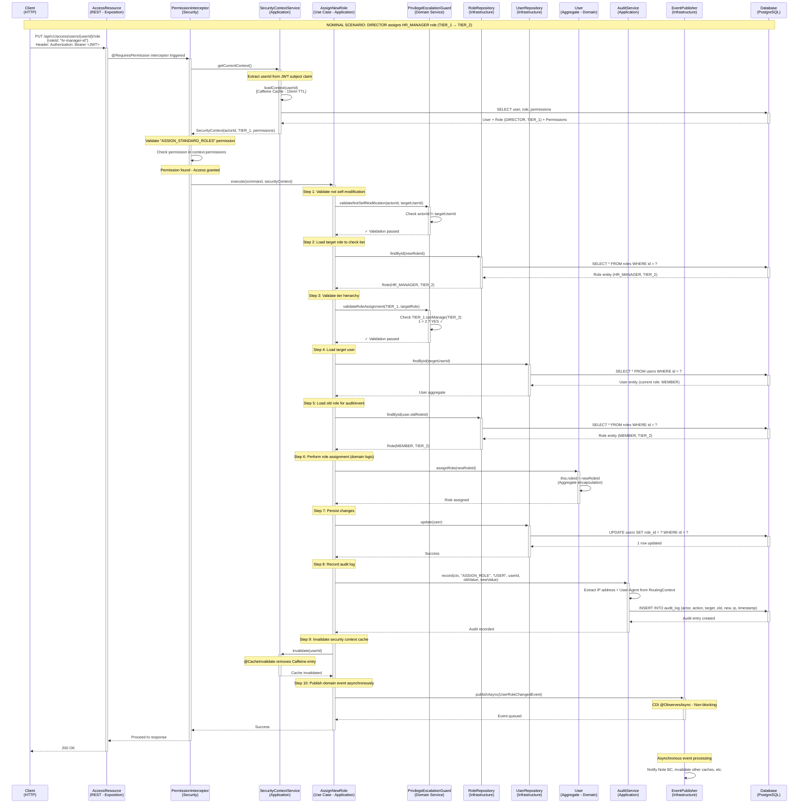
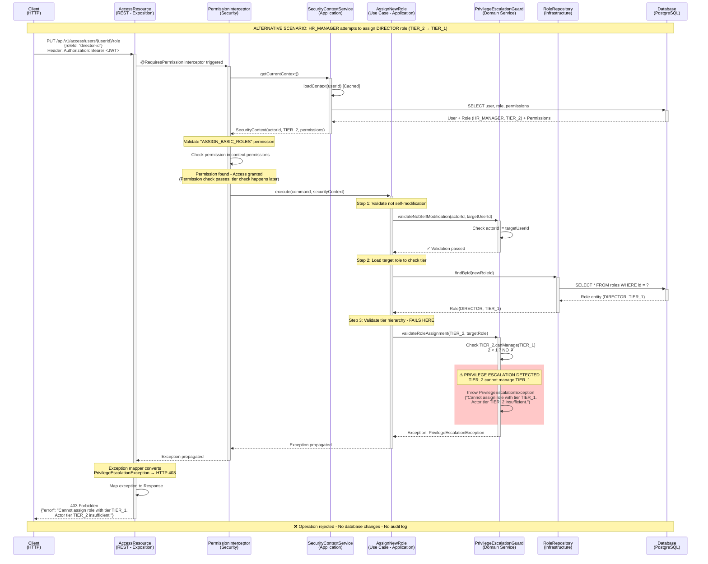
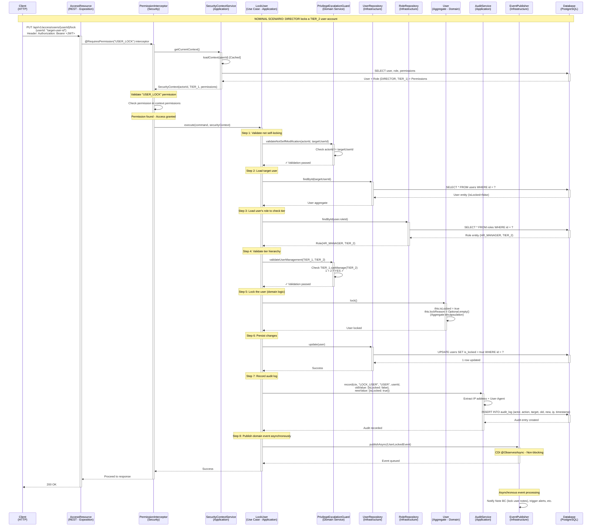
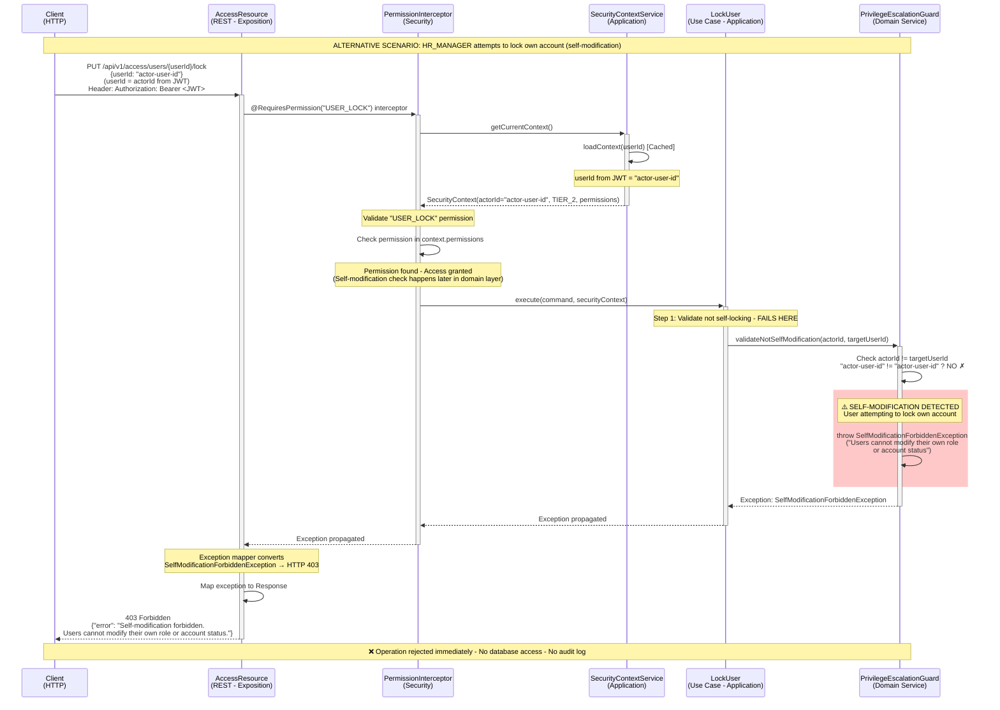

# Sequence Diagrams - BeeBoard API

## 9. Sequence Diagram - Assign New Role

### 9.1 Nominal Scenario

### 9.2 Alternative Scenario - Privilege Escalation Rejected

## 10. Sequence Diagram - Lock User

### 10.1 Nominal Scenario

### 10.2 Alternative Scenario - Self-Lock Forbidden

