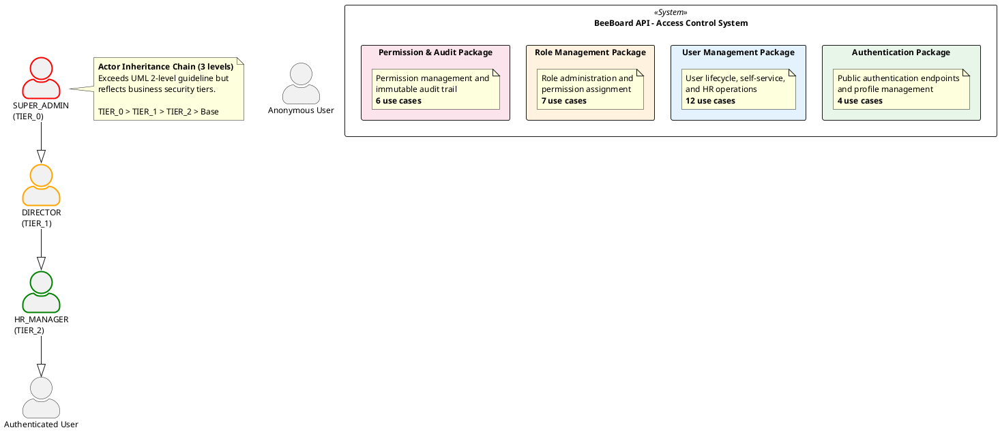
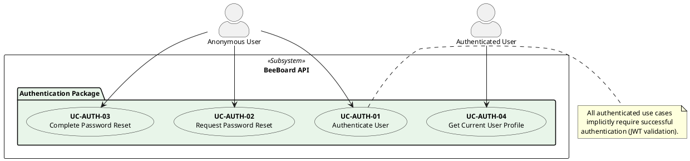
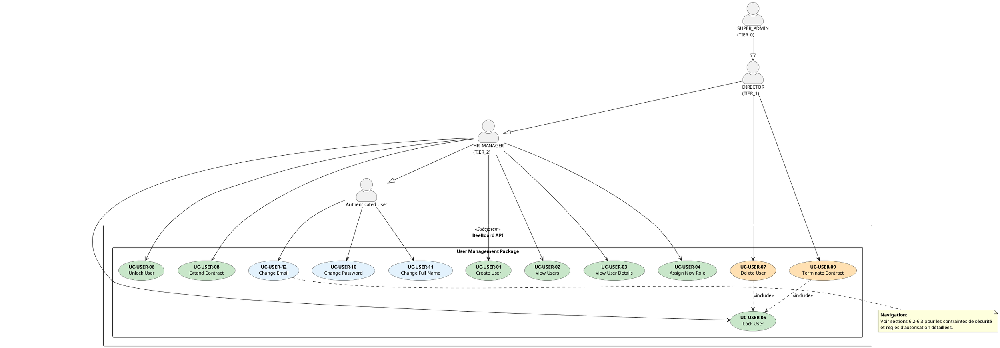
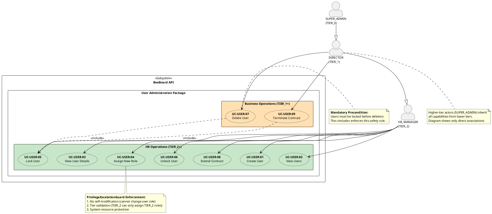
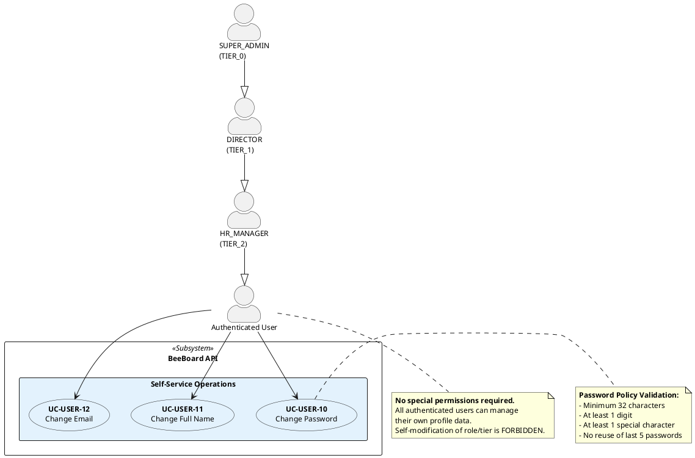
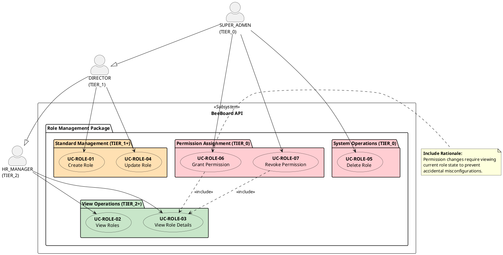
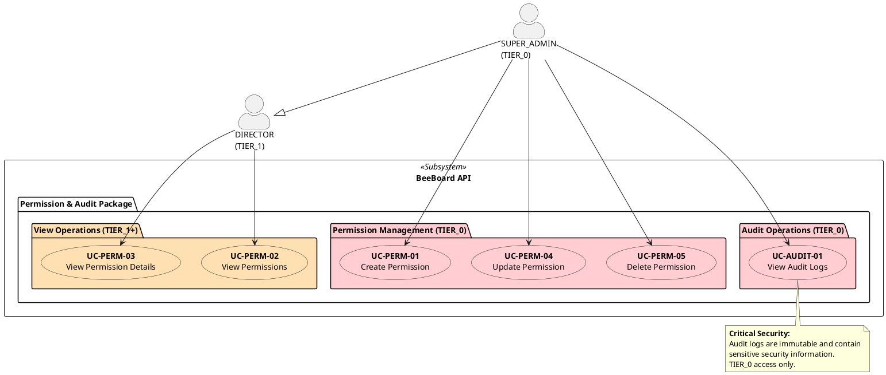

# Use Case Diagrams - BeeBoard API

## 4. Use Case Diagram - Global View

## 5. Use Case Diagram - Authentication

## 6. Use Case Diagram - User Management

### 6.1 Use Case Diagram - User Management (Overview)

### 6.2 Use Case Diagram - User Administration (Detail)

### 6.3 Use Case Diagram - User Self-Service (Detail)

## 7. Use Case Diagram - Role Management

## 8. Use Case Diagram - Permission & Audit

