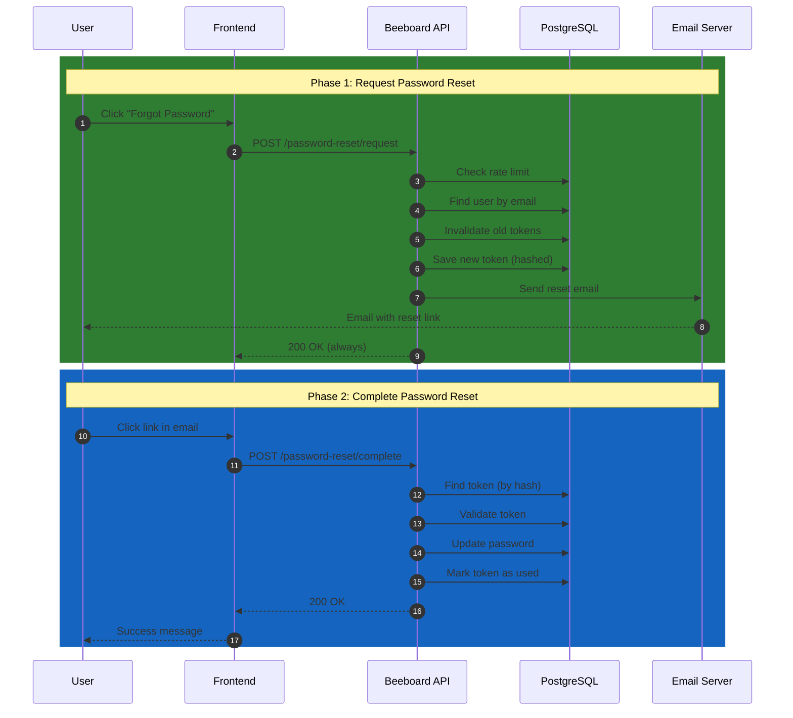
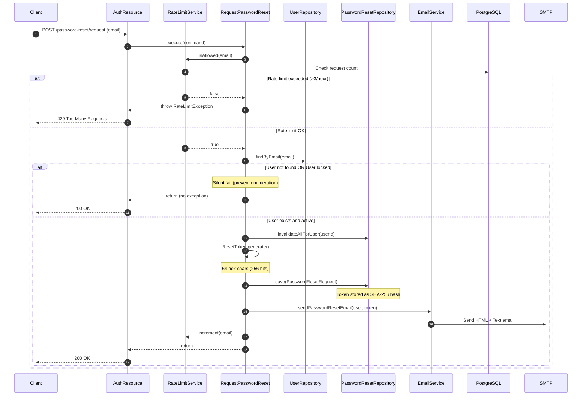
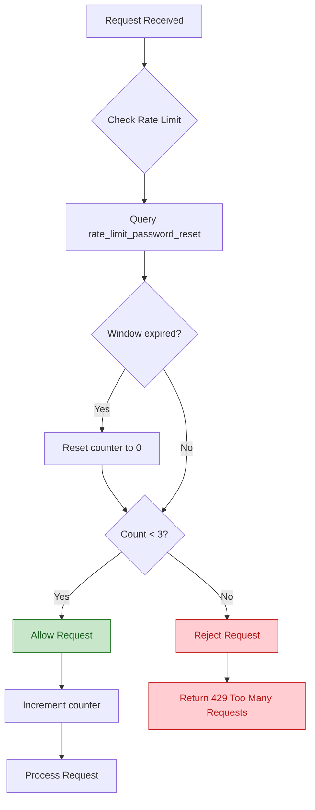
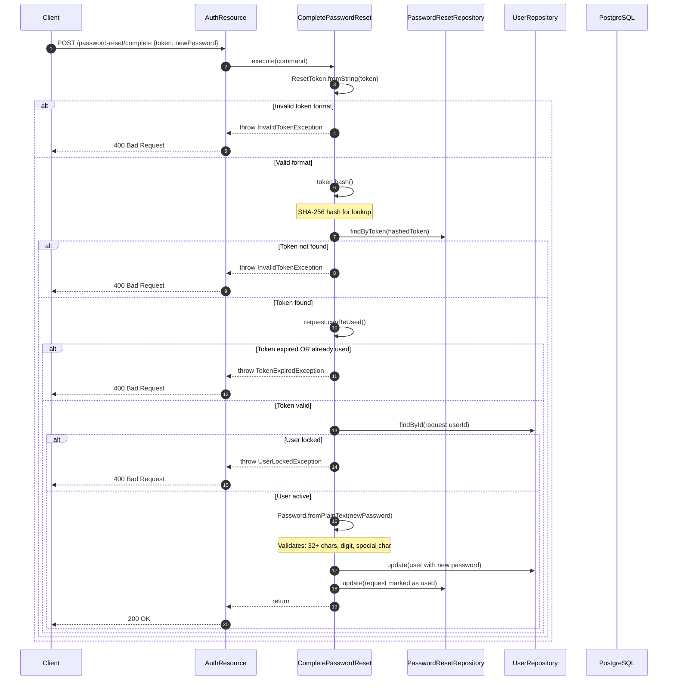
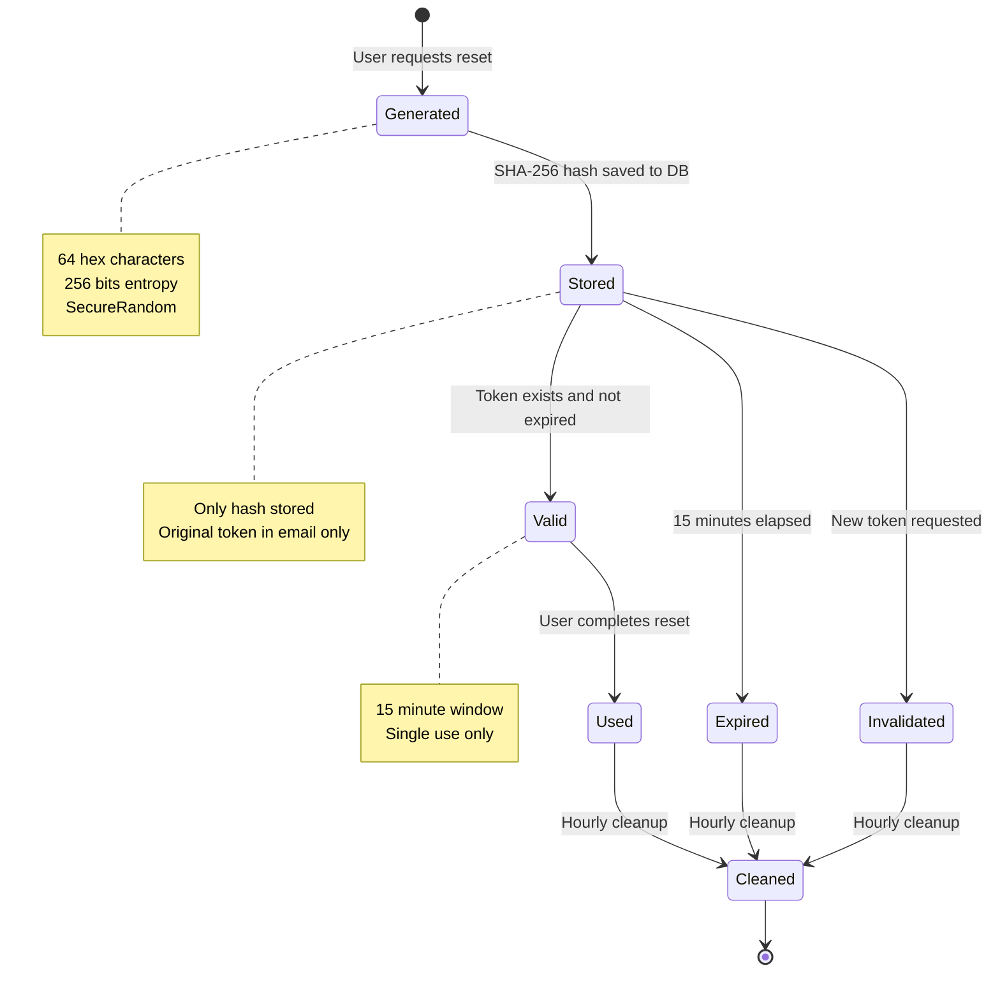
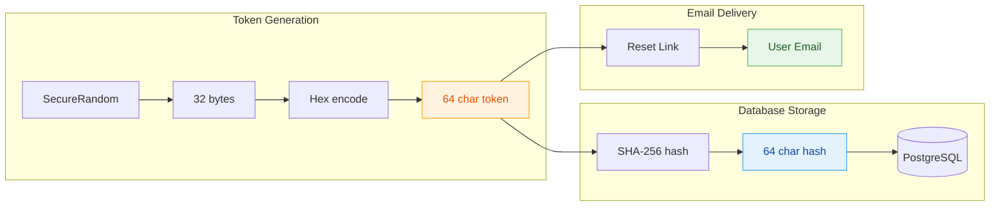
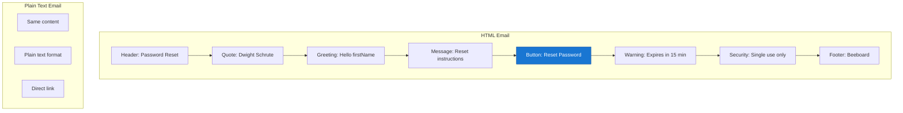
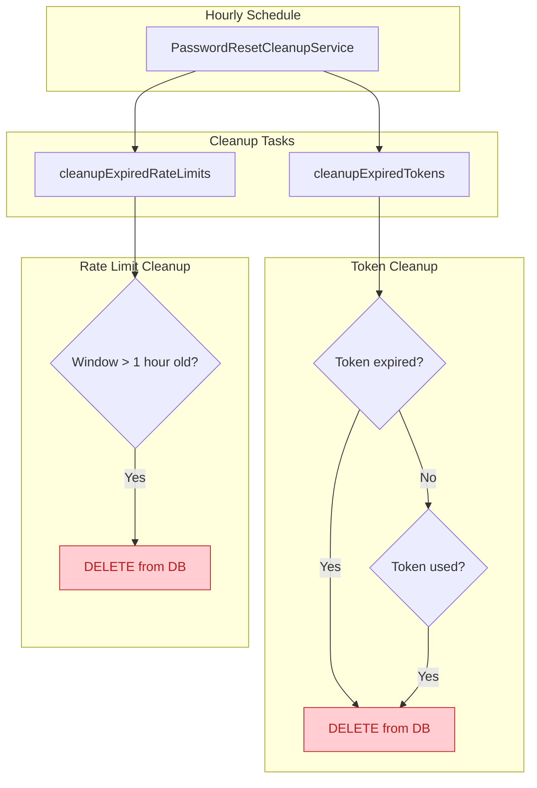
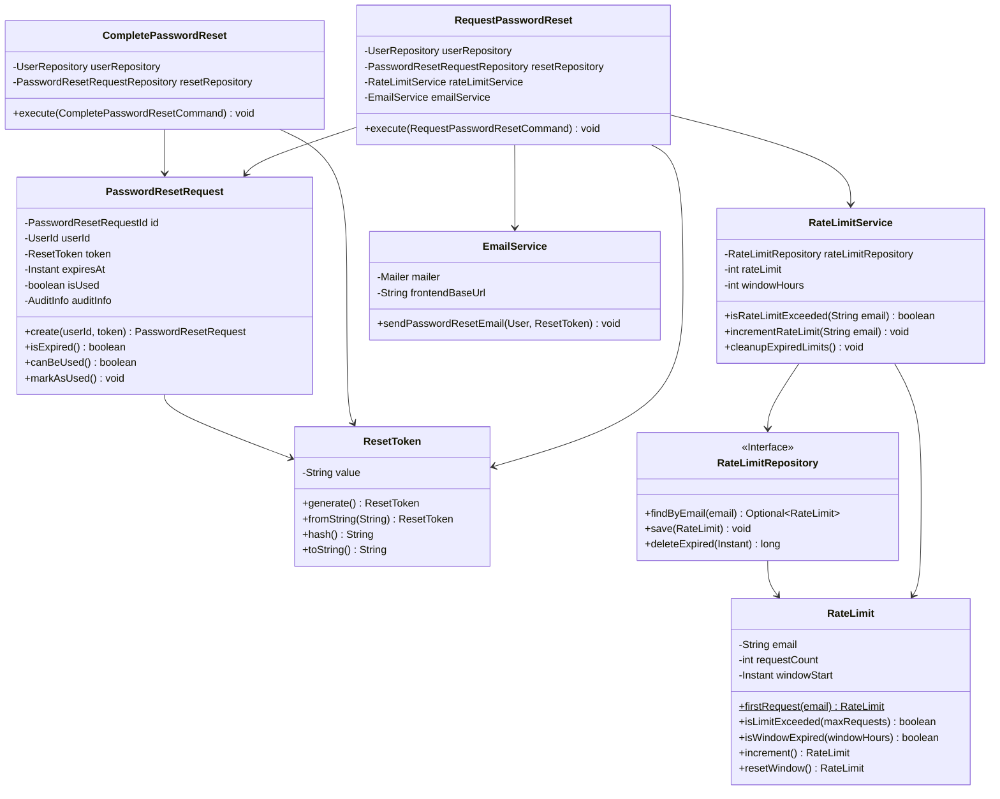
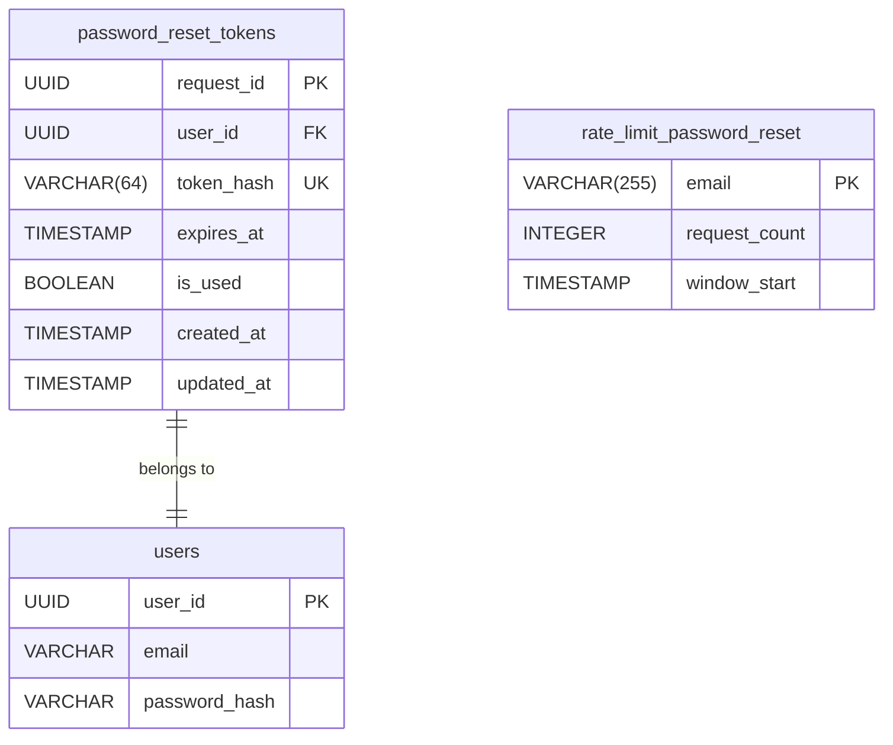

# Password Reset Workflow

## 1. Overview

The password reset workflow is a secure two-phase process that allows users to regain access to their accounts when they've forgotten their password.



---

## 2. Phase 1: Request Password Reset

**Endpoint**: `POST /api/v1/auth/password-reset/request`

### Request Body

```json
{
    "email": "user@example.com"
}
```

### Sequence Diagram



### Rate Limiting Logic



### Security Features

| Feature | Description |
|---------|-------------|
| User Enumeration Prevention | Always returns 200 OK regardless of user existence |
| Rate Limiting | Maximum 3 requests per email per hour |
| Token Invalidation | Previous tokens invalidated when new one is created |
| Silent Fail | Locked accounts receive no email (silent) |

---

## 3. Phase 2: Complete Password Reset

**Endpoint**: `POST /api/v1/auth/password-reset/complete`

### Request Body

```json
{
    "token": "a1b2c3d4e5f6...64_hex_characters",
    "newPassword": "MySecurePassword123!@#$%NewPass2024"
}
```

### Sequence Diagram



### Password Validation Rules

| Rule | Requirement |
|------|-------------|
| Minimum Length | 32 characters |
| Digit | At least one numeric character |
| Special Character | At least one special character |
| Hashing | BCrypt with cost factor |

---

## 4. Token Security

### Token Lifecycle



### Token Generation & Storage



### Security Properties

| Property | Value | Description |
|----------|-------|-------------|
| Entropy | 256 bits | Cryptographically secure random |
| Format | 64 hex chars | `^[a-f0-9]{64}$` |
| Storage | SHA-256 hash | Token never stored in plaintext |
| Validity | 15 minutes | Short-lived to minimize exposure |
| Usage | Single use | Marked as used after completion |
| Lookup | O(1) | Indexed hash lookup |

---

## 5. Email Template

### Reset Link Format

```
{FRONTEND_BASE_URL}/reset-password?token={64_char_hex_token}
```

### Email Structure



### Configuration

| Property | Environment Variable | Default |
|----------|---------------------|---------|
| Frontend URL | `FRONTEND_BASE_URL` | `http://localhost:3000` |
| Feature Toggle | `PASSWORD_RESET_ENABLED` | `true` |
| SMTP Host | - | `smtp.resend.com` |
| SMTP Port | - | `465` (SSL) |

---

## 6. Scheduled Maintenance

### Cleanup Service



---

## 7. Component Architecture

### Class Diagram



### File Reference

| Layer | File | Responsibility |
|-------|------|----------------|
| **Exposition** | `AuthenticationRessource.java` | REST endpoints |
| **Application** | `RequestPasswordReset.java` | Request use case |
| **Application** | `CompletePasswordReset.java` | Complete use case |
| **Application** | `EmailService.java` | Email sending |
| **Application** | `RateLimitService.java` | Rate limiting |
| **Application** | `PasswordResetCleanupService.java` | Scheduled cleanup |
| **Domain** | `PasswordResetRequest.java` | Aggregate root |
| **Domain** | `ResetToken.java` | Token value object |
| **Domain** | `RateLimit.java` | Rate limit domain model |
| **Domain** | `RateLimitRepository.java` | Rate limit repository interface |
| **Infrastructure** | `PasswordResetRequestRepositoryImpl.java` | JPA persistence |
| **Infrastructure** | `PasswordResetRequestEntity.java` | JPA entity |
| **Infrastructure** | `RateLimitRepositoryImpl.java` | Rate limit JPA persistence |
| **Infrastructure** | `RateLimitEntity.java` | Rate limit JPA entity |
| **Infrastructure** | `RateLimitMapper.java` | Entity/Domain mapper |
| **Database** | `V6__create_password_reset_tokens_table.sql` | Schema migration |

---

## 8. Database Schema

### Tables



### Indexes

| Table | Index | Columns | Purpose |
|-------|-------|---------|---------|
| `password_reset_tokens` | `idx_password_reset_user_id` | `user_id` | User lookup |
| `password_reset_tokens` | `idx_password_reset_token_hash` | `token_hash` | Token validation |
| `password_reset_tokens` | `idx_password_reset_expires_at` | `expires_at` | Cleanup queries |
| `password_reset_tokens` | `idx_password_reset_expired` | `expires_at, is_used` | Composite cleanup |
| `rate_limit_password_reset` | `idx_rate_limit_window` | `window_start` | Cleanup queries |

---

## 9. Error Handling

| Error | HTTP Code | Cause |
|-------|-----------|-------|
| Rate limit exceeded | 429 | More than 3 requests in 1 hour |
| Invalid token format | 400 | Token not 64 hex characters |
| Token not found | 400 | Token hash not in database |
| Token expired | 400 | Token older than 15 minutes |
| Token already used | 400 | Token marked as used |
| User locked | 400 | Target user account is locked |
| Invalid password | 400 | Password doesn't meet requirements |
