# Security Architecture - Tiered Administration

## Table of Contents

1. [Security Layers Overview](#1-security-layers-overview)
2. [Tier Hierarchy](#2-tier-hierarchy)
3. [Sensitive Operation Flow](#3-sensitive-operation-flow)
4. [Security Rules](#4-security-rules)
5. [Permissions Matrix](#5-permissions-matrix)
6. [Component Architecture](#6-component-architecture)
7. [Audit Data Flow](#7-audit-data-flow)
8. [User States and Transitions](#8-user-states-and-transitions)
9. [Token Lifecycle & Permission Caching](#9-token-lifecycle--permission-caching)
10. [Cross-Bounded Context Communication](#10-cross-bounded-context-communication)
11. [ApplicationRole Hierarchy](#11-applicationrole-hierarchy)
12. [Account Status State Machine](#12-account-status-state-machine)
13. [Event-Driven Synchronization](#13-event-driven-synchronization)
14. [Anti-Corruption Layer Pattern](#14-anti-corruption-layer-pattern)
15. [Internal API Architecture](#15-internal-api-architecture)

---

## 1. Security Layers Overview

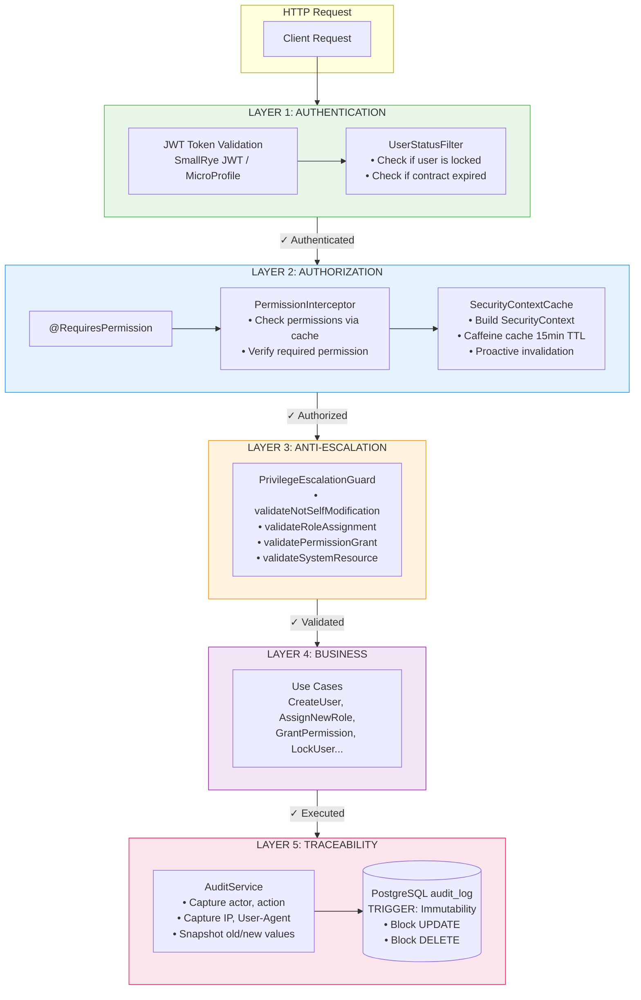

## 2. Tier Hierarchy

### SecurityTier (Internal to Access BC)

`SecurityTier` is the **internal hierarchy** used within Access BC for permission management and privilege escalation control. It is NOT exposed to other bounded contexts.

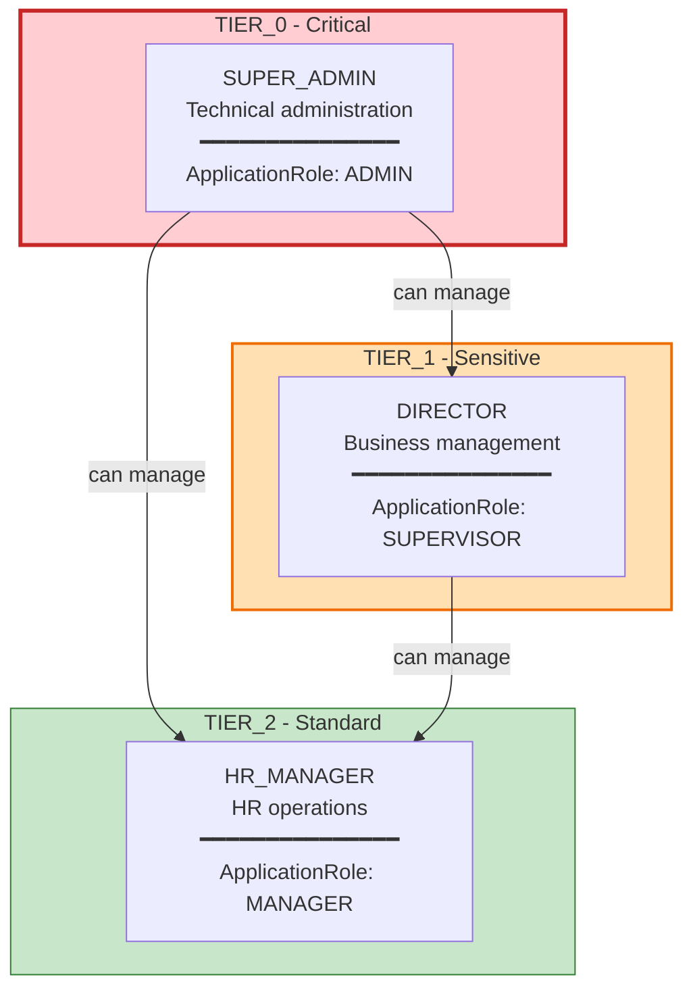

### SecurityTier vs ApplicationRole

**SecurityTier (Internal):**
- Used within Access BC for permission checks
- Tied to organizational hierarchy (SUPER_ADMIN, DIRECTOR, HR_MANAGER)
- Controls who can manage whom (TIER_0 > TIER_1 > TIER_2)
- Used by PrivilegeEscalationGuard

**ApplicationRole (Published Language):**
- Exposed to other bounded contexts (Note BC, future Project BC)
- Represents capability levels (ADMIN, SUPERVISOR, MANAGER, MEMBER, GUEST)
- Not tied to specific organizational roles
- Used for cross-BC authorization decisions

**Mapping:**

| SecurityTier | Organizational Role | ApplicationRole | Cross-BC Capability |
|--------------|--------------------|-----------------|--------------------|
| TIER_0 | SUPER_ADMIN | ADMIN | Full system access |
| TIER_1 | DIRECTOR | SUPERVISOR | Read-all supervisory access |
| TIER_2 | HR_MANAGER | MANAGER | Resource management |
| N/A | DEVELOPER | MEMBER | Standard user access |
| N/A | INTERN | GUEST | Limited read-only access |

**Note:** Not all roles have SecurityTier (DEVELOPER, INTERN don't). SecurityTier is only for Access BC's internal management hierarchy.

## 3. Sensitive Operation Flow

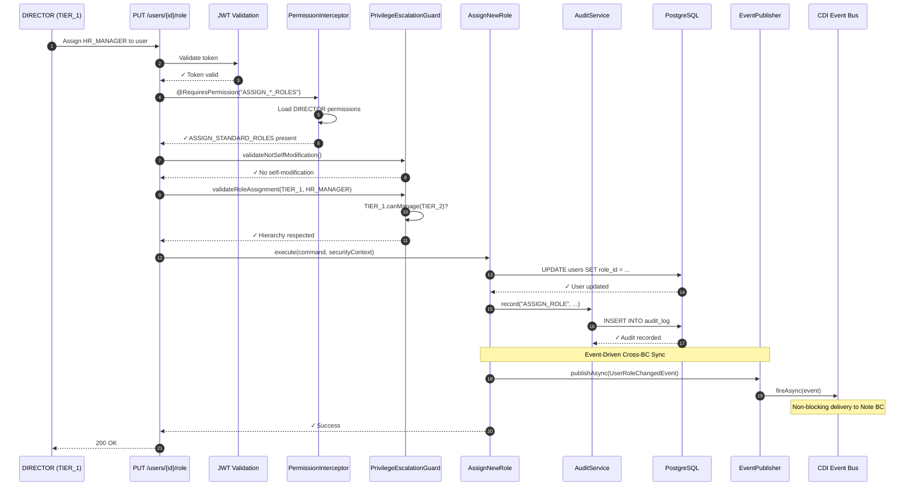

**Key Addition: Event Publishing (Steps 13-14)**

After persisting changes and recording audit logs, the use case publishes a domain event asynchronously:
- **Step 13:** Use case calls `EventPublisher.publishAsync(UserRoleChangedEvent)`
- **Step 14:** Event is delivered to CDI Event Bus via `fireAsync()`
- **Non-blocking:** Use case completes immediately without waiting for consumers
- **Eventual Consistency:** Note BC receives event and updates `author_view` asynchronously

This ensures other bounded contexts (e.g., Note BC) stay synchronized without coupling Access BC to their availability or performance.

## 4. Security Rules

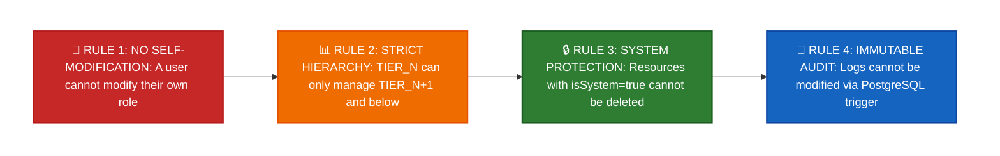

## 5. Permissions Matrix

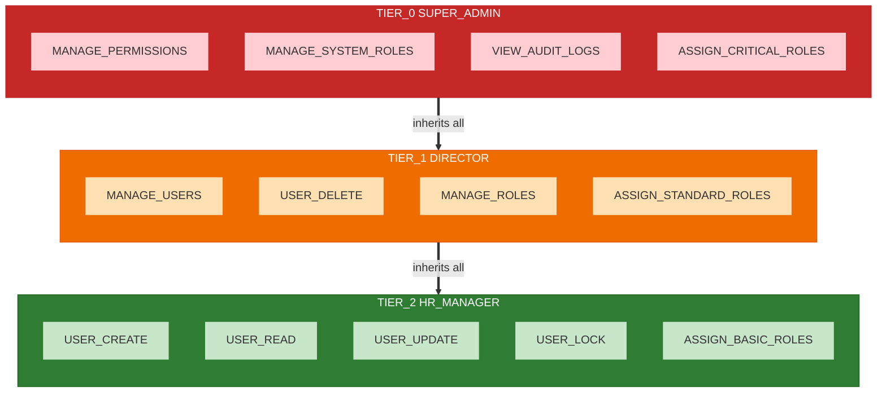

## 6. Component Architecture

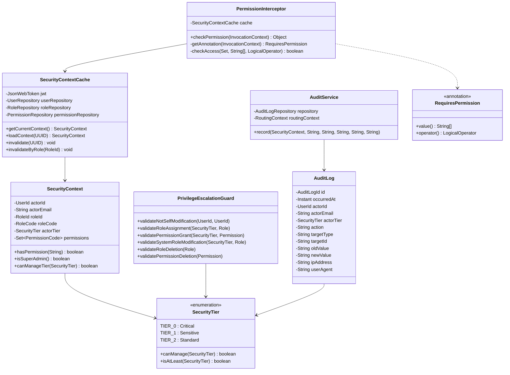

## 7. Audit Data Flow

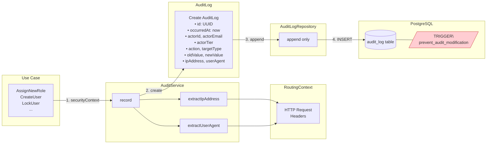

## 8. User States and Transitions

### Overview

User state is managed through two boolean flags (`isLocked`, `contractEndDate`) in the User aggregate. The `AccountStatus` enum is a **computed property** derived from these flags, representing the current authentication eligibility.

**For comprehensive AccountStatus documentation, see [Section 12: Account Status State Machine](#12-account-status-state-machine).**

### State Diagram

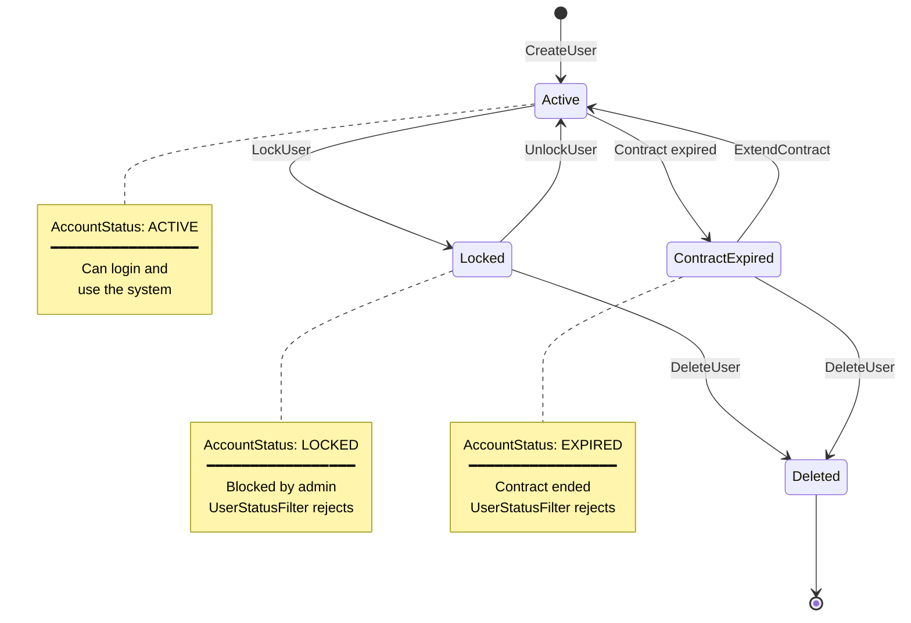

### AccountStatus Derivation

**AccountStatus is computed, not stored:**

```java
public AccountStatus getAccountStatus() {
    if (this.isLocked()) {
        return AccountStatus.LOCKED;  // Highest priority
    }
    if (this.isContractExpired()) {
        return AccountStatus.EXPIRED;
    }
    return AccountStatus.ACTIVE;  // Default
}
```

**Priority Rules:**
1. LOCKED (highest priority) - if `isLocked() == true`
2. EXPIRED - if contract has expired
3. ACTIVE - default state

### Cross-BC Synchronization

When user state changes, Access BC publishes events:
- `LockUser` → publishes `UserLockedEvent` → Note BC updates `author_view.account_status = LOCKED`
- `UnlockUser` → publishes `UserUnlockedEvent` → Note BC updates `author_view.account_status = ACTIVE`
- `TerminateContract` → publishes `UserContractTerminatedEvent` → Note BC updates `author_view.account_status = EXPIRED`

See [Section 13: Event-Driven Synchronization](#13-event-driven-synchronization) for details.

## 9. Token Lifecycle & Permission Caching

### JWT Token Configuration

| Property | Value | Description |
|----------|-------|-------------|
| Duration | 1 hour (3600s) | Token expiration time |
| Issuer | beeboard-api | Token issuer identifier |
| Algorithm | RS256 | RSA signature with SHA-256 |
| Refresh | Not implemented | User must re-authenticate |

### Permission Caching (Caffeine)

| Property | Value | Description |
|----------|-------|-------------|
| TTL | 15 minutes | Cache entry expiration |
| Max Size | 1000 entries | Maximum cached users |
| Invalidation | Proactive | Triggered on role/permission changes |

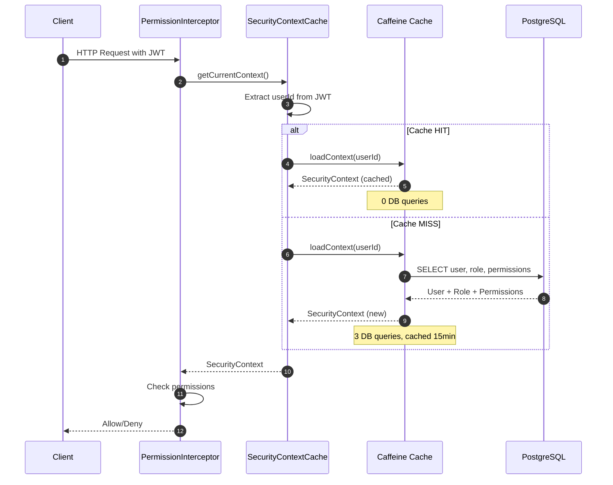

### Cache Invalidation Triggers

| Trigger | Use Case | Invalidation Scope |
|---------|----------|-------------------|
| Role assignment | AssignNewRole | Single user |
| Role update | UpdateRole | All users with role |
| Permission grant | GrantPermission | All users with role |
| Permission revoke | RevokePermissionFromRole | All users with role |

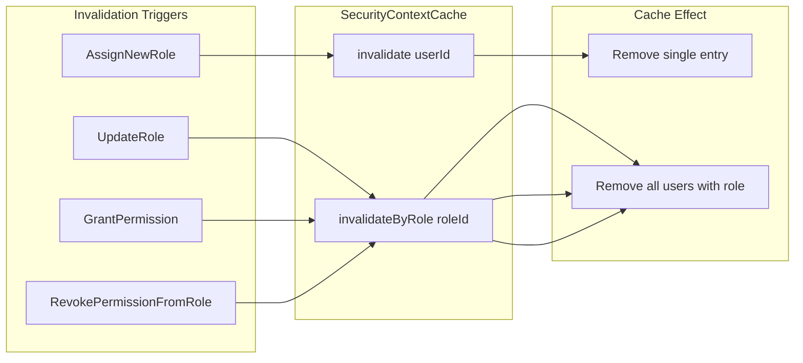

### Performance Comparison

| Metric | Before (No Cache) | After (Caffeine 15min) |
|--------|-------------------|------------------------|
| DB queries/request | 6 | 0 (if cached) |
| DB queries/15min (100 requests) | 600 | 3 |
| Permission check latency | ~50ms | ~1ms |
| Memory overhead | None | ~1KB/user |

### Cross-BC Caching Strategy

**Access BC (SecurityContextCache):**
- **Mechanism:** Caffeine in-memory cache
- **TTL:** 15 minutes
- **Scope:** SecurityContext (user + role + permissions)
- **Invalidation:** Proactive (on role/permission changes)
- **Performance:** ~1ms cache hit, ~50ms cache miss

**Note BC (author_view CQRS):**
- **Mechanism:** PostgreSQL denormalized table (CQRS read model)
- **TTL:** No expiration (updated via events)
- **Scope:** UserId, AccessLevel, AccountStatus, FullName
- **Synchronization:** Event-driven (UserEventHandler)
- **Performance:** <5ms local query (no network call)

### Cross-BC Performance Comparison

| Approach | Access BC → Note BC | Query Time | Coupling | Consistency |
|----------|---------------------|------------|----------|-------------|
| **REST API Call** | Synchronous HTTP request | 50-200ms | Tight | Immediate |
| **CQRS + Events** | Local `author_view` query | <5ms | Loose | Eventual (<1s) |

**Why CQRS + Events?**
1. **40x faster:** <5ms local query vs 50-200ms REST call
2. **Resilient:** Note BC remains operational if Access BC is down
3. **Scalable:** No synchronous cross-BC calls
4. **Independent:** Note BC can optimize its read model

**Trade-off:** Eventual consistency (typically <1 second propagation delay) instead of immediate consistency.

### Caching Architecture Across BCs

```mermaid
flowchart TB
    subgraph AccessBC["Access BC"]
        SCC[SecurityContextCache<br/>Caffeine 15min TTL<br/>~1ms hit, ~50ms miss]
        ACDB[(PostgreSQL<br/>users, roles, permissions)]
        SCC --> ACDB
    end

    subgraph Events["Event-Driven Sync"]
        EP[EventPublisher<br/>publishAsync]
        CDI[CDI Event Bus]
        EP --> CDI
    end

    subgraph NoteBC["Note BC"]
        AV[(author_view<br/>CQRS read model<br/><5ms query)]
        EH[UserEventHandler<br/>@ObservesAsync]
        CDI --> EH
        EH --> AV
    end

    ACDB -->|"Domain events"| EP

    style AccessBC fill:#e3f2fd,stroke:#2196f3
    style Events fill:#fff3e0,stroke:#ff9800
    style NoteBC fill:#f3e5f5,stroke:#9c27b0
```

**Key Insight:** Each BC optimizes its own caching strategy:
- **Access BC:** In-memory cache for permission checks
- **Note BC:** Denormalized table for author metadata
- **Synchronization:** Asynchronous events keep them consistent

## 10. Cross-Bounded Context Communication

### Overview

BeeBoard API uses **Published Language** and **Event-Driven Architecture** to enable communication between bounded contexts while maintaining loose coupling and independence.

**Key Concepts:**
- **Published Language:** Shared vocabulary (ApplicationRole, AccountStatus, UserContext) for cross-BC communication
- **Event-Driven Sync:** Asynchronous domain events replace synchronous REST calls for better resilience
- **Anti-Corruption Layer (ACL):** Translation boundary protecting Note BC from Access BC vocabulary changes
- **CQRS Read Model:** `author_view` table in Note BC, updated via events, queried locally for performance

### Communication Flow

```mermaid
flowchart TB
    subgraph AccessBC["Access BC (Source of Truth)"]
        UC[Use Case<br/>CreateUser<br/>AssignNewRole<br/>LockUser...]
        EP[EventPublisher<br/>publishAsync]
    end

    subgraph CDI["CDI Event Bus"]
        BUS[fireAsync<br/>Non-blocking delivery]
    end

    subgraph NoteBC["Note BC (Consumer)"]
        EH[UserEventHandler<br/>@ObservesAsync<br/>Anti-Corruption Layer]
        AV[(author_view<br/>CQRS read model)]
    end

    UC -->|"1. Execute domain logic"| EP
    EP -->|"2. Publish async"| BUS
    BUS -->|"3. Deliver non-blocking"| EH
    EH -->|"4. Translate & update"| AV

    style AccessBC fill:#e3f2fd,stroke:#2196f3
    style CDI fill:#fff3e0,stroke:#ff9800
    style NoteBC fill:#f3e5f5,stroke:#9c27b0
```

### Published Language: ApplicationRole

`ApplicationRole` is the **shared vocabulary** for cross-BC authorization. It represents capability levels, not organizational hierarchy.

```java
public enum ApplicationRole {
    ADMIN,       // Full system access - technical administration
    SUPERVISOR,  // Read-all, supervisory access - direction level
    MANAGER,     // Resource management - project managers, team leads
    MEMBER,      // Standard user access - developers, employees
    GUEST        // Limited, read-only access - interns, contractors
}
```

**Key Methods:**
- `isAtLeast(ApplicationRole minRole)` - Check privilege level
- `canManage()` - Returns true for ADMIN, SUPERVISOR, MANAGER
- `canSupervise()` - Returns true for ADMIN, SUPERVISOR

### Published Language: AccountStatus

`AccountStatus` represents the computed user state for authentication and access control.

```java
public enum AccountStatus {
    ACTIVE,   // Can authenticate and access resources
    LOCKED,   // Administratively locked
    EXPIRED   // Contract expired
}
```

**Derivation Logic (Access BC):**
- `LOCKED` if `user.isLocked() == true` (highest priority)
- `EXPIRED` if `user.isContractExpired() == true`
- `ACTIVE` otherwise

**Key Method:**
- `canAuthenticate()` - Returns true only for ACTIVE

### Published Language: UserContext

`UserContext` is the minimal authorization data transferred between bounded contexts.

```java
public record UserContext(
    UUID userId,
    ApplicationRole applicationRole,
    AccountStatus status
)
```

**Key Methods:**
- `canSupervise()` - Checks if user has ADMIN or SUPERVISOR role
- `isAdmin()` - Checks if user has ADMIN role
- `canManage()` - Checks if user has management capabilities
- `canCreateContent()` - Checks if user is active and not a guest
- `isAtLeast(ApplicationRole minRole)` - Compares privilege levels

### Event-Driven vs REST Comparison

| Aspect | Event-Driven (Current) | REST API (Alternative) |
|--------|------------------------|------------------------|
| **Coupling** | Loose - async, non-blocking | Tight - synchronous dependency |
| **Performance** | High - local queries (<5ms) | Moderate - network calls (50-200ms) |
| **Resilience** | High - eventual consistency | Low - fails if Access BC is down |
| **Complexity** | Moderate - event handlers, ACL | Low - simple HTTP calls |
| **Consistency** | Eventual (seconds) | Immediate |
| **Best for** | User metadata, permissions | Real-time critical data |

**Why Event-Driven?**
1. **Performance:** Note BC queries local `author_view` instead of calling Access BC REST API
2. **Resilience:** Note BC remains operational even if Access BC is temporarily down
3. **Independence:** Changes to Access BC vocabulary don't break Note BC (ACL protects)
4. **Scalability:** No synchronous cross-BC calls means better throughput

## 11. ApplicationRole Hierarchy

### Capability-Based Privilege Levels

`ApplicationRole` represents **capability levels** for cross-BC communication, not organizational hierarchy. Access BC maps organizational roles (DIRECTOR, HR_MANAGER, etc.) to these capability levels, and other BCs translate them to local vocabulary.

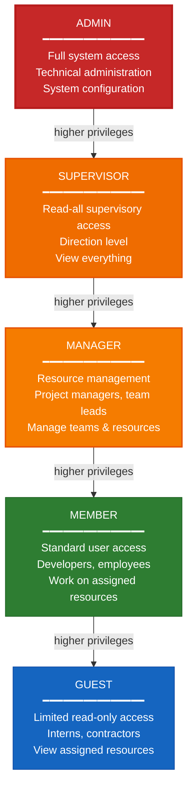

### Role Mapping Examples

Access BC maps organizational roles to ApplicationRole for cross-BC communication:

| Organizational Role (Access BC) | SecurityTier | ApplicationRole | Typical Use Case |
|--------------------------------|--------------|-----------------|------------------|
| SUPER_ADMIN | TIER_0 | ADMIN | System configuration, user management |
| DIRECTOR | TIER_1 | SUPERVISOR | Business oversight, view all resources |
| PROJECT_MANAGER | TIER_2 | MANAGER | Manage projects, assign tasks |
| TECH_LEAD | TIER_2 | MANAGER | Manage development teams |
| HR_MANAGER | TIER_2 | MANAGER | Manage employee data, roles |
| DEVELOPER | N/A | MEMBER | Write code, create content |
| SENIOR_DEVELOPER | N/A | MEMBER | Write code, review PRs |
| INTERN | N/A | GUEST | Read documentation, learn |
| EXTERNAL | N/A | GUEST | Limited contractor access |

**Note:** SecurityTier is internal to Access BC for permission management. ApplicationRole is the Published Language used by all other BCs.

### Privilege Comparison Methods

```java
// Check if role is at least a certain level
applicationRole.isAtLeast(ApplicationRole.MANAGER)
// ADMIN.isAtLeast(MANAGER) → true
// MEMBER.isAtLeast(MANAGER) → false

// Check management capabilities
applicationRole.canManage()
// Returns true for: ADMIN, SUPERVISOR, MANAGER
// Returns false for: MEMBER, GUEST

// Check supervisory capabilities (view all)
applicationRole.canSupervise()
// Returns true for: ADMIN, SUPERVISOR
// Returns false for: MANAGER, MEMBER, GUEST
```

### Translation to BC-Specific Vocabulary

Each bounded context translates ApplicationRole to its local vocabulary:

**Note BC Translation (via Anti-Corruption Layer):**

| ApplicationRole | Note BC: AccessLevel | Capabilities |
|----------------|---------------------|--------------|
| ADMIN | SUPERVISOR | Full note management, moderation |
| SUPERVISOR | SUPERVISOR | View all notes, moderate content |
| MANAGER | MODERATOR | Manage team notes, moderate comments |
| MEMBER | COMMENTER | Create notes, add comments |
| GUEST | VIEWER | Read-only access to assigned notes |

**Future: Project BC Translation (example):**

| ApplicationRole | Project BC: ProjectRole | Capabilities |
|----------------|------------------------|--------------|
| ADMIN | PROJECT_ADMIN | Configure project templates |
| SUPERVISOR | PROJECT_VIEWER | View all projects |
| MANAGER | PROJECT_MANAGER | Create projects, assign tasks |
| MEMBER | PROJECT_CONTRIBUTOR | Work on assigned tasks |
| GUEST | PROJECT_OBSERVER | View assigned projects |

This translation happens at the Anti-Corruption Layer boundary, keeping each BC's vocabulary clean and independent.

## 12. Account Status State Machine

### Overview

`AccountStatus` is a **computed property** derived from the User aggregate state, not a stored field. It represents the current authentication eligibility of a user account.

**Derivation Priority (highest to lowest):**
1. **LOCKED** - User is administratively locked (highest priority)
2. **EXPIRED** - User's contract has expired
3. **ACTIVE** - Default state when neither locked nor expired

### State Machine Diagram

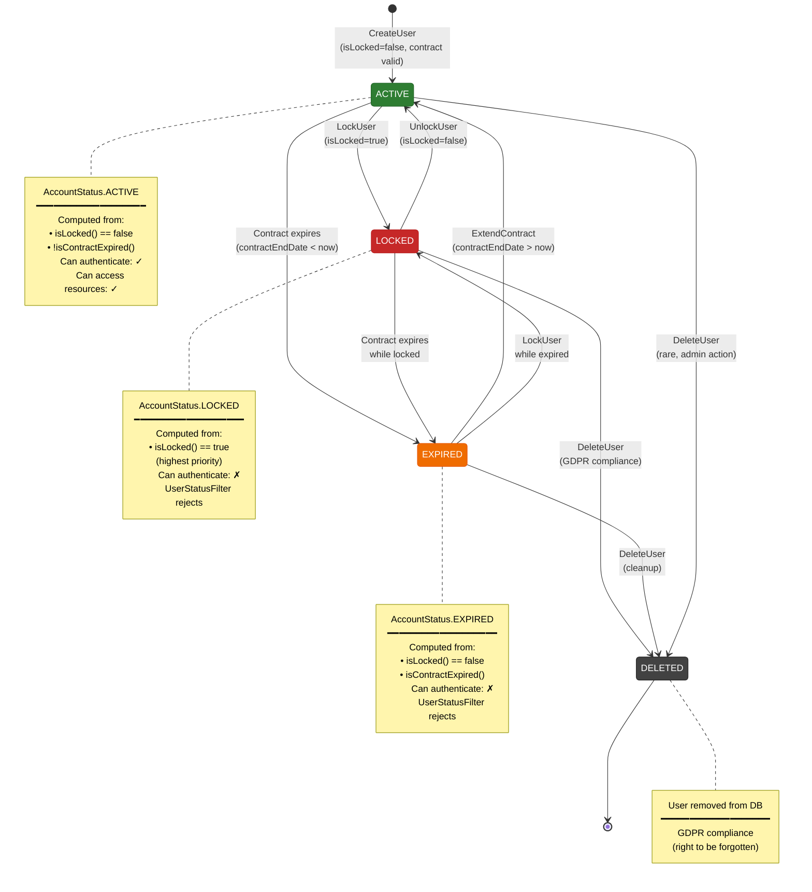

### Derivation Logic

**Access BC (User.java):**

```java
public AccountStatus getAccountStatus() {
    if (this.isLocked()) {
        return AccountStatus.LOCKED;  // Highest priority
    }
    if (this.isContractExpired()) {
        return AccountStatus.EXPIRED;
    }
    return AccountStatus.ACTIVE;  // Default
}

private boolean isContractExpired() {
    return contractEndDate != null && contractEndDate.isBefore(Instant.now());
}
```

**Priority Rules:**
- If both `isLocked == true` AND contract expired → **LOCKED** (lock takes precedence)
- If only contract expired → **EXPIRED**
- Otherwise → **ACTIVE**

### Authentication Guard

**UserStatusFilter (Layer 1: Authentication):**

```java
@ServerRequestFilter
public void checkUserStatus(@Context SecurityContext securityContext) {
    User user = loadUser(securityContext.getUserPrincipal());
    AccountStatus status = user.getAccountStatus();

    if (!status.canAuthenticate()) {
        throw new ForbiddenException(
            "Account is " + status + ". Please contact an administrator."
        );
    }
}
```

**Only `AccountStatus.ACTIVE` passes authentication.**

### Event Publishing

When AccountStatus changes, Access BC publishes events to synchronize other BCs:

| State Transition | Event Published | Note BC Impact |
|------------------|-----------------|----------------|
| CreateUser → ACTIVE | `UserCreatedEvent` | Creates `author_view` entry with ACTIVE |
| ACTIVE → LOCKED | `UserLockedEvent` | Updates `author_view.account_status = LOCKED` |
| LOCKED → ACTIVE | `UserUnlockedEvent` | Updates `author_view.account_status = ACTIVE` |
| ACTIVE → EXPIRED | `UserContractTerminatedEvent` | Updates `author_view.account_status = EXPIRED` |
| EXPIRED → ACTIVE | (not implemented) | Would publish `UserContractExtendedEvent` |
| Any → DELETED | `UserDeletedEvent` | Deletes `author_view` entry (GDPR) |

### Cross-BC Consistency

**Access BC (Source of Truth):**
- Computes AccountStatus from `isLocked()` + `isContractExpired()`
- Publishes events asynchronously when status changes

**Note BC (Consumer):**
- Stores AccountStatus in `author_view.account_status` (denormalized)
- Updates via event handlers (@ObservesAsync)
- Queries locally for performance (<5ms vs 50-200ms REST call)

**Eventual Consistency:**
- Typical propagation delay: <1 second
- Note BC remains operational even if Access BC is down
- One-time sync endpoint available for recovery: `GET /api/v1/internal/users/all`

## 13. Event-Driven Synchronization

### Overview

Access BC publishes **8 domain events** asynchronously to synchronize user data across bounded contexts. This replaces synchronous REST calls with a resilient, high-performance event-driven architecture.

**Key Benefits:**
- **Non-blocking:** Use cases complete without waiting for consumers
- **Resilient:** Consumers remain operational even if Access BC is temporarily down
- **Performant:** Local queries (<5ms) instead of cross-BC REST calls (50-200ms)
- **Decoupled:** Changes to Access BC don't break consumers (Anti-Corruption Layer)

### Domain Events

| Event | Use Case | Trigger | Impact on Note BC |
|-------|----------|---------|-------------------|
| **UserCreatedEvent** | CreateUser | New user registered | Creates `author_view` entry |
| **UserRoleChangedEvent** | AssignNewRole | User role assignment changed | Updates `access_level` in `author_view` |
| **UserFullNameChangedEvent** | ChangeFullName | User name changed | Updates `full_name` in `author_view` |
| **RoleApplicationRoleChangedEvent** | UpdateRoleApplicationRole | Role's ApplicationRole changed | Bulk updates `access_level` for all affected users |
| **UserLockedEvent** | LockUser | Admin locks user account | Updates `account_status` to LOCKED |
| **UserUnlockedEvent** | UnlockUser | Admin unlocks user account | Updates `account_status` to ACTIVE |
| **UserContractTerminatedEvent** | TerminateContract | User contract expires | Updates `account_status` to EXPIRED |
| **UserDeletedEvent** | DeleteUser | User deleted (GDPR) | Deletes `author_view` entry |

### Event Publishing Flow

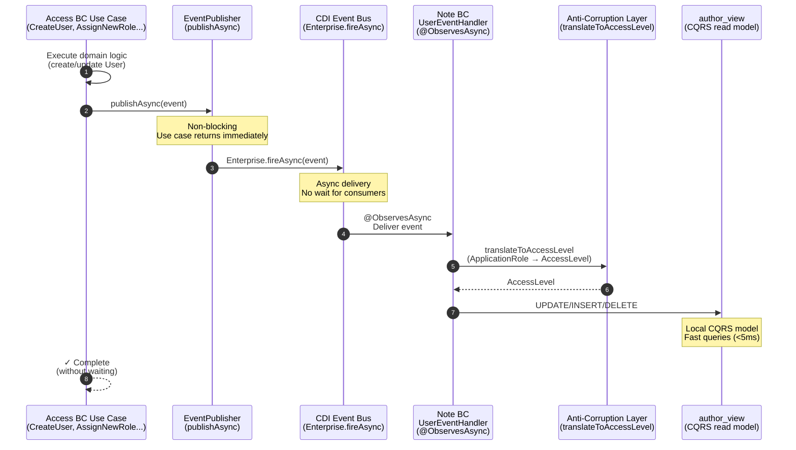

### Event Structure Example

**UserCreatedEvent:**

```java
public record UserCreatedEvent(
    UUID eventId,               // Unique event ID
    UUID userId,                // User aggregate ID
    String fullName,            // For display in Note BC
    ApplicationRole applicationRole,  // Published Language
    AccountStatus status,       // Published Language
    UUID createdBy,             // Audit trail
    Instant occurredAt          // Event timestamp
) implements DomainEvent
```

**Key Properties:**
- All events implement `DomainEvent` interface
- `eventId` auto-generated if null (idempotency support)
- `occurredAt` defaults to `Instant.now()`
- Includes `ApplicationRole` and `AccountStatus` (Published Language)

### Publishing Pattern

**Access BC Use Cases:**

```java
@ApplicationScoped
public class CreateUser {

    @Inject
    EventPublisher eventPublisher;

    @Transactional
    public UserId execute(CreateUserCommand command, SecurityContext context) {
        // 1. Execute domain logic
        User user = new User(...);
        userRepository.save(user);

        // 2. Publish event asynchronously (non-blocking)
        UserCreatedEvent event = new UserCreatedEvent(
            null,  // eventId auto-generated
            user.getUserId(),
            user.getFullName(),
            user.getRole().getApplicationRole(),
            user.getAccountStatus(),
            context.getActorId(),
            null   // occurredAt auto-generated
        );
        eventPublisher.publishAsync(event);

        // 3. Return immediately (don't wait for consumers)
        return user.getUserId();
    }
}
```

**EventPublisher (Shared Infrastructure):**

```java
@ApplicationScoped
public class EventPublisher {

    @Inject
    Event<DomainEvent> eventBus;

    public void publishAsync(DomainEvent event) {
        eventBus.fireAsync(event)
            .thenAccept(e -> LOG.infof("Event published: %s", e.eventType()))
            .exceptionally(ex -> {
                LOG.errorf(ex, "Event publishing failed: %s", event.eventType());
                return null;
            });
    }
}
```

### Event Handler Pattern

**Note BC UserEventHandler:**

```java
@ApplicationScoped
public class UserEventHandler {

    @Inject
    AuthorViewRepository authorViewRepository;

    /**
     * Asynchronous event handler with Anti-Corruption Layer translation.
     */
    public void onUserCreated(@ObservesAsync UserCreatedEvent event) {
        LOG.infof("Handling UserCreated: %s", event.userId());

        try {
            // ACL: Translate ApplicationRole → AccessLevel
            AccessLevel accessLevel = translateToAccessLevel(event.applicationRole());

            AuthorView authorView = new AuthorView(
                event.userId(),
                accessLevel,        // Note BC vocabulary
                event.accountStatus(),
                event.fullName()
            );

            authorViewRepository.save(authorView);
            LOG.infof("author_view created for %s", event.userId());
        } catch (Exception e) {
            LOG.errorf(e, "Failed to handle UserCreated: %s", event.userId());
            // Note: Don't propagate - use sync endpoint for recovery
        }
    }

    // Other event handlers follow same pattern...
}
```

### Error Handling & Idempotency

**Error Handling:**
- Event handlers catch all exceptions and log errors
- Failures don't propagate to Access BC (already committed)
- One-time sync endpoint available for recovery: `GET /api/v1/internal/users/all`

**Idempotency:**
- Events include `eventId` for deduplication (if needed)
- Event handlers are designed to be safely re-runnable
- Example: `updateAccessLevel(userId, newLevel)` is idempotent

**Retry Strategy (Future Enhancement):**
- Current: Log errors, rely on manual sync
- Future: Dead letter queue, automatic retry with exponential backoff

### Performance Impact

| Metric | Synchronous REST | Event-Driven (Async) |
|--------|------------------|----------------------|
| Use case completion | 150-300ms | 20-50ms |
| Cross-BC latency | 50-200ms (per call) | <1s (eventual) |
| Coupling | Tight (blocks on failure) | Loose (resilient to failures) |
| Database load | High (real-time queries) | Low (local CQRS queries) |
| Scalability | Limited (synchronous bottleneck) | High (async, non-blocking) |

### Event Ordering & Consistency

**Ordering Guarantees:**
- CDI Event Bus delivers events in order per publisher
- Multiple publishers (threads) may interleave events
- Event handlers should be idempotent to handle reordering

**Consistency Model:**
- **Access BC:** Strong consistency (PostgreSQL ACID)
- **Cross-BC:** Eventual consistency (typically <1 second)
- **Trade-off:** Performance and resilience over immediate consistency

## 14. Anti-Corruption Layer Pattern

### Overview

The **Anti-Corruption Layer (ACL)** is a translation boundary that protects Note BC from Access BC vocabulary changes. It ensures that Note BC remains independent and uses its own domain vocabulary (AccessLevel) instead of directly depending on Access BC's Published Language (ApplicationRole).

**Key Principles:**
- **Vocabulary Independence:** Note BC uses AccessLevel, not ApplicationRole
- **Translation at Boundary:** UserEventHandler translates at the BC boundary
- **Resilience to Change:** Access BC can change ApplicationRole without breaking Note BC
- **Clear Responsibilities:** Each BC owns its vocabulary

### ACL Boundary Diagram

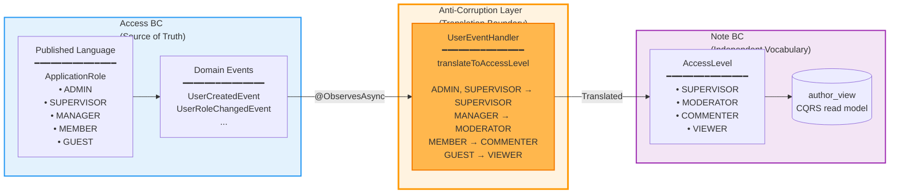

### Translation Rules

**UserEventHandler.translateToAccessLevel():**

```java
private AccessLevel translateToAccessLevel(ApplicationRole applicationRole) {
    return switch (applicationRole) {
        case ADMIN, SUPERVISOR -> AccessLevel.SUPERVISOR;   // Full privileges
        case MANAGER -> AccessLevel.MODERATOR;              // Content management
        case MEMBER -> AccessLevel.COMMENTER;               // Standard participation
        case GUEST -> AccessLevel.VIEWER;                   // Read-only
    };
}
```

**Translation Table:**

| Access BC (Published Language) | Note BC (Internal Vocabulary) | Rationale |
|--------------------------------|------------------------------|-----------|
| **ADMIN** | **SUPERVISOR** | Technical admins get full note privileges |
| **SUPERVISOR** | **SUPERVISOR** | Business directors get full note privileges |
| **MANAGER** | **MODERATOR** | Team leads can moderate content |
| **MEMBER** | **COMMENTER** | Standard users can create & comment |
| **GUEST** | **VIEWER** | Limited users have read-only access |

**Note:** Note BC doesn't need to distinguish between ADMIN and SUPERVISOR - both get full privileges. This is a deliberate design choice to keep Note BC's vocabulary simpler.

### Benefits of ACL

**1. Vocabulary Independence**

Note BC uses domain-specific terminology:
- `AccessLevel.SUPERVISOR` makes sense for note management
- `AccessLevel.MODERATOR` clearly indicates content moderation
- Not tied to organizational roles (ADMIN, DIRECTOR, etc.)

**2. Resilience to Change**

If Access BC adds a new ApplicationRole:
- Example: `ApplicationRole.POWER_USER`
- ACL handles the translation: `POWER_USER -> AccessLevel.COMMENTER`
- Note BC code remains unchanged
- Only UserEventHandler needs updating

**3. Clear Boundaries**

```
Access BC owns:           Note BC owns:
- ApplicationRole         - AccessLevel
- AccountStatus           - AccountStatus (shared)
- UserContext             - NoteUserContext
- User aggregate          - AuthorView (CQRS)
```

**4. Testability**

Translation logic is isolated and testable:

```java
@Test
void testApplicationRoleTranslation() {
    var handler = new UserEventHandler();

    assertEquals(AccessLevel.SUPERVISOR,
        handler.translateToAccessLevel(ApplicationRole.ADMIN));
    assertEquals(AccessLevel.SUPERVISOR,
        handler.translateToAccessLevel(ApplicationRole.SUPERVISOR));
    assertEquals(AccessLevel.MODERATOR,
        handler.translateToAccessLevel(ApplicationRole.MANAGER));
    assertEquals(AccessLevel.COMMENTER,
        handler.translateToAccessLevel(ApplicationRole.MEMBER));
    assertEquals(AccessLevel.VIEWER,
        handler.translateToAccessLevel(ApplicationRole.GUEST));
}
```

### Implementation Location

**Anti-Corruption Layer resides in Note BC:**

```
src/main/java/org/note/application/event/
  └── UserEventHandler.java  ← ACL implementation
      ├── onUserCreated(@ObservesAsync UserCreatedEvent)
      ├── onUserRoleChanged(@ObservesAsync UserRoleChangedEvent)
      ├── translateToAccessLevel(ApplicationRole) ← Translation logic
      └── ...other event handlers
```

**Why in Note BC?**
- Note BC owns the translation to its vocabulary
- Access BC doesn't need to know about AccessLevel
- Follows the principle: "Translate at the consumer boundary"

### Alternative: No ACL (Direct Usage)

**Without ACL (anti-pattern):**

```java
// Note BC directly uses ApplicationRole (BAD)
public class AuthorView {
    private UUID userId;
    private ApplicationRole role;  // ❌ Tight coupling to Access BC
    private AccountStatus status;
}
```

**Problems:**
- Note BC vocabulary polluted with Access BC terminology
- Changes to ApplicationRole break Note BC
- Note BC can't evolve its vocabulary independently
- Unclear which BC owns ApplicationRole semantics

**With ACL (recommended):**

```java
// Note BC uses its own vocabulary (GOOD)
public class AuthorView {
    private UUID userId;
    private AccessLevel accessLevel;  // ✅ Note BC vocabulary
    private AccountStatus status;     // ✅ Shared Published Language
}
```

**Benefits:**
- Clear vocabulary ownership
- Independent evolution
- Translation logic isolated at boundary

### Real-World Scenario: Adding a New Role

**Scenario:** Access BC adds `ApplicationRole.CONTRACTOR` for external contractors.

**Without ACL:**
- Note BC breaks (unknown enum value)
- Must update AuthorView, queries, business logic
- Tight coupling causes cascading changes

**With ACL:**
1. Access BC adds `CONTRACTOR` to ApplicationRole enum
2. UserEventHandler updated:
   ```java
   case CONTRACTOR -> AccessLevel.VIEWER;  // Only change needed
   ```
3. Note BC code remains unchanged
4. author_view continues to use AccessLevel vocabulary
5. No breaking changes, no cascading updates

### Future: Project BC ACL (Example)

When Project BC is implemented, it will have its own ACL:

```java
// Project BC Anti-Corruption Layer
private ProjectRole translateToProjectRole(ApplicationRole applicationRole) {
    return switch (applicationRole) {
        case ADMIN -> ProjectRole.PROJECT_ADMIN;
        case SUPERVISOR -> ProjectRole.PROJECT_VIEWER;
        case MANAGER -> ProjectRole.PROJECT_MANAGER;
        case MEMBER -> ProjectRole.PROJECT_CONTRIBUTOR;
        case GUEST -> ProjectRole.PROJECT_OBSERVER;
    };
}
```

Each BC translates ApplicationRole to its local vocabulary, maintaining independence and clear boundaries.

## 15. Internal API Architecture

### Overview

Access BC provides an **internal API** for one-time synchronization of user data to other bounded contexts. This complements the event-driven architecture by enabling initial population and recovery scenarios.

**Purpose:**
- **Initial Sync:** Populate `author_view` when Note BC is first deployed
- **Recovery:** Restore consistency after event processing failures
- **Bootstrap:** Enable new BCs to get current user data

**Important:** This is NOT for regular operations - use domain events for ongoing synchronization.

### Internal vs Public APIs

**Public APIs** (`/api/v1/users`):
- Protected by JWT authentication
- Require `@RequiresPermission` annotations
- Subject to rate limiting and audit logging
- Exposed to external clients

**Internal APIs** (`/api/v1/internal/users`):
- Used for BC-to-BC communication only
- Should be protected by internal network rules or service mesh
- No JWT required (service-to-service trust)
- Not exposed to external clients

### Endpoint: GET /api/v1/internal/users/all

**Purpose:** Return all users with their context and full name for initial synchronization.

**Request:**
```http
GET /api/v1/internal/users/all
Accept: application/json
```

**Response:**
```json
[
  {
    "userId": "550e8400-e29b-41d4-a716-446655440000",
    "applicationRole": "ADMIN",
    "accountStatus": "ACTIVE",
    "fullName": "Alice Admin"
  },
  {
    "userId": "550e8400-e29b-41d4-a716-446655440001",
    "applicationRole": "MEMBER",
    "accountStatus": "ACTIVE",
    "fullName": "Bob Developer"
  },
  {
    "userId": "550e8400-e29b-41d4-a716-446655440002",
    "applicationRole": "GUEST",
    "accountStatus": "LOCKED",
    "fullName": "Charlie Contractor"
  }
]
```

### UserSyncResponse Structure

```java
public record UserSyncResponse(
    UUID userId,                 // User aggregate ID
    ApplicationRole applicationRole,  // Published Language
    AccountStatus accountStatus, // Published Language
    String fullName              // For display in Note BC
)
```

**Comparison with UserContext:**

| Field | UserContext | UserSyncResponse | Purpose |
|-------|-------------|------------------|---------|
| userId | ✓ | ✓ | Unique identifier |
| applicationRole | ✓ | ✓ | Authorization level |
| accountStatus | ✓ | ✓ | Authentication eligibility |
| fullName | ✗ | ✓ | Display name (synchronization only) |

**Design Rationale:**
- `UserContext` is minimal for authorization decisions
- `UserSyncResponse` includes `fullName` for CQRS read model population
- Keeps Published Language clean and focused

### Usage Example: Note BC Initial Sync

**Scenario:** Note BC is deployed for the first time and needs to populate `author_view`.

```java
@ApplicationScoped
public class AuthorViewSyncService {

    @Inject
    @RestClient
    InternalUserClient internalUserClient;

    @Inject
    AuthorViewRepository authorViewRepository;

    /**
     * One-time synchronization to populate author_view.
     * Should only be run on initial deployment or after data loss.
     */
    @Transactional
    public void performInitialSync() {
        LOG.info("Starting initial author_view synchronization...");

        // 1. Call Access BC internal endpoint
        List<UserSyncResponse> users = internalUserClient.getAllUsers();
        LOG.infof("Retrieved %d users from Access BC", users.size());

        // 2. Translate and save to author_view
        int syncedCount = 0;
        for (UserSyncResponse user : users) {
            // ACL: Translate ApplicationRole → AccessLevel
            AccessLevel accessLevel = translateToAccessLevel(user.applicationRole());

            AuthorView authorView = new AuthorView(
                user.userId(),
                accessLevel,
                user.accountStatus(),
                user.fullName()
            );

            authorViewRepository.save(authorView);
            syncedCount++;
        }

        LOG.infof("Initial sync complete: %d users synced", syncedCount);
    }
}
```

### Security Considerations

**Network-Level Protection:**

```yaml
# application.properties (recommended configuration)
quarkus.http.cors.origins=http://localhost:3000
quarkus.http.cors.methods=GET,POST,PUT,DELETE

# Internal API should NOT be exposed externally
# Use service mesh, API gateway, or firewall rules to restrict:
# - Allow: Note BC service (internal network)
# - Deny: External clients
```

**Future Enhancement: Service Token**

For additional security, consider implementing service-to-service authentication:

```java
@ServerRequestFilter
public void validateServiceToken(@Context ContainerRequestContext ctx) {
    if (ctx.getUriInfo().getPath().startsWith("/api/v1/internal")) {
        String serviceToken = ctx.getHeaderString("X-Service-Token");
        if (!isValidServiceToken(serviceToken)) {
            throw new ForbiddenException("Invalid service token");
        }
    }
}
```

### Event-Driven vs Internal API

| Aspect | Event-Driven (Primary) | Internal API (Fallback) |
|--------|------------------------|-------------------------|
| **Use Case** | Ongoing synchronization | Initial sync, recovery |
| **Frequency** | Continuous (per change) | One-time or rare |
| **Performance** | Non-blocking, async | Blocking, synchronous |
| **Data Volume** | Single user (event) | All users (bulk) |
| **Coupling** | Loose (eventual consistency) | Tight (synchronous call) |
| **When to Use** | Normal operations | Bootstrap, disaster recovery |

**Best Practice:**
- Use events for all regular synchronization
- Use internal API only for initial population or recovery
- Avoid polling the internal API - it defeats the purpose of event-driven architecture

### Monitoring & Observability

**Internal API Metrics:**

```java
@Counted(name = "internal_api_calls", description = "Internal API call count")
@Timed(name = "internal_api_duration", description = "Internal API call duration")
public Response getAllUsers() {
    // ...implementation
}
```

**Key Metrics to Track:**
- Call frequency (should be very low)
- Response time (indicates DB load)
- Number of users returned (indicates data volume)
- Error rate (should be near zero)

**Alerts:**
- ⚠️ Frequent calls (>1/hour) suggest misconfiguration
- ⚠️ Slow responses (>5s) suggest DB performance issues
- ⚠️ Errors indicate serious problems requiring investigation

### Future: Project BC Integration

When Project BC is implemented, it will have its own sync service:

```java
@ApplicationScoped
public class ProjectUserSyncService {

    @Inject
    @RestClient
    InternalUserClient accessBcClient;

    @Transactional
    public void performInitialSync() {
        List<UserSyncResponse> users = accessBcClient.getAllUsers();

        for (UserSyncResponse user : users) {
            // ACL: Translate ApplicationRole → ProjectRole
            ProjectRole projectRole = translateToProjectRole(user.applicationRole());

            ProjectUser projectUser = new ProjectUser(
                user.userId(),
                projectRole,
                user.accountStatus()
            );

            projectUserRepository.save(projectUser);
        }
    }
}
```

Each BC uses the internal API for bootstrap, then relies on events for ongoing synchronization.
