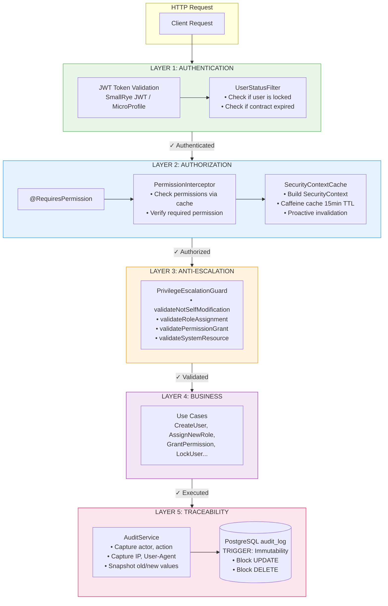
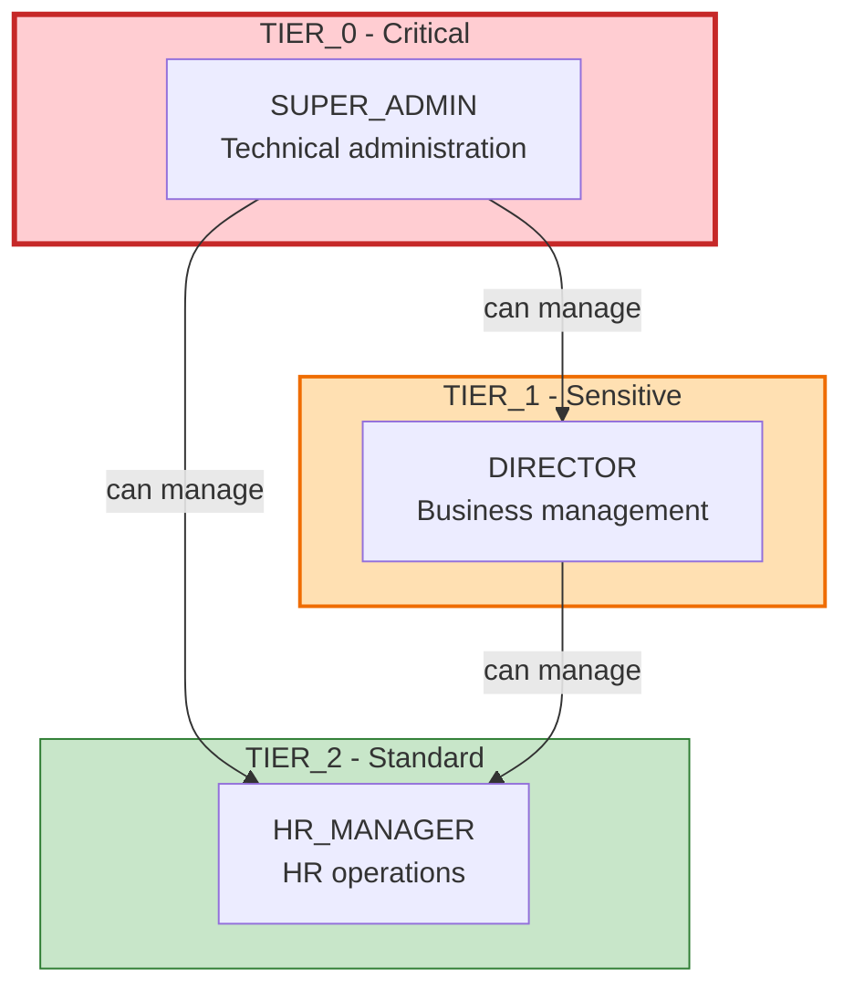
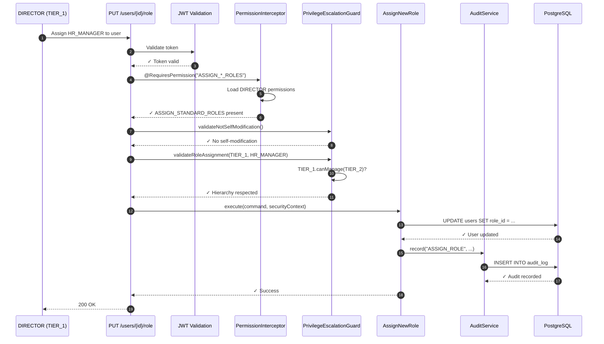
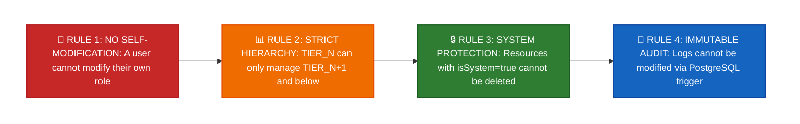
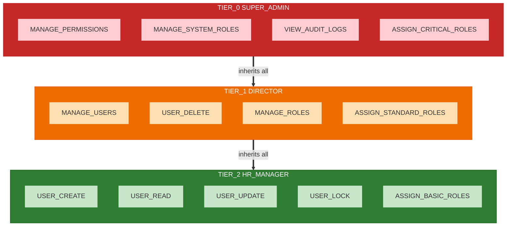
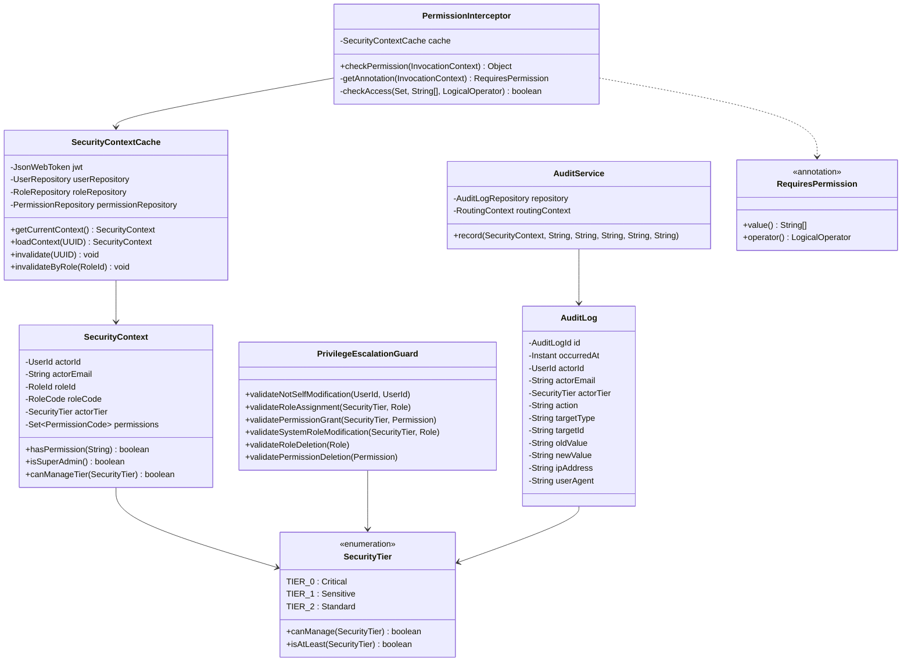
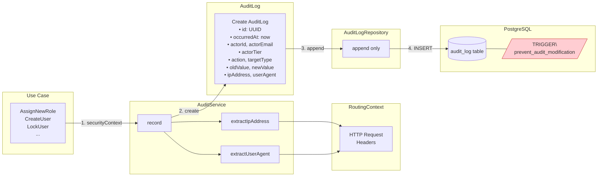
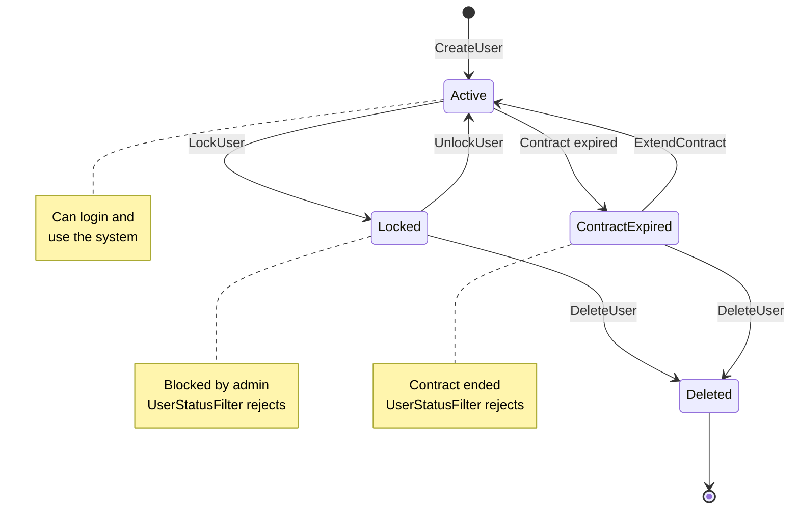
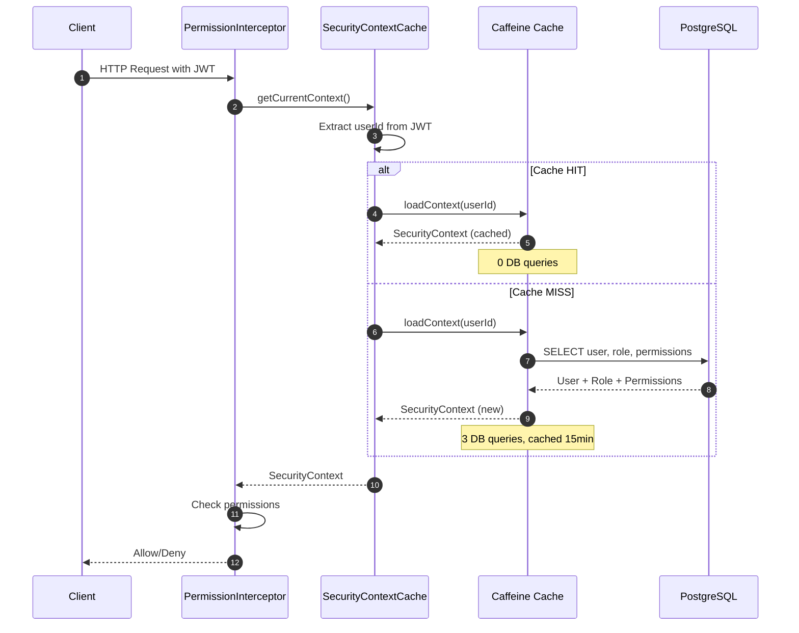
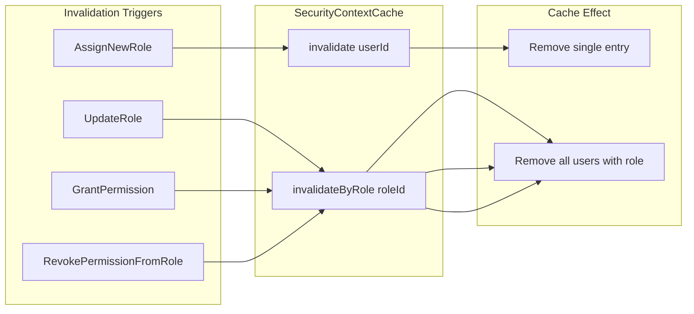

# Security Architecture - Tiered Administration

## 1. Security Layers Overview

## 2. Tier Hierarchy

## 3. Sensitive Operation Flow

## 4. Security Rules

## 5. Permissions Matrix

## 6. Component Architecture

## 7. Audit Data Flow

## 8. User States and Transitions

## 9. Token Lifecycle & Permission Caching

### JWT Token Configuration

| Property | Value | Description |
|----------|-------|-------------|
| Duration | 1 hour (3600s) | Token expiration time |
| Issuer | beeboard-api | Token issuer identifier |
| Algorithm | RS256 | RSA signature with SHA-256 |
| Refresh | Not implemented | User must re-authenticate |

### Permission Caching (Caffeine)

| Property | Value | Description |
|----------|-------|-------------|
| TTL | 15 minutes | Cache entry expiration |
| Max Size | 1000 entries | Maximum cached users |
| Invalidation | Proactive | Triggered on role/permission changes |

### Cache Invalidation Triggers

| Trigger | Use Case | Invalidation Scope |
|---------|----------|-------------------|
| Role assignment | AssignNewRole | Single user |
| Role update | UpdateRole | All users with role |
| Permission grant | GrantPermission | All users with role |
| Permission revoke | RevokePermissionFromRole | All users with role |

### Performance Comparison

| Metric | Before (No Cache) | After (Caffeine 15min) |
|--------|-------------------|------------------------|
| DB queries/request | 6 | 0 (if cached) |
| DB queries/15min (100 requests) | 600 | 3 |
| Permission check latency | ~50ms | ~1ms |
| Memory overhead | None | ~1KB/user |
